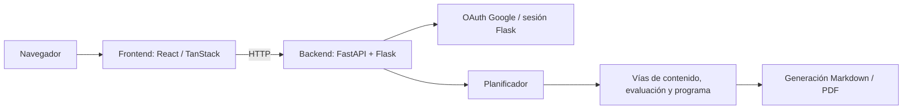

# SICCIA

SICCIA es una aplicación web para docentes que genera materiales educativos estructurados con proveedores de inteligencia artificial.

El repositorio contiene dos partes:

- [Frontend](/workspaces/SICCIA/SICCIA/FrontEnd): interfaz web construida con TanStack Start, React y TypeScript.
- [Backend](/workspaces/SICCIA/SICCIA/BackEnd): servidor Python que combina FastAPI y Flask, autenticación OAuth con Google, orquestación de cursos y generación de PDF.

## Arquitectura



El backend expuesto por `SICCIA/BackEnd/run.py` usa un único puerto ASGI:

- FastAPI administra el orquestador de cursos.
- Flask administra autenticación y sesiones de Google.
- Authlib valida el flujo OAuth.
- Flask-WTF protege las solicitudes que modifican estado con CSRF.
- WeasyPrint genera los PDF desde Markdown.
- Los trabajos se mantienen en memoria y los archivos se guardan temporalmente bajo `orquestador_salida/`.

## Requisitos

- Git.
- Python 3.10 o superior; Python 3.13 es el entorno recomendado.
- Node.js y Bun o npm para el frontend.
- Pango/GTK cuando se ejecuta WeasyPrint en el sistema.
- Cuenta y credenciales OAuth 2.0 de Google para iniciar sesión.
- Opcional: credenciales de Gemini, OpenAI u otro proveedor compatible para generar cursos reales.

Las versiones de las dependencias Python están fijadas en [dependencias.txt](/workspaces/SICCIA/dependencias.txt).

## Instalación

### 1. Clonar

```bash
git clone https://github.com/SICCIA-UdeA/SICCIA.git
cd SICCIA
```

### 2. Backend

Linux o macOS:

```bash
cd SICCIA/BackEnd
python3 -m venv .venv
source .venv/bin/activate
python -m pip install --upgrade pip
python -m pip install -r ../../dependencias.txt
cp .env.example .env
```

Windows PowerShell:

```powershell
cd SICCIA\BackEnd
py -3.13 -m venv .venv
.\.venv\Scripts\Activate.ps1
python -m pip install --upgrade pip
python -m pip install -r ..\..\dependencias.txt
Copy-Item .env.example .env
```

No publiques el archivo `.env`. Configura al menos la clave secreta de Flask y las credenciales OAuth:

```dotenv
FLASK_SECRET_KEY=valor-local-largo-y-aleatorio
GOOGLE_CLIENT_ID=tu-client-id
GOOGLE_CLIENT_SECRET=tu-client-secret
GOOGLE_REDIRECT_URI=http://localhost:8084/auth/google/callback
BACKEND_PORT=8084
FRONTEND_PORT=8085
SESSION_COOKIE_SECURE=False
```

Para una generación real también configura un proveedor en variables `ORQ_*`. El modo `mock` permite probar el orquestador sin claves externas.

### 3. Frontend

Desde otra terminal:

```bash
cd SICCIA/FrontEnd
bun install
```

También puede usar npm:

```bash
npm install
```

## Ejecutar

Abre el backend:

```bash
cd SICCIA/BackEnd
python run.py
```

Abre el frontend:

```bash
cd SICCIA/FrontEnd
bun run dev
```

Con npm:

```bash
npm run dev
```

Direcciones locales:

- Aplicación: `http://localhost:8085`
- API FastAPI y documentación: `http://localhost:8084/docs`
- Inicio OAuth: `http://localhost:8084/auth/google`

Usa siempre `localhost`, no mezclado con `127.0.0.1`, para conservar correctamente la cookie de sesión.

## API principal

### Autenticación

| Método | Ruta | Uso |
|---|---|---|
| `GET` | `/auth/google` | Inicia OAuth con Google |
| `GET` | `/auth/google/callback` | Procesa el retorno de Google |
| `GET` | `/auth/me` | Consulta el usuario autenticado |
| `GET` | `/auth/logout` | Cierra la sesión local |

### Cursos

| Método | Ruta | Uso |
|---|---|---|
| `POST` | `/orquestador/cursos` | Crea un trabajo |
| `GET` | `/orquestador/cursos/{id}` | Consulta estado y archivos |
| `GET` | `/orquestador/cursos/{id}/archivos/{nombre}` | Descarga un archivo |
| `GET` | `/orquestador/cursos/{id}/descarga` | Descarga los PDF disponibles en ZIP |

Los estados son `pendiente`, `planificando`, `ejecutando`, `completado`, `completado_con_errores` y `error`.

## Pruebas

Desde `SICCIA/BackEnd`:

```bash
python -m pytest
```

La suite usa datos deterministas y bloquea la red externa. Los reportes se generan en:

- `SICCIA/BackEnd/reports/coverage.xml`
- `SICCIA/BackEnd/reports/junit.xml`

## Seguridad

- Las sesiones usan una cookie HttpOnly y `SameSite=Lax`.
- El flujo OAuth está protegido por el parámetro `state`.
- Flask-WTF aplica protección CSRF global sin rutas exentas.
- Las rutas mutables deben validar explícitamente el token CSRF antes de aceptar cambios.
- Los secretos deben permanecer solo en archivos `.env` locales o variables del entorno de despliegue.
- La configuración OAuth y los proveedores reales no deben exponerse en el código ni en archivos versionados.

## Archivos generados

No deben versionarse:

- Entornos virtuales y dependencias locales.
- `.env` y otros archivos con credenciales.
- `SICCIA/FrontEnd/.output/` y `.wrangler/`.
- `orquestador_salida/`, PDF, ZIP y archivos de telemetría generados.
- Reportes de cobertura, cachés y temporales de herramientas.

El trabajo de generación vive en memoria y se pierde al reiniciar el backend. Los archivos generados siguen en disco hasta que se eliminen manualmente o mediante una limpieza posterior.

## Documentación relacionada

- [Guía de instalación](/workspaces/SICCIA/GUIA_DE_INSTALACION.md)
- [Backend](/workspaces/SICCIA/SICCIA/BackEnd/README.md)
- [Diagrama del orquestador](/workspaces/SICCIA/SICCIA/BackEnd/diagrama_orquestador.md)
- [Matriz de pruebas](/workspaces/SICCIA/SICCIA/BackEnd/tests/MATRIZ_PRUEBAS.md)
