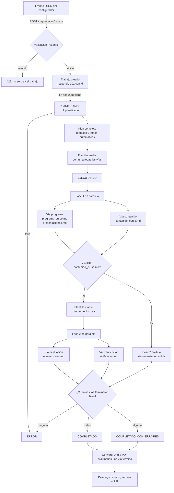
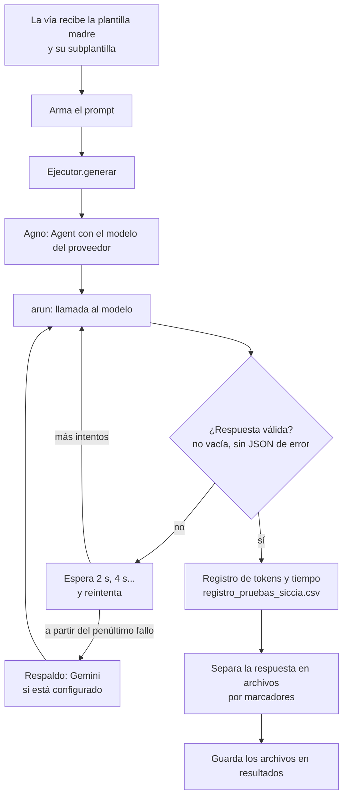

# Diagrama del orquestador de SICCIA

## Piezas

- **Orquestador** (`app/orquestador/orquestador.py`): decide el orden de las vías y el estado del trabajo. Usa asyncio.
- **Vía** (`app/orquestador/agentes/via_*.py`): arma el prompt de su tarea y separa la respuesta en archivos.
- **Ejecutor** (`EjecutorAgno`, en `ejecutores.py`): llama al modelo, valida la respuesta, reintenta y registra tokens.
- **Agno**: librería que ejecuta cada llamada (`Agent` + `arun`). No coordina nada: solo habla con el modelo.

## 1. Flujo del trabajo (orquestador)

## 2. Dentro de una vía (Agno)

## 3. Clase de Agno según el proveedor

| Proveedor (`ORQ_PROVEEDOR_*`) | Clase de Agno | Uso típico |
|---|---|---|
| `gemini` | `agno.models.google.Gemini` | Google AI Studio |
| `openai_like` | `agno.models.openai.like.OpenAILike` | Cualquier API compatible con OpenAI: OpenRouter, Groq, NVIDIA |
| `openai` | `agno.models.openai.OpenAIChat` | OpenAI |
| Respaldo (automático) | Proveedor configurado en `ORQ_PROVEEDOR_RESPALDO_<ROL>` | Tras reintentos de errores transitorios del proveedor principal |

Cada proveedor se registra una sola vez con `ORQ_PROVEEDOR_<NOMBRE>_TIPO`, `_MODELO`,
`_API_KEY` y `_BASE_URL`. Las vías se asocian mediante `ORQ_VIA_<ROL>` y el respaldo mediante
`ORQ_RESPALDO_<ROL>`. Para Gemini se acepta la clave del registro o `GOOGLE_API_KEY`; para
`openai_like` se necesita clave y URL.
Los errores de configuración no se reintentan y se comunican explícitamente.

## 4. Roles

| Rol | Qué genera | Proveedor configurable |
|---|---|---|
| planificador | Módulos y temas automáticos | `ORQ_PROVEEDOR_PLANIFICADOR` o `ORQ_PROVEEDOR` |
| programa | `programa_curso.md`, `presentaciones.md` | `ORQ_PROVEEDOR_PROGRAMA` o `ORQ_PROVEEDOR` |
| contenido | `contenido_curso.md` | `ORQ_PROVEEDOR_CONTENIDO` o `ORQ_PROVEEDOR` |
| evaluación | `evaluaciones.md` | `ORQ_PROVEEDOR_EVALUACION` o `ORQ_PROVEEDOR` |
| verificación | `verificacion.md` | `ORQ_PROVEEDOR_VERIFICACION` o `ORQ_PROVEEDOR` |

## 5. Estados de una vía

`pendiente` → `en_curso` → `completada`, `omitida` o `error`.

## 6. Calidad y fuentes

- La verificación consulta el contenido real generado y conserva únicamente URLs que responden
  y pertenecen a dominios académicos u oficiales permitidos.
- El solucionario queda al final de `evaluaciones.md`.
- Las presentaciones salen de la vía programa.
- El frontend consulta el backend mediante `/api`.