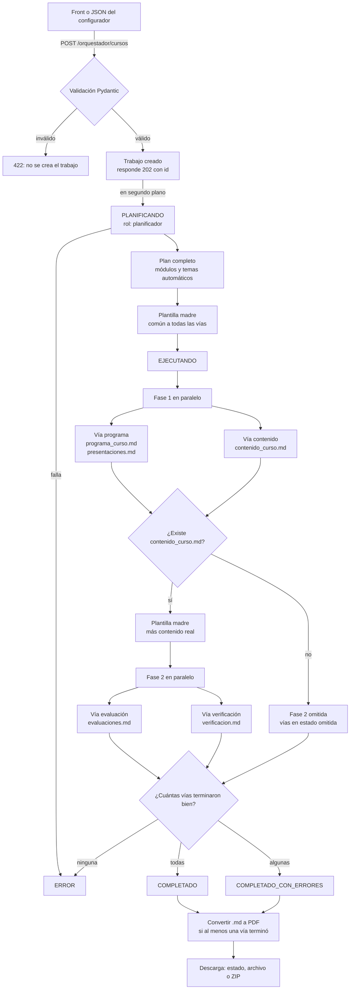
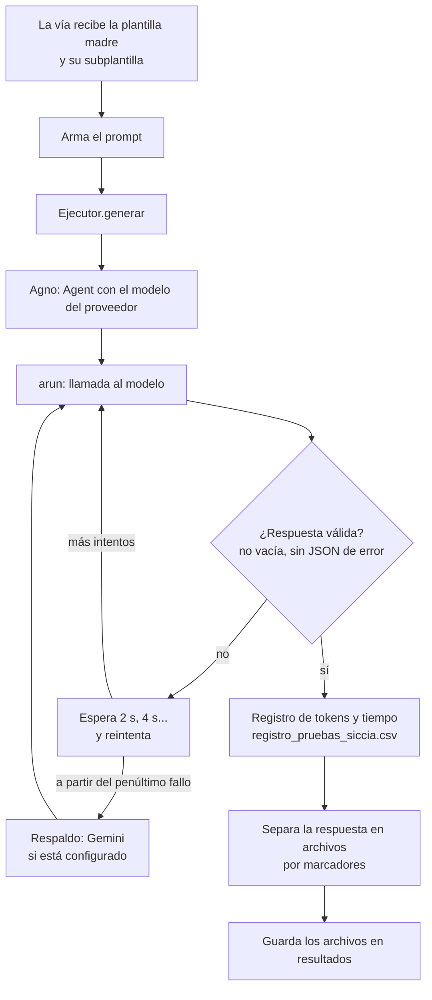
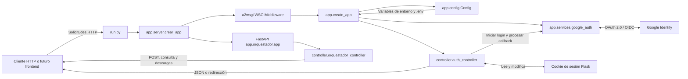
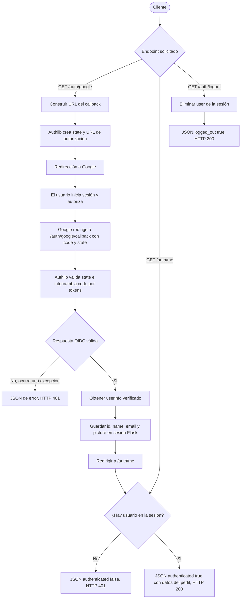

This file is a merged representation of the entire codebase, combined into a single document by Repomix.

# File Summary

## Purpose
This file contains a packed representation of the entire repository's contents.
It is designed to be easily consumable by AI systems for analysis, code review,
or other automated processes.

## File Format
The content is organized as follows:
1. This summary section
2. Repository information
3. Directory structure
4. Repository files (if enabled)
5. Multiple file entries, each consisting of:
  a. A header with the file path (## File: path/to/file)
  b. The full contents of the file in a code block

## Usage Guidelines
- This file should be treated as read-only. Any changes should be made to the
  original repository files, not this packed version.
- When processing this file, use the file path to distinguish
  between different files in the repository.
- Be aware that this file may contain sensitive information. Handle it with
  the same level of security as you would the original repository.

## Notes
- Some files may have been excluded based on .gitignore rules and Repomix's configuration
- Binary files are not included in this packed representation. Please refer to the Repository Structure section for a complete list of file paths, including binary files
- Files matching patterns in .gitignore are excluded
- Files matching default ignore patterns are excluded
- Files are sorted by Git change count (files with more changes are at the bottom)

# Directory Structure
````
.github/
  workflows/
    sonar.yml
SICCIA/
  BackEnd/
    app/
      orquestador/
        agentes/
          __init__.py
          base.py
          via_contenido.py
          via_evaluacion.py
          via_programa.py
          via_verificacion.py
        __init__.py
        __main__.py
        app.py
        config.py
        ejecutores.py
        exportador_pdf.py
        orquestador.py
        planificador.py
        plantilla_pdf.css
        plantillas.py
        schemas.py
        trabajos.py
      routes/
        __init__.py
      services/
        google_auth.py
      __init__.py
      config.py
      ejemplo_configurador.json
      README2.md
      requirements.txt
      server.py
      sistema_solar.json
    controller/
      __init__.py
      auth_controller.py
      orquestador_controller.py
    tests/
      controller/
        __init__.py
        test_auth_controller.py
        test_google_auth.py
        test_orquestador_controller.py
        test_server.py
      orquestador/
        __init__.py
        test_config.py
        test_planificador.py
        test_plantillas.py
        test_schemas.py
        test_subplantillas_vias.py
      secuence/
        __init__.py
        test_ejecutores.py
        test_exportador_pdf.py
        test_flujo_fases.py
        test_respuestas_vias.py
        test_trabajos.py
      __init__.py
      conftest.py
      factories.py
      MATRIZ_PRUEBAS.md
    __init__.py
    .coveragerc
    .env.example
    .gitignore
    analizar.py
    diagrama_orquestador.md
    medir.py
    pytest.ini
    README.md
    requirements.txt
    run.py
    sonar-project.properties
  FrontEnd/
    public/
      favicon.ico
      robots.txt
    scripts/
      dev.mjs
    src/
      hooks/
        use-mobile.tsx
      lib/
        api.ts
        configurador.ts
        error-capture.ts
        error-page.ts
        lovable-error-reporting.ts
        utils.ts
        zip.ts
      routes/
        __root.tsx
        index.tsx
        README.md
      router.tsx
      server.ts
      start.ts
      styles.css
    .env.example
    AGENTS.md
    bunfig.toml
    components.json
    eslint.config.js
    favicon.ico
    package.json
    README.md
    robots.txt
    tsconfig.json
    vite.config.ts
  __init__.py
.gitignore
.repomixignore
dependencias.txt
GUIA_DE_INSTALACION.md
````

# Files

## File: SICCIA/BackEnd/app/sistema_solar.json
````json
{
  "datos": {
    "tema": "El Sistema Solar y la exploración espacial",
    "publico_objetivo": "Estudiantes de 5° grado de primaria (10 a 11 años)",
    "duracion_estimada": "15 horas",
    "metodologia": "Aprendizaje lúdico y visual, usando analogías simples (ej. tamaños comparados con frutas) y lenguaje amigable para niños"
  },
  "contenido": {
    "modulos_modo": "automatico",
    "num_modulos": 3,
    "incluir_ejemplos_practicos": true,
    "incluir_talleres_practica": true,
    "incluir_cierre_por_modulo": true
  },
  "evaluacion": {
    "tipos_pregunta": ["selección múltiple", "falso/verdadero", "pregunta abierta de imaginación"],
    "actividades": [
      {"tipo": "taller_visual", "cantidad": 2, "porcentaje": 60},
      {"tipo": "quiz_divertido", "cantidad": 1, "porcentaje": 40}
    ],
    "total_actividades": 3
  },
  "estilo": {
    "formato_salida": "pdf",
    "incluir_imagenes": true
  }
}
````

## File: SICCIA/BackEnd/analizar.py
````python
"""Analiza los .md generados por medir.py (o cualquier carpeta de resultados).

Uso (desde BackEnd/):
    python analizar.py experimentos/
    python analizar.py experimentos/20261014_1200_nvidia/run_01/trabajos/<id>/resultados
    python analizar.py experimentos/ --verificar-enlaces --verificar-refs

Escribe experimentos/analisis.csv: una fila por archivo y por corrida.

Métricas automáticas. La legibilidad usa una aproximación de sílabas (grupos de vocales),
así que es orientativa. La revisión pedagógica NO se automatiza: se hace sobre una muestra
fija elegida antes de leer.
"""
import argparse
import csv
import re
import time
from pathlib import Path

import requests

RE_MODULO = re.compile(r"^#{1,4}\s*M[óo]dulo\s*\d+", re.M | re.I)
RE_URL = re.compile(r"https?://[^\s)\]>\"']+")
RE_LATEX = re.compile(r"\\\(|\\\)|\$\$|\\frac|\\text\{|\\begin\{|\\sqrt|\\cdot")
RE_PREGUNTA = re.compile(r"^\s*\d+[\.\)]\s+\S", re.M)
RE_OPCION = re.compile(r"^\s*[A-Da-d]\)\s+\S", re.M)
RE_SECCION_REF = re.compile(r"^#{1,4}\s*.*(Referencias|Bibliograf[ií]a|Fuentes)", re.M | re.I)
VOCALES = "aeiouáéíóúü"
UA = {"User-Agent": "SICCIA-medicion/1.0 (proyecto academico UdeA)"}


def silabas(palabra: str) -> int:
    # Aproximación: cada grupo de vocales cuenta como una sílaba.
    return max(1, len(re.findall(f"[{VOCALES}]+", palabra.lower())))


def legibilidad_fernandez_huerta(texto: str):
    palabras = re.findall(r"[A-Za-zÁÉÍÓÚÜÑáéíóúüñ]+", texto)
    if not palabras:
        return None
    oraciones = max(1, len(re.findall(r"[.!?]+(?:\s|$)", texto)))
    n = len(palabras)
    p = sum(silabas(w) for w in palabras) / n * 100  # sílabas por 100 palabras
    f = n / oraciones                                # palabras por oración
    return round(206.84 - 0.60 * p - 1.02 * f, 1)


def lineas_referencias(texto: str):
    m = RE_SECCION_REF.search(texto)
    if not m:
        return []
    bloque = texto[m.end():]
    refs = []
    for linea in bloque.splitlines():
        limpia = linea.strip(" -*")
        if re.match(r"^\s*(\[\d+\]|[-*]\s|\d+\.\s)", linea) and len(limpia) > 20:
            refs.append(limpia)
    return refs


def estado_url(url: str) -> str:
    try:
        r = requests.get(url, timeout=10, allow_redirects=True, headers=UA)
        return str(r.status_code)
    except requests.RequestException as exc:
        return type(exc).__name__


def verificar_referencia(ref: str):
    """Busca la referencia en Crossref y comprueba que las palabras del título aparezcan en el texto."""
    consulta = re.sub(r"https?://\S+", "", ref)
    try:
        r = requests.get("https://api.crossref.org/works",
                         params={"query.bibliographic": consulta, "rows": 1},
                         timeout=15, headers=UA)
        items = r.json()["message"]["items"]
        if not items:
            return "sin_resultado", ""
        titulo = (items[0].get("title") or [""])[0]
        palabras = {w for w in re.findall(r"\w+", titulo.lower()) if len(w) > 3}
        if not palabras:
            return "sin_titulo", titulo
        presentes = {w for w in re.findall(r"\w+", consulta.lower()) if len(w) > 3}
        cobertura = len(palabras & presentes) / len(palabras)
        return ("encontrada" if cobertura >= 0.6 else "no_coincide"), titulo
    except Exception as exc:  # noqa: BLE001
        return f"error:{type(exc).__name__}", ""
    finally:
        time.sleep(1)  # cortesía con la API


def archivos_md(raiz: Path):
    if raiz.is_file():
        yield raiz
        return
    for p in sorted(raiz.rglob("*.md")):
        if "interno" in p.parts:  # plantillas internas, no son material
            continue
        yield p


def analizar(archivo: Path, raiz: Path, verificar_enlaces: bool, verificar_refs: bool) -> dict:
    texto = archivo.read_text(encoding="utf-8", errors="replace")
    corrida = str(archivo.relative_to(raiz)) if raiz.is_dir() else archivo.name
    palabras = re.findall(r"\w+", texto)
    urls = sorted(set(RE_URL.findall(texto)))
    refs = lineas_referencias(texto)

    fila = {
        "corrida": corrida,
        "archivo": archivo.name,
        "palabras": len(palabras),
        "legibilidad_fh": legibilidad_fernandez_huerta(texto),
        "modulos": len(set(RE_MODULO.findall(texto))),
        "ejemplos": len(re.findall(r"\bejemplo", texto, re.I)),
        "latex_restos": len(RE_LATEX.findall(texto)),
        "preguntas": len(RE_PREGUNTA.findall(texto)),
        "opciones": len(RE_OPCION.findall(texto)),
        "urls": len(urls),
        "urls_ok": "",
        "seccion_referencias": bool(RE_SECCION_REF.search(texto)),
        "referencias": len(refs),
        "refs_encontradas": "",
    }
    if verificar_enlaces and urls:
        estados = {u: estado_url(u) for u in urls}
        fila["urls_ok"] = sum(1 for s in estados.values() if s == "200")
        fila["detalle_urls"] = "; ".join(f"{u}={s}" for u, s in estados.items())
    if verificar_refs and refs:
        resultados = [verificar_referencia(r) for r in refs]
        fila["refs_encontradas"] = sum(1 for estado, _ in resultados if estado == "encontrada")
        fila["detalle_refs"] = " | ".join(f"{estado}: {titulo[:80]}" for estado, titulo in resultados)
    return fila


def main():
    ap = argparse.ArgumentParser(description="Métricas automáticas de los archivos generados.")
    ap.add_argument("ruta", nargs="?", default="experimentos", help="carpeta o archivo .md")
    ap.add_argument("--salida", default="experimentos/analisis.csv")
    ap.add_argument("--verificar-enlaces", action="store_true", help="pide cada URL (requiere red)")
    ap.add_argument("--verificar-refs", action="store_true", help="busca cada referencia en Crossref (requiere red)")
    args = ap.parse_args()

    raiz = Path(args.ruta)
    if not raiz.exists():
        raise SystemExit(f"No existe: {raiz}")
    archivos = list(archivos_md(raiz))
    if not archivos:
        raise SystemExit("No encontré archivos .md (ignoré las carpetas 'interno').")

    filas = [analizar(a, raiz, args.verificar_enlaces, args.verificar_refs) for a in archivos]

    columnas = []
    for f in filas:
        for k in f:
            if k not in columnas:
                columnas.append(k)
    salida = Path(args.salida)
    salida.parent.mkdir(parents=True, exist_ok=True)
    with salida.open("w", newline="", encoding="utf-8") as fh:
        w = csv.DictWriter(fh, fieldnames=columnas, delimiter=";", extrasaction="ignore")
        w.writeheader()
        w.writerows(filas)

    print(f"{len(filas)} archivo(s) analizados -> {salida}")
    for f in filas:
        print(f"  {f['corrida'][:60]:60} palabras={f['palabras']:>5} "
              f"legib={f['legibilidad_fh']} modulos={f['modulos']} latex={f['latex_restos']} "
              f"urls={f['urls']} refs={f['referencias']}")


if __name__ == "__main__":
    main()
````

## File: SICCIA/BackEnd/medir.py
````python
"""Experimento reproducible con el orquestador real.

Uso (desde BackEnd/, con el .env configurado):
    python medir.py --etiqueta nvidia-tema1 --repeticiones 3 --confirmar
    python medir.py --etiqueta prueba-mock --repeticiones 1 --confirmar   (sin proveedores)

Sin --confirmar no hace nada: cada repetición llama a los proveedores y consume cuota.
Cada repetición va a experimentos/<fecha>_<etiqueta>/run_NN/ con su propio registro de tokens.
Una fila por corrida se agrega a experimentos/experimento.csv.
"""
import argparse
import asyncio
import csv
import hashlib
import json
import os
import shutil
import sys
import time
from datetime import datetime
from pathlib import Path

from dotenv import load_dotenv

RAIZ = Path(__file__).resolve().parent
load_dotenv(RAIZ / ".env")
sys.path.insert(0, str(RAIZ))

from app.orquestador import Configurador, Orquestador  # noqa: E402
from app.orquestador.config import ROLES, config_modelo  # noqa: E402

TIMEOUT_S = 1800  # 30 min por corrida
COLUMNAS = ["fecha", "etiqueta", "corrida", "repeticion", "config_sha", "modelos", "estado",
            "duracion_s", "archivos", "llamadas_registradas", "prompt_tokens", "completion_tokens",
            "vias", "error"]


def snapshot_modelos() -> str:
    return ";".join(f"{rol}={config_modelo(rol).proveedor}:{config_modelo(rol).model_id}" for rol in ROLES)


def resumen_tokens(dir_run: Path):
    registro = dir_run / "registro_pruebas_siccia.csv"
    if not registro.exists():
        return 0, 0, 0
    pt = ct = n = 0
    with registro.open(encoding="utf-8") as fh:
        for fila in csv.DictReader(fh, delimiter=";"):
            n += 1
            try:
                pt += int(fila.get("Prompt_Tokens") or 0)
                ct += int(fila.get("Completion_Tokens") or 0)
            except ValueError:
                pass
    return pt, ct, n


async def correr_una(config_dict: dict, dir_run: Path):
    cfg = Configurador.model_validate(config_dict)
    dir_run.mkdir(parents=True, exist_ok=True)
    cwd_previo = os.getcwd()
    os.chdir(dir_run)  # log_prueba escribe el registro en el directorio actual
    try:
        orq = Orquestador(directorio=dir_run / "trabajos")
        t0 = time.time()
        trabajo = orq.iniciar(cfg)
        while not trabajo.terminado and time.time() - t0 < TIMEOUT_S:
            await asyncio.sleep(0.5)
        return trabajo, time.time() - t0
    finally:
        os.chdir(cwd_previo)


def main():
    ap = argparse.ArgumentParser(description="Corre el orquestador N veces con la misma configuración.")
    ap.add_argument("--etiqueta", required=True, help="nombre corto del experimento, sin espacios")
    ap.add_argument("--config", default="app/ejemplo_configurador.json")
    ap.add_argument("--repeticiones", type=int, default=3)
    ap.add_argument("--confirmar", action="store_true",
                    help="obligatorio: cada repetición llama a los proveedores configurados")
    args = ap.parse_args()

    if not args.confirmar:
        raise SystemExit("No corrí nada. Agrega --confirmar: cada repetición consume cuota.")

    config_path = Path(args.config)
    if not config_path.is_absolute():
        config_path = RAIZ / config_path
    config_dict = json.loads(config_path.read_text(encoding="utf-8"))
    config_sha = hashlib.sha256(config_path.read_bytes()).hexdigest()[:12]
    modelos = snapshot_modelos()
    if "mock" in modelos:
        print("AVISO: algún rol usa 'mock'. Esto no mide modelos reales.")

    base = RAIZ / "experimentos" / f"{datetime.now():%Y%m%d_%H%M}_{args.etiqueta}"
    base.mkdir(parents=True, exist_ok=True)
    shutil.copy(config_path, base / "config.json")  # para reproducir el experimento

    ruta_csv = RAIZ / "experimentos" / "experimento.csv"
    nuevo = not ruta_csv.exists()
    with ruta_csv.open("a", newline="", encoding="utf-8") as fh:
        escritor = csv.DictWriter(fh, fieldnames=COLUMNAS, delimiter=";")
        if nuevo:
            escritor.writeheader()

        for i in range(1, args.repeticiones + 1):
            dir_run = base / f"run_{i:02d}"
            print(f"\n== Repetición {i}/{args.repeticiones} ({args.etiqueta}) ==")
            trabajo, duracion = asyncio.run(correr_una(config_dict, dir_run))
            pt, ct, n = resumen_tokens(dir_run)
            errores = [k for k, v in trabajo.vias.items() if str(v).startswith("error")]
            fila = {
                "fecha": datetime.now().isoformat(timespec="seconds"),
                "etiqueta": args.etiqueta,
                "corrida": dir_run.name,
                "repeticion": i,
                "config_sha": config_sha,
                "modelos": modelos,
                "estado": trabajo.estado.value,
                "duracion_s": round(duracion, 1),
                "archivos": len(trabajo.archivos),
                "llamadas_registradas": n,
                "prompt_tokens": pt,
                "completion_tokens": ct,
                "vias": json.dumps(trabajo.vias, ensure_ascii=False),
                "error": (trabajo.error or "") + (f" vias_con_error={errores}" if errores else ""),
            }
            escritor.writerow(fila)
            fh.flush()
            print(f"   estado={fila['estado']} tokens={pt}+{ct} archivos={fila['archivos']} "
                  f"duración={fila['duracion_s']}s")

    print(f"\nListo. Carpeta: {base}\nResumen acumulado: {ruta_csv}")


if __name__ == "__main__":
    main()
````

## File: .repomixignore
````
SICCIA/FrontEnd/.output/
SICCIA/FrontEnd/.wrangler/
SICCIA/FrontEnd/src/components/ui/
*.zip
*.pdf
*.docx
*.VSIXPackage
*.csv
````

## File: .github/workflows/sonar.yml
````yaml
name: SonarQube Cloud

on:
  push:
    branches: [ main ]
  pull_request:
    types: [ opened, synchronize, reopened ]

permissions:
  contents: read
  pull-requests: read

jobs:
  analysis:
    name: Análisis de código
    runs-on: ubuntu-latest
    timeout-minutes: 20
    steps:
      - uses: actions/checkout@v6
        with:
          fetch-depth: 0   # historial completo: necesario para el blame

      - uses: actions/setup-python@v6
        with:
          python-version: "3.13"

      - name: Instalar librerías del sistema (WeasyPrint)
        run: sudo apt-get update && sudo apt-get install -y libpango-1.0-0 libpangoft2-1.0-0

      - name: Instalar dependencias
        run: pip install -r dependencias.txt

      - name: Ejecutar pruebas con cobertura
        working-directory: SICCIA/BackEnd
        run: python -m pytest

      - name: SonarQube Cloud Scan
        uses: SonarSource/sonarqube-scan-action@v7
        with:
          projectBaseDir: SICCIA/BackEnd
        env:
          SONAR_TOKEN: ${{ secrets.SONAR_TOKEN }}
````

## File: SICCIA/BackEnd/app/orquestador/agentes/__init__.py
````python
"""Vías de trabajo del orquestador: cada clase es un agente (o grupo de agentes) en paralelo."""
from .base import ArchivoGenerado, ResultadoVia, ViaBase
from .via_contenido import ViaContenido
from .via_evaluacion import ViaEvaluacion
from .via_programa import ViaPrograma

__all__ = [
    "ArchivoGenerado", "ResultadoVia", "ViaBase",
    "ViaEvaluacion", "ViaContenido", "ViaPrograma",
]
````

## File: SICCIA/BackEnd/app/orquestador/__init__.py
````python
"""Paquete orquestador: genera un curso educativo en paralelo a partir de un JSON configurador."""
from .orquestador import Orquestador
from .schemas import Configurador

__all__ = ["Orquestador", "Configurador"]
````

## File: SICCIA/BackEnd/app/orquestador/app.py
````python
"""App FastAPI mínima para ejecutar el orquestador solo (en el backend real basta con el router)."""
from fastapi import FastAPI

if __package__ in {"orquestador", "app.orquestador"}:
    from controller.orquestador_controller import OrquestadorController
else:
    from ...controller.orquestador_controller import OrquestadorController


def crear_app() -> FastAPI:
    app = FastAPI(title="Orquestador de cursos")
    app.include_router(OrquestadorController().router)
    return app
````

## File: SICCIA/BackEnd/app/routes/__init__.py
````python

````

## File: SICCIA/BackEnd/app/server.py
````python
"""Servidor ASGI que reúne los endpoints FastAPI y Flask del backend."""

from a2wsgi import WSGIMiddleware
from fastapi import FastAPI

from . import create_app as crear_app_flask
from .orquestador.app import crear_app as crear_app_orquestador


def crear_app() -> FastAPI:
    """Monta Flask dentro de FastAPI para servir ambas APIs en un puerto."""
    app = crear_app_orquestador()
    app.mount("/", WSGIMiddleware(crear_app_flask()), name="flask")
    return app
````

## File: SICCIA/BackEnd/controller/__init__.py
````python
"""Controladores HTTP del backend."""
````

## File: SICCIA/BackEnd/tests/controller/__init__.py
````python

````

## File: SICCIA/BackEnd/tests/controller/test_auth_controller.py
````python
import logging
from types import SimpleNamespace

import pytest

from app.config import Config
from app.services import google_auth
from controller.auth_controller import AuthController
from tests.factories import crear_sesion_flask


def test_auth_google_redirige_con_uri_y_prompt_configurados(cliente_flask, monkeypatch):
    # Arrange
    llamadas = []

    def autorizar(uri):
        llamadas.append(uri)
        from flask import redirect

        return redirect("https://accounts.google.com/?prompt=select_account&state=estado-prueba")

    monkeypatch.setattr("controller.auth_controller.get_google_authorize_redirect", autorizar)

    # Act
    respuesta = cliente_flask.get("/auth/google")

    # Assert
    assert respuesta.status_code == 302
    assert llamadas == [Config.GOOGLE_REDIRECT_URI]
    assert "prompt=select_account" in respuesta.headers["Location"]
    assert "state=estado-prueba" in respuesta.headers["Location"]


def test_auth_google_error_proveedor_devuelve_error_controlado(cliente_flask, monkeypatch):
    # Arrange
    monkeypatch.setattr(
        "controller.auth_controller.get_google_authorize_redirect",
        lambda uri: (_ for _ in ()).throw(RuntimeError("proveedor fuera")),
    )

    # Act
    respuesta = cliente_flask.get("/auth/google")

    # Assert
    assert respuesta.status_code == 500
    assert b"Internal Server Error" in respuesta.data


def test_auth_callback_usuario_crea_sesion_temporal_y_redirige(cliente_flask, monkeypatch):
    # Arrange
    usuario = {"id": "id-prueba", "name": "Persona", "email": "persona@localhost", "picture": None}
    monkeypatch.setattr("controller.auth_controller.get_google_user_info", lambda: usuario)

    # Act
    respuesta = cliente_flask.get("/auth/google/callback")

    # Assert
    assert respuesta.status_code == 302
    with cliente_flask.session_transaction() as sesion:
        assert sesion["user"] == usuario
        assert sesion["epoch"] == AuthController.SESSION_EPOCH
        assert sesion.permanent is False


def test_auth_callback_error_devuelve_401_y_registra_excepcion(cliente_flask, monkeypatch, caplog):
    # Arrange
    monkeypatch.setattr(
        "controller.auth_controller.get_google_user_info",
        lambda: (_ for _ in ()).throw(RuntimeError("detalle interno")),
    )

    # Act
    with caplog.at_level(logging.ERROR, logger="controller.auth_controller"):
        respuesta = cliente_flask.get("/auth/google/callback")

    # Assert
    assert respuesta.status_code == 401
    assert b"detalle interno" not in respuesta.data
    assert "No se pudo procesar el callback" in caplog.text


def test_auth_me_sesion_valida_no_cachea_y_devuelve_usuario(cliente_flask):
    # Arrange
    crear_sesion_flask(cliente_flask)

    # Act
    respuesta = cliente_flask.get("/auth/me")

    # Assert
    assert respuesta.status_code == 200
    assert respuesta.json["authenticated"] is True
    assert respuesta.headers["Cache-Control"] == "no-store"


@pytest.mark.parametrize("epoch", ["epoch-antiguo", None])
def test_auth_me_sesion_ausente_o_epoch_antiguo_no_autentica(cliente_flask, epoch):
    # Arrange
    if epoch:
        crear_sesion_flask(cliente_flask, epoch=epoch)

    # Act
    respuesta = cliente_flask.get("/auth/me")

    # Assert
    assert respuesta.status_code == 401
    assert respuesta.json == {"authenticated": False}


@pytest.mark.parametrize("metodo", ["get", "post"])
def test_auth_logout_limpia_sesion_de_manera_idempotente(cliente_flask, metodo):
    # Arrange
    crear_sesion_flask(cliente_flask)

    # Act
    respuesta = getattr(cliente_flask, metodo)("/auth/logout")

    # Assert
    assert respuesta.status_code == 200
    assert respuesta.json == {"logged_out": True}
    assert respuesta.headers["Cache-Control"] == "no-store"
    assert cliente_flask.get("/auth/me").status_code == 401


def test_auth_logout_sin_sesion_sigue_respondiendo_ok(cliente_flask):
    # Arrange
    cliente = cliente_flask

    # Act
    respuesta = cliente.get("/auth/logout")

    # Assert
    assert respuesta.status_code == 200
    assert respuesta.json["logged_out"] is True


def test_auth_controller_login_con_uri_derivada(cliente_flask, monkeypatch):
    # Arrange
    monkeypatch.setattr(Config, "GOOGLE_REDIRECT_URI", None)
    llamadas = []
    monkeypatch.setattr(
        "controller.auth_controller.get_google_authorize_redirect",
        lambda uri: llamadas.append(uri) or SimpleNamespace(status_code=200),
    )

    # Act
    with cliente_flask.application.test_request_context():
        respuesta = AuthController().login_google()

    # Assert
    assert respuesta.status_code == 200
    assert llamadas[0].endswith("/auth/google/callback")


def test_google_auth_helper_pide_seleccion_de_cuenta(monkeypatch):
    # Arrange
    llamadas = []
    cliente = SimpleNamespace(
        authorize_redirect=lambda uri, **kwargs: llamadas.append((uri, kwargs)) or "redirigido"
    )
    monkeypatch.setattr(google_auth, "oauth", SimpleNamespace(google=cliente))

    # Act
    resultado = google_auth.get_google_authorize_redirect(Config.GOOGLE_REDIRECT_URI)

    # Assert
    assert resultado == "redirigido"
    assert llamadas[0][1] == {"prompt": "select_account"}
````

## File: SICCIA/BackEnd/tests/controller/test_google_auth.py
````python
from types import SimpleNamespace

import pytest

from app.services import google_auth


def test_google_auth_normaliza_datos_del_token(monkeypatch):
    # Arrange
    perfil = {"sub": "id-prueba", "name": "Persona", "email": "persona@localhost", "picture": "foto"}
    cliente = SimpleNamespace(authorize_access_token=lambda: {"userinfo": perfil})
    monkeypatch.setattr(google_auth, "oauth", SimpleNamespace(google=cliente))

    # Act
    usuario = google_auth.get_google_user_info()

    # Assert
    assert usuario == {
        "id": "id-prueba",
        "name": "Persona",
        "email": "persona@localhost",
        "picture": "foto",
    }


def test_google_auth_consulta_fallback_de_userinfo(monkeypatch):
    # Arrange
    cliente = SimpleNamespace(
        authorize_access_token=lambda: {"access_token": "valor-de-prueba"},
        userinfo=lambda token: {"sub": token["access_token"]},
    )
    monkeypatch.setattr(google_auth, "oauth", SimpleNamespace(google=cliente))

    # Act
    usuario = google_auth.get_google_user_info()

    # Assert
    assert usuario["id"] == "valor-de-prueba"
    assert usuario["name"] is None


def test_google_auth_propaga_error_del_proveedor(monkeypatch):
    # Arrange
    cliente = SimpleNamespace(
        authorize_access_token=lambda: (_ for _ in ()).throw(RuntimeError("respuesta no válida"))
    )
    monkeypatch.setattr(google_auth, "oauth", SimpleNamespace(google=cliente))

    # Act
    with pytest.raises(RuntimeError, match="respuesta no válida"):
        google_auth.get_google_user_info()

    # Assert
    assert google_auth.oauth.google is cliente


def test_google_auth_inicializa_registro_oauth(monkeypatch):
    # Arrange
    llamadas = []
    oauth_falso = SimpleNamespace(
        init_app=lambda app: llamadas.append(("app", app)),
        register=lambda **kwargs: llamadas.append(("register", kwargs)),
    )
    monkeypatch.setattr(google_auth, "oauth", oauth_falso)
    app = SimpleNamespace(
        config={
            "GOOGLE_CLIENT_ID": "valor-de-prueba",
            "GOOGLE_CLIENT_SECRET": "valor-de-prueba",
            "GOOGLE_DISCOVERY_URL": "https://accounts.google.com/.well-known/openid-configuration",
        }
    )

    # Act
    resultado = google_auth.init_google_oauth(app)

    # Assert
    assert resultado is oauth_falso
    assert llamadas[1][1]["client_kwargs"]["scope"] == "openid email profile"
````

## File: SICCIA/BackEnd/tests/controller/test_orquestador_controller.py
````python
import io
import zipfile

import pytest
from fastapi import FastAPI
from fastapi.testclient import TestClient

from app.orquestador.agentes.base import ArchivoGenerado
from app.orquestador.trabajos import EstadoTrabajo
from controller.orquestador_controller import OrquestadorController
from tests.factories import crear_configurador, fabrica_falsa


def _cliente_con_orquestador(orquestador):
    app = FastAPI()
    app.include_router(OrquestadorController(orquestador).router)
    return TestClient(app)


def _trabajo(orquestador, estado=EstadoTrabajo.COMPLETADO):
    trabajo = orquestador.trabajos.crear()
    trabajo.estado = estado
    return trabajo


def test_endpoint_crear_curso_devuelve_202(cliente_orquestador, config_referencia):
    # Arrange
    cuerpo = config_referencia.model_dump()

    # Act
    respuesta = cliente_orquestador.post("/orquestador/cursos", json=cuerpo)

    # Assert
    assert respuesta.status_code == 202
    assert respuesta.json()["id"]
    assert respuesta.json()["estado"] == "pendiente"


@pytest.mark.parametrize(
    "cuerpo",
    [
        {"datos": {"tema": "ab"}, "contenido": {"modulos_modo": "manual", "modulos": [{"titulo": "A"}]}},
        {"datos": {"tema": "Ciencias"}, "contenido": {"modulos_modo": "manual"}},
        {
            "datos": {"tema": "Ciencias"},
            "evaluacion": {"actividades": [{"tipo": "Quiz", "porcentaje": 60}, {"tipo": "Examen", "porcentaje": 30}]},
        },
    ],
)
def test_endpoint_crear_curso_configuracion_invalida_devuelve_422(cliente_orquestador, cuerpo):
    # Arrange
    datos_invalidos = cuerpo

    # Act
    respuesta = cliente_orquestador.post("/orquestador/cursos", json=datos_invalidos)

    # Assert
    assert respuesta.status_code == 422


def test_endpoint_estado_incluye_vias_archivos_y_advertencias(tmp_path):
    # Arrange
    from app.orquestador.orquestador import Orquestador

    orquestador = Orquestador(tmp_path, fabrica_falsa({}))
    trabajo = _trabajo(orquestador)
    trabajo.vias = {"contenido": "completada"}
    trabajo.advertencias = ["PDF parcial"]
    trabajo.archivos["curso.md"] = ArchivoGenerado("curso.md", "# Curso", "contenido")
    (trabajo.dir_resultados / "curso.md").write_text("# Curso", encoding="utf-8")
    cliente = _cliente_con_orquestador(orquestador)

    # Act
    respuesta = cliente.get(f"/orquestador/cursos/{trabajo.id}")

    # Assert
    assert respuesta.status_code == 200
    assert respuesta.json()["advertencias"] == ["PDF parcial"]
    assert respuesta.json()["archivos"][0]["tamano_bytes"] == 7


def test_endpoint_estado_trabajo_inexistente_devuelve_404(cliente_orquestador):
    # Arrange
    trabajo_id = "no-existe"

    # Act
    respuesta = cliente_orquestador.get(f"/orquestador/cursos/{trabajo_id}")

    # Assert
    assert respuesta.status_code == 404


def test_endpoint_descarga_zip_contiene_solo_pdfs_validos(tmp_path):
    # Arrange
    from app.orquestador.orquestador import Orquestador

    orquestador = Orquestador(tmp_path, fabrica_falsa({}))
    trabajo = _trabajo(orquestador)
    (trabajo.dir_resultados / "curso.pdf").write_bytes(b"PDF")
    (trabajo.dir_resultados / "curso.md").write_text("# Curso", encoding="utf-8")
    trabajo.archivos["curso.pdf"] = ArchivoGenerado("curso.pdf", "", "exportador")
    trabajo.archivos["curso.md"] = ArchivoGenerado("curso.md", "# Curso", "contenido")
    cliente = _cliente_con_orquestador(orquestador)

    # Act
    respuesta = cliente.get(f"/orquestador/cursos/{trabajo.id}/descarga")

    # Assert
    with zipfile.ZipFile(io.BytesIO(respuesta.content)) as archivo_zip:
        assert respuesta.status_code == 200
        assert archivo_zip.namelist() == ["curso.pdf"]
        assert archivo_zip.read("curso.pdf") == b"PDF"


@pytest.mark.parametrize(
    ("estado", "advertencia", "codigo"),
    [
        (EstadoTrabajo.EJECUTANDO, None, 409),
        (EstadoTrabajo.ERROR, "error general", 409),
        (EstadoTrabajo.COMPLETADO, "PDF no disponible", 500),
    ],
)
def test_endpoint_descarga_zip_estados_no_descargables_devuelve_error(tmp_path, estado, advertencia, codigo):
    # Arrange
    from app.orquestador.orquestador import Orquestador

    orquestador = Orquestador(tmp_path, fabrica_falsa({}))
    trabajo = _trabajo(orquestador, estado)
    trabajo.error = "error general" if estado is EstadoTrabajo.ERROR else None
    trabajo.advertencias = [advertencia] if advertencia else []
    cliente = _cliente_con_orquestador(orquestador)

    # Act
    respuesta = cliente.get(f"/orquestador/cursos/{trabajo.id}/descarga")

    # Assert
    assert respuesta.status_code == codigo


@pytest.mark.parametrize("contenido", [None, b""])
def test_endpoint_descarga_zip_pdf_ausente_o_vacio_devuelve_410(tmp_path, contenido):
    # Arrange
    from app.orquestador.orquestador import Orquestador

    orquestador = Orquestador(tmp_path, fabrica_falsa({}))
    trabajo = _trabajo(orquestador)
    trabajo.archivos["curso.pdf"] = ArchivoGenerado("curso.pdf", "", "exportador")
    if contenido is not None:
        (trabajo.dir_resultados / "curso.pdf").write_bytes(contenido)
    cliente = _cliente_con_orquestador(orquestador)

    # Act
    respuesta = cliente.get(f"/orquestador/cursos/{trabajo.id}/descarga")

    # Assert
    assert respuesta.status_code == 410


@pytest.mark.parametrize(
    ("nombre", "media_type"),
    [("curso.pdf", "application/pdf"), ("curso.md", "text/markdown")],
)
def test_endpoint_archivo_entrega_tipo_mime_correcto(tmp_path, nombre, media_type):
    # Arrange
    from app.orquestador.orquestador import Orquestador

    orquestador = Orquestador(tmp_path, fabrica_falsa({}))
    trabajo = _trabajo(orquestador)
    (trabajo.dir_resultados / nombre).write_bytes(b"contenido")
    trabajo.archivos[nombre] = ArchivoGenerado(nombre, "contenido", "contenido")
    cliente = _cliente_con_orquestador(orquestador)

    # Act
    respuesta = cliente.get(f"/orquestador/cursos/{trabajo.id}/archivos/{nombre}")

    # Assert
    assert respuesta.status_code == 200
    assert respuesta.headers["content-type"].startswith(media_type)


def test_endpoint_archivo_no_registrado_devuelve_404(tmp_path):
    # Arrange
    from app.orquestador.orquestador import Orquestador

    orquestador = Orquestador(tmp_path, fabrica_falsa({}))
    trabajo = _trabajo(orquestador)
    cliente = _cliente_con_orquestador(orquestador)

    # Act
    respuesta = cliente.get(f"/orquestador/cursos/{trabajo.id}/archivos/falta.md")

    # Assert
    assert respuesta.status_code == 404


def test_endpoint_archivo_rechaza_ruta_fuera_de_resultados(tmp_path):
    # Arrange
    from app.orquestador.orquestador import Orquestador

    orquestador = Orquestador(tmp_path, fabrica_falsa({}))
    trabajo = _trabajo(orquestador)
    nombre = "..\\fuera.md"
    trabajo.archivos[nombre] = ArchivoGenerado(nombre, "fuera", "prueba")
    cliente = _cliente_con_orquestador(orquestador)

    # Act
    respuesta = cliente.get(f"/orquestador/cursos/{trabajo.id}/archivos/..%5Cfuera.md")

    # Assert
    assert respuesta.status_code == 400


def test_endpoint_descarga_zip_trabajo_inexistente_devuelve_404(cliente_orquestador):
    # Arrange
    trabajo_id = "ausente"

    # Act
    respuesta = cliente_orquestador.get(f"/orquestador/cursos/{trabajo_id}/descarga")

    # Assert
    assert respuesta.status_code == 404
````

## File: SICCIA/BackEnd/tests/controller/test_server.py
````python
import pytest
from fastapi.testclient import TestClient

from app.config import Config
from app.orquestador.app import crear_app as crear_app_orquestador
from app.server import crear_app


def test_server_monta_fastapi_y_flask_en_una_app():
    # Arrange
    app = crear_app()
    cliente = TestClient(app)

    # Act
    docs = cliente.get("/docs")
    usuario = cliente.get("/auth/me")

    # Assert
    assert docs.status_code == 200
    assert usuario.status_code == 401


def test_server_configuracion_incompleta_falla_al_iniciar(monkeypatch):
    # Arrange
    monkeypatch.setattr(Config, "GOOGLE_CLIENT_ID", None)

    # Act
    with pytest.raises(RuntimeError, match="GOOGLE_CLIENT_ID"):
        crear_app()

    # Assert
    assert Config.GOOGLE_CLIENT_ID is None


@pytest.mark.parametrize(
    "valor",
    [None, "tu-credencial", "cambia-esta", "...", "pon-aqui-la-clave"],
)
def test_config_validate_rechaza_credenciales_ausentes_o_de_ejemplo(monkeypatch, valor):
    # Arrange
    monkeypatch.setattr(Config, "GOOGLE_CLIENT_SECRET", valor)

    # Act
    with pytest.raises(RuntimeError, match="GOOGLE_CLIENT_SECRET"):
        Config.validate()

    # Assert
    assert valor is None or valor.startswith(("tu-", "cambia-")) or valor in {"...", "pon-aqui-la-clave"}


def test_config_validate_acepta_credenciales_falsas_de_prueba():
    # Arrange
    configuracion = Config

    # Act
    resultado = configuracion.validate()

    # Assert
    assert resultado is None


def test_app_orquestador_monta_router_y_ruta_inexistente_devuelve_404():
    # Arrange
    cliente = TestClient(crear_app_orquestador())

    # Act
    respuesta = cliente.get("/no-existe")

    # Assert
    assert respuesta.status_code == 404


def test_app_orquestador_publica_ruta_de_cursos():
    # Arrange
    cliente = TestClient(crear_app_orquestador())

    # Act
    respuesta = cliente.get("/openapi.json")

    # Assert
    assert "/orquestador/cursos" in respuesta.json()["paths"]
````

## File: SICCIA/BackEnd/tests/orquestador/__init__.py
````python

````

## File: SICCIA/BackEnd/tests/orquestador/test_config.py
````python
import pytest

from app.orquestador import config
from app.orquestador.ejecutores import EjecutorAgno, EjecutorMock, crear_ejecutor


def test_config_modelo_mock_define_valores_predeterminados(monkeypatch):
    # Arrange
    monkeypatch.setattr(config, "_DOTENV", {})

    # Act
    modelo = config.config_modelo("contenido")

    # Assert
    assert (modelo.proveedor, modelo.max_tokens, modelo.timeout_segundos) == ("mock", 32768, 900)


@pytest.mark.parametrize(("rol", "tokens"), [("contenido", 32768), ("evaluacion", 16384)])
def test_config_modelo_asigna_tokens_por_rol(monkeypatch, rol, tokens):
    # Arrange
    monkeypatch.setattr(config, "_DOTENV", {})

    # Act
    modelo = config.config_modelo(rol)

    # Assert
    assert modelo.max_tokens == tokens


def test_config_modelo_lee_proveedor_registrado_y_respaldo(monkeypatch):
    # Arrange
    monkeypatch.setenv("ORQ_VIA_CONTENIDO", "principal")
    monkeypatch.setenv("ORQ_PROVEEDOR_PRINCIPAL_TIPO", "openai_like")
    monkeypatch.setenv("ORQ_PROVEEDOR_PRINCIPAL_MODELO", "modelo-principal")
    monkeypatch.setenv("ORQ_PROVEEDOR_PRINCIPAL_BASE_URL", "https://api.localhost/v1")
    monkeypatch.setenv("ORQ_RESPALDO_CONTENIDO", "alterno")
    monkeypatch.setenv("ORQ_PROVEEDOR_ALTERNO_TIPO", "gemini")

    # Act
    modelo = config.config_modelo("contenido")

    # Assert
    assert modelo.proveedor == "openai_like"
    assert modelo.model_id == "modelo-principal"
    assert modelo.respaldo.proveedor == "gemini"


def test_config_modelo_compatibilidad_lee_variables_por_rol(monkeypatch):
    # Arrange
    monkeypatch.setenv("ORQ_PROVEEDOR_EVALUACION", "openai")
    monkeypatch.setenv("ORQ_MODEL_ID_EVALUACION", "modelo-prueba")

    # Act
    modelo = config.config_modelo("evaluacion")

    # Assert
    assert (modelo.proveedor, modelo.model_id) == ("openai", "modelo-prueba")


def test_config_modelo_lee_respaldo_compatibilidad_por_rol(monkeypatch):
    # Arrange
    monkeypatch.setenv("ORQ_PROVEEDOR_EVALUACION", "openai")
    monkeypatch.setenv("ORQ_PROVEEDOR_RESPALDO_EVALUACION", "gemini")

    # Act
    modelo = config.config_modelo("evaluacion")

    # Assert
    assert modelo.respaldo.proveedor == "gemini"


def test_config_modelo_valor_numerico_invalido_lanza_value_error(monkeypatch):
    # Arrange
    monkeypatch.setenv("ORQ_MAX_TOKENS", "no-numero")

    # Act
    with pytest.raises(ValueError):
        config.config_modelo("contenido")

    # Assert
    assert config._env("MAX_TOKENS", "contenido") == "no-numero"


def test_config_modelo_crear_ejecutor_segun_proveedor(monkeypatch):
    # Arrange
    monkeypatch.setenv("ORQ_PROVEEDOR", "mock")

    # Act
    ejecutor = crear_ejecutor("programa")

    # Assert
    assert isinstance(ejecutor, EjecutorMock)


def test_config_modelo_proveedor_no_mock_crea_ejecutor_agno(monkeypatch):
    # Arrange
    monkeypatch.setenv("ORQ_PROVEEDOR", "openai")

    # Act
    ejecutor = crear_ejecutor("programa")

    # Assert
    assert isinstance(ejecutor, EjecutorAgno)


def test_config_modelo_lee_clave_google(monkeypatch):
    # Arrange
    monkeypatch.setenv("GOOGLE_API_KEY", "valor-de-prueba")

    # Act
    clave = config.clave_google()

    # Assert
    assert clave == "valor-de-prueba"


def test_config_modelo_directorio_salida_personalizado(monkeypatch, tmp_path):
    # Arrange
    salida = tmp_path / "salida"
    monkeypatch.setenv("ORQ_DIR_SALIDA", str(salida))

    # Act
    directorio = config.directorio_salida()

    # Assert
    assert directorio == salida
````

## File: SICCIA/BackEnd/tests/orquestador/test_planificador.py
````python
import json

import pytest

from app.orquestador.planificador import Planificador
from app.orquestador.schemas import CursoPlan, ModuloConfig
from tests.factories import FakeEjecutor, crear_configurador, plan_json


@pytest.mark.parametrize(
    ("config", "esperado"),
    [
        (crear_configurador(datos={"publico_objetivo": None}), "publico_objetivo"),
        (crear_configurador(contenido={"modulos_modo": "automatico"}), "modulos y temas"),
    ],
)
def test_planificador_faltantes_identifica_datos_automaticos(config, esperado):
    # Arrange
    entrada = config

    # Act
    faltantes = Planificador._faltantes(entrada)

    # Assert
    assert esperado in faltantes


def test_planificador_plan_desde_config_conserva_modulos(config_referencia):
    # Arrange
    config_referencia.contenido.modulos = [
        ModuloConfig(titulo="Sumas", temas=["Suma"]),
        ModuloConfig(titulo="Restas", temas=["Resta"]),
        ModuloConfig(titulo="Multiplicacion", temas=["Multiplicación"]),
        ModuloConfig(titulo="Division", temas=["División"]),
    ]
    configurador = config_referencia

    # Act
    plan = Planificador._plan_desde_config(configurador)

    # Assert
    assert [modulo.titulo for modulo in plan.modulos] == ["Sumas", "Restas", "Multiplicacion", "Division"]


def test_planificador_parsea_json_embebido_en_texto():
    # Arrange
    texto = f"Plan generado:\n{CursoPlan.model_validate(plan_json()).model_dump_json()}\nFin."

    # Act
    plan = Planificador._parsear(texto)

    # Assert
    assert plan.modulos[0].temas == ["Estados"]


def test_planificador_parsear_sin_json_lanza_value_error():
    # Arrange
    texto = "No hay objeto estructurado"

    # Act
    with pytest.raises(ValueError, match="no se encontró"):
        Planificador._parsear(texto)

    # Assert
    assert texto


def test_planificador_fusiona_preferencias_del_usuario():
    # Arrange
    configurador = crear_configurador(
        datos={"tema": "Tema del usuario", "publico_objetivo": None},
        contenido={"modulos": [{"titulo": "Mi módulo", "temas": []}]},
    )
    generado = CursoPlan.model_validate({**plan_json(), "modulos": [{"titulo": "Mi módulo", "temas": ["Tema sugerido"]}]})

    # Act
    fusionado = Planificador._fusionar(configurador, generado)

    # Assert
    assert fusionado.tema == "Tema del usuario"
    assert fusionado.modulos[0].titulo == "Mi módulo"


def test_planificador_fusionar_modulo_sin_temas_rechaza():
    # Arrange
    configurador = crear_configurador(
        contenido={
            "modulos": [
                {"titulo": "Módulo uno", "temas": []},
                {"titulo": "Sin temas", "temas": []},
            ]
        }
    )
    generado = CursoPlan.model_validate({**plan_json(), "modulos": [{"titulo": "Otro", "temas": ["Tema"]}]})

    # Act
    with pytest.raises(ValueError, match="no devolvió temas") as error:
        Planificador._fusionar(configurador, generado)

    # Assert
    assert "Sin temas" in str(error.value)


def test_planificador_plan_simulado_completa_modulos_manuales(config_referencia):
    # Arrange
    configurador = config_referencia

    # Act
    plan = Planificador._plan_simulado(configurador)

    # Assert
    assert plan.modulos[0].temas
    assert plan.modulos[2].titulo == "Multiplicacion"


@pytest.mark.parametrize("texto", ["429 límite", "rate limit", "provider returned error"])
def test_planificador_detecta_error_del_proveedor(texto):
    # Arrange
    respuesta = texto

    # Act
    es_error = Planificador._es_error_proveedor(respuesta)

    # Assert
    assert es_error


async def test_planificador_completar_sin_datos_faltantes_devuelve_config(config_referencia):
    # Arrange
    config_referencia.contenido.modulos = [
        ModuloConfig(titulo="Sumas", temas=["Suma básica"])
    ]
    planificador = Planificador(FakeEjecutor())

    # Act
    plan = await planificador.completar(config_referencia)

    # Assert
    assert plan.tema == config_referencia.datos.tema


async def test_planificador_completar_reintenta_respuesta_invalida():
    # Arrange
    config = crear_configurador(
        datos={"publico_objetivo": None},
        contenido={"modulos": [{"titulo": "Materia", "temas": []}]},
    )
    fake = FakeEjecutor({"planificador": ["texto", json.dumps(plan_json())]})

    # Act
    plan = await Planificador(fake).completar(config)

    # Assert
    assert plan.tema == config.datos.tema


async def test_planificador_completar_devuelve_error_del_proveedor():
    # Arrange
    config = crear_configurador(datos={"metodologia": None})
    fake = FakeEjecutor({"planificador": ["rate limit: temporal"]})

    # Act
    with pytest.raises(RuntimeError, match="devolvió un error"):
        await Planificador(fake).completar(config)

    # Assert
    assert fake.llamadas[0][0] == "planificador"


async def test_planificador_completar_dos_respuestas_invalidas_falla():
    # Arrange
    config = crear_configurador(datos={"metodologia": None})
    fake = FakeEjecutor({"planificador": ["invalido", "tampoco es JSON"]})

    # Act
    with pytest.raises(RuntimeError, match="no devolvió un plan válido"):
        await Planificador(fake).completar(config)

    # Assert
    assert len(fake.llamadas) == 2


async def test_planificador_completar_proveedor_inaccesible_expone_error():
    # Arrange
    config = crear_configurador(datos={"metodologia": None})
    fake = FakeEjecutor({"planificador": [ConnectionError("sin proveedor") ]})

    # Act
    with pytest.raises(RuntimeError, match="no respondió"):
        await Planificador(fake).completar(config)

    # Assert
    assert len(fake.llamadas) == 1
````

## File: SICCIA/BackEnd/tests/orquestador/test_plantillas.py
````python
import pytest

from app.orquestador.plantillas import (
    _rango_horas,
    construir_plantilla_madre,
    distribucion_horaria,
    formatear_estructura,
    instrucciones_matematicas,
    perfil_metodologia,
    perfil_publico,
)


@pytest.mark.parametrize(
    ("texto", "grados"),
    [
        ("Básica primaria · Grados 3.º a 5.º", (3, 5)),
        ("Primaria 3° a 5°", (3, 5)),
        ("Primaria grados 3 a 5", (3, 5)),
        ("Primaria grados 3-5", (3, 5)),
    ],
)
def test_perfil_publico_primaria_reconoce_rangos(texto, grados):
    # Arrange
    entrada = texto

    # Act
    perfil = perfil_publico(entrada)

    # Assert
    assert perfil.nivel == "primaria"
    assert perfil.grados == grados


def test_perfil_publico_desconocido_devuelve_perfil_general():
    # Arrange
    texto = "Público sin nivel descrito"

    # Act
    perfil = perfil_publico(texto)

    # Assert
    assert perfil.nivel == "general"
    assert perfil.grados is None


def test_perfil_metodologia_resolucion_problemas_incluye_fases():
    # Arrange
    metodologia = "Resolución de problemas"

    # Act
    perfil = perfil_metodologia(metodologia)

    # Assert
    assert all(fase in perfil for fase in ("Comprender", "Planear", "Resolver", "Revisar"))


def test_perfil_metodologia_abp_conserva_aprendizaje_basado_en_problemas():
    # Arrange
    metodologia = "Aprendizaje basado en problemas"

    # Act
    perfil = perfil_metodologia(metodologia)

    # Assert
    assert "Aprendizaje basado en problemas" in perfil


def test_perfil_metodologia_desconocida_es_personalizada():
    # Arrange
    metodologia = "Método propio"

    # Act
    perfil = perfil_metodologia(metodologia)

    # Assert
    assert "Metodología personalizada" in perfil


def test_instrucciones_matematicas_primaria_evitan_contenido_avanzado():
    # Arrange
    publico = "Básica primaria · Grados 3.º a 5.º"

    # Act
    instrucciones = instrucciones_matematicas("Matematicas", publico)

    # Assert
    assert "derivadas" not in instrucciones.lower()
    assert "∫" not in instrucciones


def test_instrucciones_matematicas_tema_no_matematico_devuelve_vacio():
    # Arrange
    tema = "Historia del arte"

    # Act
    instrucciones = instrucciones_matematicas(tema)

    # Assert
    assert instrucciones == ""


def test_instrucciones_matematicas_nivel_superior_incluye_simbolos():
    # Arrange
    publico = "Universitario"

    # Act
    instrucciones = instrucciones_matematicas("Cálculo integral", publico)

    # Assert
    assert "∫" in instrucciones
    assert "d/dx" in instrucciones


@pytest.mark.parametrize(
    ("duracion", "esperado"),
    [("12-16 horas", (12, 16)), ("10 horas", (10, 10)), ("sin dato", (3, 3))],
)
def test_rango_horas_resuelve_rango_cifra_y_sin_dato(duracion, esperado):
    # Arrange
    cantidad_temas = 3

    # Act
    rango = _rango_horas(duracion, cantidad_temas)

    # Assert
    assert rango == esperado


def test_distribucion_horaria_conserva_totales_del_plan(plan_referencia):
    # Arrange
    plan = plan_referencia

    # Act
    tabla = distribucion_horaria(plan)

    # Assert
    assert "| **TOTAL** | | **12** | **16** |" in tabla
    assert tabla.count("| Sumas |") == 2


def test_formatear_estructura_numera_modulos_y_temas(plan_referencia):
    # Arrange
    plan = plan_referencia

    # Act
    estructura = formatear_estructura(plan)

    # Assert
    assert "### Módulo 1: Sumas\n1.1. Sumas sin llevar" in estructura


def test_construir_plantilla_madre_incluye_datos_perfil_y_reglas(plan_referencia):
    # Arrange
    plan = plan_referencia

    # Act
    plantilla = construir_plantilla_madre(plan)

    # Assert
    assert all(texto in plantilla for texto in ("Matematicas", "primaria", "Distribución horaria", "Reglas generales"))
````

## File: SICCIA/BackEnd/tests/orquestador/test_schemas.py
````python
import pytest
from pydantic import ValidationError

from app.orquestador.schemas import Configurador, TrabajoRespuesta


def test_configurador_valido_con_actividad_y_campos_extra_ignora_extras(config_referencia):
    # Arrange
    datos = config_referencia.model_dump()
    datos["estilo"] = "campo antiguo"

    # Act
    configurador = Configurador.model_validate(datos)

    # Assert
    assert configurador.datos.tema == "Matematicas"
    assert not hasattr(configurador, "estilo")


@pytest.mark.parametrize("tema", ["", "ab"])
def test_configurador_tema_corto_rechaza(tema):
    # Arrange
    datos = {"datos": {"tema": tema}}

    # Act
    with pytest.raises(ValidationError):
        Configurador.model_validate(datos)

    # Assert
    assert tema == "" or len(tema) < 3


def test_contenido_manual_sin_modulos_rechaza():
    # Arrange
    datos = {"datos": {"tema": "Matematicas"}, "contenido": {"modulos_modo": "manual"}}

    # Act
    with pytest.raises(ValidationError, match="requiere al menos un módulo") as error:
        Configurador.model_validate(datos)

    # Assert
    assert "manual" in str(error.value)


@pytest.mark.parametrize(
    "porcentajes",
    [[40, 50], [60, 50]],
)
def test_evaluacion_porcentajes_no_suman_cien_rechaza(porcentajes):
    # Arrange
    datos = {
        "datos": {"tema": "Matematicas"},
        "evaluacion": {
            "actividades": [
                {"tipo": "Quiz", "porcentaje": porcentajes[0]},
                {"tipo": "Examen", "porcentaje": porcentajes[1]},
            ]
        },
    }

    # Act
    with pytest.raises(ValidationError, match="porcentajes de evaluación suman"):
        Configurador.model_validate(datos)

    # Assert
    assert sum(porcentajes) != 100


def test_trabajo_respuesta_incluye_advertencias():
    # Arrange
    datos = {
        "id": "trabajo-prueba",
        "estado": "completado_con_errores",
        "creado_en": "2026-01-01T00:00:00Z",
        "vias": {},
        "archivos": [],
        "advertencias": ["PDF no disponible"],
    }

    # Act
    respuesta = TrabajoRespuesta.model_validate(datos)

    # Assert
    assert respuesta.advertencias == ["PDF no disponible"]


def test_actividad_porcentaje_superior_a_cien_rechaza():
    # Arrange
    datos = {
        "datos": {"tema": "Matematicas"},
        "evaluacion": {"actividades": [{"tipo": "Quiz", "porcentaje": 101}]},
    }

    # Act
    with pytest.raises(ValidationError):
        Configurador.model_validate(datos)

    # Assert
    assert datos["evaluacion"]["actividades"][0]["porcentaje"] > 100
````

## File: SICCIA/BackEnd/tests/orquestador/test_subplantillas_vias.py
````python
import pytest

from app.orquestador.agentes.via_contenido import ViaContenido
from app.orquestador.agentes.via_evaluacion import ViaEvaluacion, clasificar_actividad
from app.orquestador.agentes.via_programa import ViaPrograma
from app.orquestador.agentes.via_verificacion import ViaVerificacion
from tests.factories import FakeEjecutor


@pytest.mark.parametrize(
    ("tipo", "categoria"),
    [("Quiz", "prueba"), ("Examen", "prueba"), ("Laboratorio", "practica"), ("Taller", "practica"), ("Otro", "practica")],
)
def test_evaluacion_clasifica_actividades(tipo, categoria):
    # Arrange
    actividad = tipo

    # Act
    resultado = clasificar_actividad(actividad)

    # Assert
    assert resultado == categoria


def test_evaluacion_subplantilla_usa_tipos_pregunta_y_pesos(config_referencia, plan_referencia):
    # Arrange
    via = ViaEvaluacion(FakeEjecutor())

    # Act
    plantilla = via.construir_subplantilla(config_referencia, plan_referencia)

    # Assert
    assert "Selección múltiple" in plantilla
    assert "**TOTAL**" in plantilla
    assert "10% para el grupo" in plantilla


def test_evaluacion_subplantilla_calcula_porcentajes_no_especificados(config_referencia, plan_referencia):
    # Arrange
    config_referencia.evaluacion.actividades[0].porcentaje = None
    via = ViaEvaluacion(FakeEjecutor())

    # Act
    plantilla = via.construir_subplantilla(config_referencia, plan_referencia)

    # Assert
    assert "porcentajes no indicados se distribuyen por igual" in plantilla


def test_evaluacion_subplantilla_reporta_total_actividades_inconsistente(config_referencia, plan_referencia):
    # Arrange
    config_referencia.evaluacion.total_actividades = 20
    via = ViaEvaluacion(FakeEjecutor())

    # Act
    plantilla = via.construir_subplantilla(config_referencia, plan_referencia)

    # Assert
    assert "Total de actividades evaluativas: **4**" in plantilla


@pytest.mark.parametrize(
    ("atributo", "frase"),
    [
        ("incluir_ejemplos_practicos", "Ejemplo práctico"),
        ("incluir_talleres_practica", "Taller de práctica"),
        ("incluir_cierre_por_modulo", "Cierre del módulo"),
    ],
)
def test_contenido_subplantilla_refleja_banderas(config_referencia, plan_referencia, atributo, frase):
    # Arrange
    via = ViaContenido(FakeEjecutor())
    setattr(config_referencia.contenido, atributo, False)

    # Act
    plantilla = via.construir_subplantilla(config_referencia, plan_referencia)

    # Assert
    assert f"{frase}" not in plantilla


def test_contenido_subplantilla_prohibe_imagenes(config_referencia, plan_referencia):
    # Arrange
    via = ViaContenido(FakeEjecutor())

    # Act
    plantilla = via.construir_subplantilla(config_referencia, plan_referencia)

    # Assert
    assert "No incluyas imágenes" in plantilla


def test_programa_subplantilla_menciona_grado_minimo(config_referencia, plan_referencia):
    # Arrange
    via = ViaPrograma(FakeEjecutor())

    # Act
    plantilla = via.construir_subplantilla(config_referencia, plan_referencia)

    # Assert
    assert "grado más bajo del rango (3.º)" in plantilla


def test_programa_subplantilla_sin_rango_usa_nivel_generico(config_referencia, plan_referencia):
    # Arrange
    plan_referencia.publico_objetivo = "Público general"
    via = ViaPrograma(FakeEjecutor())

    # Act
    plantilla = via.construir_subplantilla(config_referencia, plan_referencia)

    # Assert
    assert "conocimientos previos para el nivel general" in plantilla


def test_verificacion_subplantilla_exige_veracidad_y_exactitud(config_referencia, plan_referencia):
    # Arrange
    via = ViaVerificacion(FakeEjecutor())

    # Act
    plantilla = via.construir_subplantilla(config_referencia, plan_referencia)

    # Assert
    assert "exactitud aritmética" in plantilla
    assert "Fuentes verificables" in plantilla
````

## File: SICCIA/BackEnd/tests/secuence/__init__.py
````python

````

## File: SICCIA/BackEnd/tests/secuence/test_ejecutores.py
````python
import asyncio
import csv
from types import SimpleNamespace

import agno.agent
import pytest

from app.orquestador.config import ConfigModelo
from app.orquestador import ejecutores as modulo_ejecutores
from app.orquestador.ejecutores import (
    ConfiguracionProveedorError,
    EjecutorAgno,
    EjecutorMock,
    log_prueba,
)


def _modelo(proveedor="openai", respaldo=None, api_key="valor-de-prueba", base_url=None):
    return ConfigModelo(
        proveedor=proveedor,
        model_id="modelo-prueba",
        api_key=api_key,
        base_url=base_url,
        temperatura=0.1,
        max_tokens=20,
        timeout_segundos=5,
        respaldo=respaldo,
    )


def _agente_falso(monkeypatch, respuestas):
    class AgenteFalso:
        llamadas = 0

        def __init__(self, **kwargs):
            AgenteFalso.kwargs = kwargs

        async def arun(self, prompt):
            AgenteFalso.llamadas += 1
            respuesta = respuestas.pop(0)
            if isinstance(respuesta, Exception):
                raise respuesta
            return respuesta

    monkeypatch.setattr(agno.agent, "Agent", AgenteFalso)
    return AgenteFalso


async def test_ejecutor_mock_entrega_un_archivo_por_marcador(monkeypatch):
    # Arrange
    async def sin_espera(_):
        return None

    monkeypatch.setattr(asyncio, "sleep", sin_espera)
    ejecutor = EjecutorMock()
    prompt = "## Formato de entrega\n<!-- ARCHIVO: uno.md -->\n<!-- ARCHIVO: dos.md -->"

    # Act
    respuesta = await ejecutor.generar(rol="contenido", instrucciones="", prompt=prompt)

    # Assert
    assert respuesta.count("<!-- ARCHIVO:") == 2
    assert "[SIMULADO]" in respuesta


async def test_ejecutor_mock_sin_marcadores_devuelve_cuerpo(monkeypatch):
    # Arrange
    async def sin_espera(_):
        return None

    monkeypatch.setattr(asyncio, "sleep", sin_espera)
    ejecutor = EjecutorMock()

    # Act
    respuesta = await ejecutor.generar(rol="contenido", instrucciones="", prompt="# Sección")

    # Assert
    assert "[SIMULADO] Resultado" in respuesta
    assert "Prompt recibido" in respuesta


async def test_ejecutor_agno_respuesta_valida_registra_telemetria(monkeypatch, tmp_path):
    # Arrange
    from pathlib import Path

    monkeypatch.chdir(tmp_path)
    respuesta = SimpleNamespace(content="contenido válido", metrics={"prompt_tokens": 2, "completion_tokens": 3})
    _agente_falso(monkeypatch, [respuesta])
    ejecutor = EjecutorAgno(_modelo())
    monkeypatch.setattr(ejecutor, "_crear_modelo", lambda cfg=None: SimpleNamespace(id="modelo-prueba"))

    # Act
    resultado = await ejecutor.generar(rol="contenido", instrucciones="instrucciones", prompt="prompt")

    # Assert
    assert resultado == "contenido válido"
    assert Path("registro_pruebas_siccia.csv").is_file()


async def test_ejecutor_agno_modelo_planificador_solicita_esquema(monkeypatch):
    # Arrange
    agente = _agente_falso(monkeypatch, [SimpleNamespace(content="respuesta")])
    ejecutor = EjecutorAgno(_modelo())
    modelo = SimpleNamespace(id="modelo-prueba")
    monkeypatch.setattr(ejecutor, "_crear_modelo", lambda cfg=None: modelo)
    monkeypatch.setattr(modulo_ejecutores, "log_prueba", lambda **kwargs: None)

    # Act
    await ejecutor.generar(rol="planificador", instrucciones="", prompt="")

    # Assert
    assert agente.kwargs["use_json_mode"] is True
    assert agente.kwargs["output_schema"].__name__ == "CursoPlan"


async def test_ejecutor_agno_acepta_contenido_modelo(monkeypatch):
    # Arrange
    class ContenidoModelo:
        def model_dump_json(self):
            return '{"resultado":"válido"}'

    _agente_falso(monkeypatch, [SimpleNamespace(content=ContenidoModelo())])
    ejecutor = EjecutorAgno(_modelo())
    monkeypatch.setattr(ejecutor, "_crear_modelo", lambda cfg=None: SimpleNamespace(id="modelo"))
    monkeypatch.setattr(modulo_ejecutores, "log_prueba", lambda **kwargs: None)

    # Act
    resultado = await ejecutor.generar(rol="contenido", instrucciones="", prompt="")

    # Assert
    assert resultado == '{"resultado":"válido"}'


async def test_ejecutor_agno_sin_content_convierte_respuesta_a_texto(monkeypatch):
    # Arrange
    respuesta = SimpleNamespace()
    _agente_falso(monkeypatch, [respuesta])
    ejecutor = EjecutorAgno(_modelo())
    monkeypatch.setattr(ejecutor, "_crear_modelo", lambda cfg=None: SimpleNamespace(id="modelo"))
    monkeypatch.setattr(modulo_ejecutores, "log_prueba", lambda **kwargs: None)

    # Act
    resultado = await ejecutor.generar(rol="contenido", instrucciones="", prompt="")

    # Assert
    assert resultado == str(respuesta)


@pytest.mark.parametrize(
    ("proveedor", "clave", "base_url", "atributo", "argumentos"),
    [
        ("gemini", "valor-de-prueba", None, "Gemini", {"api_key": "valor-de-prueba"}),
        ("openai_like", "valor-de-prueba", "https://api.localhost/v1", "OpenAILike", {"base_url": "https://api.localhost/v1"}),
        ("openai", "valor-de-prueba", None, "OpenAIChat", {"api_key": "valor-de-prueba"}),
    ],
)
def test_ejecutor_agno_crea_modelo_con_configuracion(monkeypatch, proveedor, clave, base_url, atributo, argumentos):
    # Arrange
    import agno.models.google
    import agno.models.openai
    import agno.models.openai.like

    llamadas = []

    class ModeloFalso:
        def __init__(self, **kwargs):
            llamadas.append(kwargs)

    modulo = {
        "Gemini": agno.models.google,
        "OpenAILike": agno.models.openai.like,
        "OpenAIChat": agno.models.openai,
    }[atributo]
    monkeypatch.setattr(modulo, atributo, ModeloFalso)
    ejecutor = EjecutorAgno(_modelo(proveedor=proveedor, api_key=clave, base_url=base_url))

    # Act
    modelo = ejecutor._crear_modelo()

    # Assert
    assert isinstance(modelo, ModeloFalso)
    assert all(llamadas[0][clave] == valor for clave, valor in argumentos.items())


def test_ejecutor_agno_proveedor_desconocido_falla():
    # Arrange
    ejecutor = EjecutorAgno(_modelo(proveedor="desconocido"))

    # Act
    with pytest.raises(ValueError, match="no soportado"):
        ejecutor._crear_modelo()

    # Assert
    assert ejecutor._cfg.proveedor == "desconocido"


async def test_ejecutor_agno_respaldo_mal_configurado_agota_proveedores(monkeypatch):
    # Arrange
    principal = _modelo()
    respaldo = _modelo(proveedor="gemini", api_key=None)
    ejecutor = EjecutorAgno(ConfigModelo(**{**principal.__dict__, "respaldo": respaldo}))
    _agente_falso(monkeypatch, [RuntimeError("error permanente")])

    def crear_modelo(cfg=None):
        if cfg.proveedor == "gemini":
            raise ConfiguracionProveedorError("respaldo incompleto")
        return SimpleNamespace(id="modelo")

    monkeypatch.setattr(ejecutor, "_crear_modelo", crear_modelo)

    # Act
    with pytest.raises(RuntimeError, match="Fallaron los proveedores"):
        await ejecutor.generar(rol="contenido", instrucciones="", prompt="")

    # Assert
    assert ejecutor._cfg.respaldo.proveedor == "gemini"


async def test_ejecutor_agno_error_de_telemetria_no_pierde_respuesta(monkeypatch):
    # Arrange
    _agente_falso(monkeypatch, [SimpleNamespace(content="contenido útil")])
    ejecutor = EjecutorAgno(_modelo())
    monkeypatch.setattr(ejecutor, "_crear_modelo", lambda cfg=None: SimpleNamespace(id="modelo"))
    monkeypatch.setattr(
        modulo_ejecutores,
        "log_prueba",
        lambda **kwargs: (_ for _ in ()).throw(OSError("CSV no disponible")),
    )

    # Act
    resultado = await ejecutor.generar(rol="contenido", instrucciones="", prompt="")

    # Assert
    assert resultado == "contenido útil"


async def test_ejecutor_agno_error_transitorio_reintenta(monkeypatch):
    # Arrange
    _agente_falso(monkeypatch, [RuntimeError("503 temporal"), SimpleNamespace(content="recuperado")])
    ejecutor = EjecutorAgno(_modelo())
    monkeypatch.setattr(ejecutor, "_crear_modelo", lambda cfg=None: SimpleNamespace(id="modelo-prueba"))

    async def sin_espera(_):
        return None

    monkeypatch.setattr(asyncio, "sleep", sin_espera)

    # Act
    resultado = await ejecutor.generar(rol="contenido", instrucciones="", prompt="")

    # Assert
    assert resultado == "recuperado"


async def test_ejecutor_agno_error_no_reintentable_se_propaga(monkeypatch):
    # Arrange
    agente = _agente_falso(monkeypatch, [RuntimeError("error permanente")])
    ejecutor = EjecutorAgno(_modelo())
    monkeypatch.setattr(ejecutor, "_crear_modelo", lambda cfg=None: SimpleNamespace(id="modelo-prueba"))

    # Act
    with pytest.raises(RuntimeError, match="Fallaron los proveedores"):
        await ejecutor.generar(rol="contenido", instrucciones="", prompt="")

    # Assert
    assert agente.llamadas == 1


async def test_ejecutor_agno_agota_primario_y_usa_respaldo(monkeypatch):
    # Arrange
    principal = _modelo()
    respaldo = _modelo(proveedor="gemini")
    ejecutor = EjecutorAgno(
        ConfigModelo(**{**principal.__dict__, "respaldo": respaldo})
    )
    proveedores = []

    def crear_modelo(cfg=None):
        proveedores.append(cfg.proveedor)
        return SimpleNamespace(id=cfg.proveedor)

    _agente_falso(
        monkeypatch,
        [RuntimeError("503")] * 3 + [SimpleNamespace(content="respuesta de respaldo")],
    )
    monkeypatch.setattr(ejecutor, "_crear_modelo", crear_modelo)

    async def sin_espera(_):
        return None

    monkeypatch.setattr(asyncio, "sleep", sin_espera)

    # Act
    resultado = await ejecutor.generar(rol="contenido", instrucciones="", prompt="")

    # Assert
    assert resultado == "respuesta de respaldo"
    assert proveedores == ["openai", "gemini"]


@pytest.mark.parametrize("contenido", ["", "None", "null", "nan"])
async def test_ejecutor_agno_respuesta_vacia_o_nula_falla(monkeypatch, contenido):
    # Arrange
    _agente_falso(monkeypatch, [SimpleNamespace(content=contenido)])
    ejecutor = EjecutorAgno(_modelo())
    monkeypatch.setattr(ejecutor, "_crear_modelo", lambda cfg=None: SimpleNamespace(id="modelo-prueba"))

    # Act
    with pytest.raises(RuntimeError, match="Fallaron los proveedores"):
        await ejecutor.generar(rol="contenido", instrucciones="", prompt="")

    # Assert
    assert contenido.strip("` \t\r\n").lower() in {"", "none", "null", "nan"}


async def test_ejecutor_agno_json_de_error_no_se_acepta(monkeypatch):
    # Arrange
    _agente_falso(monkeypatch, [SimpleNamespace(content='{"error":"respuesta rechazada"}')])
    ejecutor = EjecutorAgno(_modelo())
    monkeypatch.setattr(ejecutor, "_crear_modelo", lambda cfg=None: SimpleNamespace(id="modelo-prueba"))

    # Act
    with pytest.raises(RuntimeError, match="Fallaron los proveedores"):
        await ejecutor.generar(rol="contenido", instrucciones="", prompt="")

    # Assert
    assert not ejecutor._reintentable(ValueError("respuesta rechazada"))


@pytest.mark.parametrize(
    ("error", "reintentable"),
    [
        (TimeoutError("timeout"), True),
        (RuntimeError("429"), True),
        (RuntimeError("503"), True),
        (RuntimeError("mensaje irrelevante"), False),
    ],
)
def test_ejecutor_agno_clasifica_reintentos(error, reintentable):
    # Arrange
    excepcion = error

    # Act
    resultado = EjecutorAgno._reintentable(excepcion)

    # Assert
    assert resultado is reintentable


def test_ejecutor_agno_gemini_sin_clave_informa_configuracion():
    # Arrange
    ejecutor = EjecutorAgno(_modelo(proveedor="gemini", api_key=None))

    # Act
    with pytest.raises(ConfiguracionProveedorError, match="requiere GOOGLE_API_KEY"):
        ejecutor._crear_modelo()

    # Assert
    assert ejecutor._cfg.proveedor == "gemini"


def test_ejecutor_agno_openai_like_sin_url_o_clave_informa_configuracion():
    # Arrange
    ejecutor = EjecutorAgno(_modelo(proveedor="openai_like", api_key=None))

    # Act
    with pytest.raises(ConfiguracionProveedorError, match="requiere ORQ_API_KEY"):
        ejecutor._crear_modelo()

    # Assert
    assert ejecutor._cfg.proveedor == "openai_like"


def test_log_prueba_escribe_encabezado_y_metricas(tmp_path, monkeypatch):
    # Arrange
    monkeypatch.chdir(tmp_path)
    respuesta = SimpleNamespace(metrics={"prompt_tokens": 7, "completion_tokens": 9})

    # Act
    log_prueba("mock", "modelo", "contenido", respuesta, 1.24)

    # Assert
    with open(tmp_path / "registro_pruebas_siccia.csv", encoding="utf-8") as archivo:
        filas = list(csv.reader(archivo, delimiter=";"))
    assert filas[0][0] == "Fecha"
    assert filas[1][4:6] == ["7", "9"]


def test_log_prueba_lee_usage_y_agrega_fila_sin_encabezado(tmp_path, monkeypatch):
    # Arrange
    monkeypatch.chdir(tmp_path)
    (tmp_path / "registro_pruebas_siccia.csv").write_text("encabezado existente\n", encoding="utf-8")
    respuesta = SimpleNamespace(usage=SimpleNamespace(input_tokens=4, output_tokens=6))

    # Act
    log_prueba("mock", "modelo", "programa", respuesta, 0.5)

    # Assert
    with open(tmp_path / "registro_pruebas_siccia.csv", encoding="utf-8") as archivo:
        filas = list(csv.reader(archivo, delimiter=";"))
    assert filas[0] == ["encabezado existente"]
    assert filas[1][4:6] == ["4", "6"]
````

## File: SICCIA/BackEnd/tests/secuence/test_exportador_pdf.py
````python
import builtins
import importlib
import json
from types import SimpleNamespace

import pytest

from app.orquestador import exportador_pdf as pdf
from app.orquestador.agentes.base import ArchivoGenerado


def test_exportador_separar_listas_pegadas_divide_opciones():
    # Arrange
    texto = "Pregunta - a) Uno - b) Dos - c) Tres"

    # Act
    resultado = pdf.separar_listas_pegadas(texto)

    # Assert
    assert "Pregunta\n\n- a) Uno\n- b) Dos\n- c) Tres" == resultado


def test_exportador_separar_listas_no_modifica_bloque_de_codigo():
    # Arrange
    texto = "```text\n- uno - dos - tres\n```"

    # Act
    resultado = pdf.separar_listas_pegadas(texto)

    # Assert
    assert resultado == texto


@pytest.mark.parametrize(
    ("cuerpo", "cantidad"),
    [("Pregunta - a) Uno - b) Dos", 3), ("Uno - Dos - Tres", 3), ("Uno - Dos", None)],
)
def test_exportador_partir_detecta_opciones_y_listas(cuerpo, cantidad):
    # Arrange
    texto = cuerpo

    # Act
    resultado = pdf._partir(texto)

    # Assert
    assert len(resultado) == cantidad if resultado is not None else cantidad is None


@pytest.mark.parametrize(
    ("texto", "esperado"),
    [
        ("- Uno - Dos - Tres", "- Uno\n- Dos\n- Tres"),
        ("1. Pregunta\n- Uno\n- Dos", "1. Pregunta\n\n    - Uno\n    - Dos"),
        ("Texto\n## Título\n| tabla |", "Texto\n\n## Título\n| tabla |"),
        ("Texto\n\nContinuación", "Texto\n\nContinuación"),
    ],
)
def test_exportador_separar_listas_maneja_niveles_y_limites(texto, esperado):
    # Arrange
    entrada = texto

    # Act
    resultado = pdf.separar_listas_pegadas(entrada)

    # Assert
    assert resultado == esperado


def test_exportador_fracciones_no_modifica_codigo():
    # Arrange
    html = "<p>1/2</p><code>3/4</code>"

    # Act
    resultado = pdf._estilizar_fracciones(html)

    # Assert
    assert "class='frac'" in resultado
    assert "<code>3/4</code>" in resultado


def test_exportador_portada_escapa_datos_del_configurador(tmp_path):
    # Arrange
    interno = tmp_path / "interno"
    interno.mkdir()
    (interno / "configurador.json").write_text(
        json.dumps({"datos": {"tema": "<Curso>", "publico_objetivo": "Primaria"}}),
        encoding="utf-8",
    )

    # Act
    portada = pdf._portada(tmp_path / "resultados")

    # Assert
    assert "&lt;Curso&gt;" in portada
    assert "Primaria" in portada


def test_exportador_portada_sin_configuracion_devuelve_vacio(tmp_path):
    # Arrange
    directorio = tmp_path / "resultados"

    # Act
    portada = pdf._portada(directorio)

    # Assert
    assert portada == ""


@pytest.mark.parametrize(
    ("nombre", "texto", "esperado"),
    [
        ("evaluaciones.md", "Pregunta\nRespuesta correcta: A\n## Solucionario\nA", "Pregunta"),
        ("contenido_curso.md", "Tema\nRespuestas orientativas\nA\n# Cierre", "# Cierre"),
        ("programa_curso.md", "Respuesta correcta: A", "Respuesta correcta: A"),
    ],
)
def test_exportador_filtra_documentos_estudiante(nombre, texto, esperado):
    # Arrange
    documento = texto

    # Act
    resultado = pdf.filtrar_contenido_estudiante(nombre, documento)

    # Assert
    assert esperado in resultado


def test_exportador_pdf_falso_genera_documentos_por_markdown(tmp_path, monkeypatch):
    # Arrange
    class HtmlFalso:
        def __init__(self, string, base_url):
            self.string = string

        def write_pdf(self, destino):
            destino.write_bytes(b"PDF de prueba")

    monkeypatch.setattr(pdf, "HTML", HtmlFalso)
    monkeypatch.setattr(pdf, "WEASYPRINT_OK", True)
    monkeypatch.setattr(
        pdf,
        "markdown",
        SimpleNamespace(markdown=lambda texto, extensions: f"<p>{texto}</p>"),
    )
    archivo = ArchivoGenerado("curso.md", "# Curso\n", "contenido")
    (tmp_path / "curso.md").write_text(archivo.contenido, encoding="utf-8")

    # Act
    generados, errores = pdf.procesar_imagenes_y_pdf(tmp_path, {"curso.md": archivo})

    # Assert
    assert generados == ["curso.pdf"]
    assert not errores
    assert (tmp_path / "curso.pdf").read_bytes() == b"PDF de prueba"


def test_exportador_pdf_registra_error_sin_detener_otros_archivos(tmp_path, monkeypatch):
    # Arrange
    class HtmlSelectivo:
        def __init__(self, string, base_url):
            self.string = string

        def write_pdf(self, destino):
            if destino.name == "malo.pdf":
                raise OSError("conversión fallida")
            destino.write_bytes(b"PDF")

    monkeypatch.setattr(pdf, "HTML", HtmlSelectivo)
    monkeypatch.setattr(pdf, "WEASYPRINT_OK", True)
    monkeypatch.setattr(
        pdf,
        "markdown",
        SimpleNamespace(markdown=lambda texto, extensions: f"<p>{texto}</p>"),
    )
    archivos = {
        "malo.md": ArchivoGenerado("malo.md", "# Malo", "contenido"),
        "bueno.md": ArchivoGenerado("bueno.md", "# Bueno", "contenido"),
    }

    # Act
    generados, errores = pdf.procesar_imagenes_y_pdf(tmp_path, archivos)

    # Assert
    assert generados == ["bueno.pdf"]
    assert "malo.md: conversión fallida" in errores


def test_exportador_pdf_sin_markdown_devuelve_error_claro(tmp_path, monkeypatch):
    # Arrange
    monkeypatch.setattr(pdf, "WEASYPRINT_OK", True)
    monkeypatch.setattr(pdf, "markdown", None)

    # Act
    generados, errores = pdf.procesar_imagenes_y_pdf(
        tmp_path, {"curso.md": ArchivoGenerado("curso.md", "# Curso", "contenido")}
    )

    # Assert
    assert generados == []
    assert "biblioteca markdown" in errores[0]


def test_exportador_pdf_sin_archivos_markdown_informa_error(tmp_path, monkeypatch):
    # Arrange
    monkeypatch.setattr(pdf, "WEASYPRINT_OK", True)
    monkeypatch.setattr(
        pdf, "markdown", SimpleNamespace(markdown=lambda texto, extensions: f"<p>{texto}</p>")
    )

    # Act
    generados, errores = pdf.procesar_imagenes_y_pdf(tmp_path, {})

    # Assert
    assert generados == []
    assert errores == ["No hay archivos Markdown para convertir en PDF."]


def test_exportador_pdf_version_estudiante_filtra_solucionario(tmp_path, monkeypatch):
    # Arrange
    documentos = []

    class HtmlCapturador:
        def __init__(self, string, base_url):
            documentos.append(string)

        def write_pdf(self, destino):
            destino.write_bytes(b"PDF")

    monkeypatch.setattr(pdf, "HTML", HtmlCapturador)
    monkeypatch.setattr(pdf, "WEASYPRINT_OK", True)
    monkeypatch.setattr(
        pdf, "markdown", SimpleNamespace(markdown=lambda texto, extensions: f"<p>{texto}</p>")
    )
    monkeypatch.setattr(pdf, "GENERAR_VERSION_ESTUDIANTE", True)
    contenido = "# Quiz\nPregunta\n## Solucionario\nRespuesta"
    archivo = ArchivoGenerado("evaluaciones.md", contenido, "evaluacion")

    # Act
    generados, errores = pdf.procesar_imagenes_y_pdf(tmp_path, {"evaluaciones.md": archivo})

    # Assert
    assert generados == ["evaluaciones_estudiante.pdf", "evaluaciones_docente.pdf"]
    assert not errores
    assert "Respuesta" not in documentos[0]
    assert "Respuesta" in documentos[1]


def test_exportador_pdf_bloquea_si_falta_weasyprint(tmp_path, monkeypatch):
    # Arrange
    monkeypatch.setattr(pdf, "WEASYPRINT_OK", False)
    monkeypatch.setattr(pdf, "WEASYPRINT_ERROR", "dependencia nativa")

    # Act
    generados, errores = pdf.procesar_imagenes_y_pdf(
        tmp_path, {"curso.md": ArchivoGenerado("curso.md", "# Curso", "contenido")}
    )

    # Assert
    assert not generados
    assert "dependencia nativa" in errores[0]


def test_exportador_pdf_importacion_oseerror_no_rompe_modulo(monkeypatch):
    # Arrange
    importar_original = builtins.__import__

    def importar_con_error(nombre, *args, **kwargs):
        if nombre == "weasyprint":
            raise OSError("Pango no disponible")
        return importar_original(nombre, *args, **kwargs)

    # Act
    with monkeypatch.context() as parche:
        parche.setattr(builtins, "__import__", importar_con_error)
        modulo = importlib.reload(pdf)
        disponibilidad = modulo.WEASYPRINT_OK
        detalle = modulo.WEASYPRINT_ERROR
    importlib.reload(pdf)

    # Assert
    assert disponibilidad is False
    assert "Pango no disponible" in detalle
````

## File: SICCIA/BackEnd/tests/secuence/test_flujo_fases.py
````python
import asyncio

import pytest

from app.orquestador.agentes.base import ArchivoGenerado
from app.orquestador.trabajos import EstadoTrabajo
from tests.factories import crear_configurador


async def _procesar(orquestador, config):
    trabajo = orquestador.trabajos.crear()
    await orquestador._procesar(trabajo, config)
    return trabajo


def _simular_pdf(monkeypatch, orquestador):
    monkeypatch.setattr(orquestador, "_generar_pdfs", lambda trabajo: (["curso.pdf"], []))


async def test_orquestador_fase_uno_inicia_programa_y_contenido_en_paralelo(
    orquestador_mock, config_referencia, monkeypatch
):
    # Arrange
    inicio_programa, inicio_contenido = asyncio.Event(), asyncio.Event()
    liberar = asyncio.Event()
    orquestador = orquestador_mock(
        barreras={
            "programa": (inicio_programa, liberar),
            "contenido": (inicio_contenido, liberar),
        }
    )
    _simular_pdf(monkeypatch, orquestador)
    trabajo = orquestador.trabajos.crear()
    tarea = asyncio.create_task(orquestador._procesar(trabajo, config_referencia))

    # Act
    await asyncio.gather(inicio_programa.wait(), inicio_contenido.wait())
    liberar.set()
    await tarea

    # Assert
    assert inicio_programa.is_set() and inicio_contenido.is_set()
    assert trabajo.estado is EstadoTrabajo.COMPLETADO


async def test_orquestador_fase_dos_espera_contenido_y_recibe_texto_real(
    orquestador_mock, config_referencia, monkeypatch
):
    # Arrange
    orquestador = orquestador_mock()
    _simular_pdf(monkeypatch, orquestador)

    # Act
    trabajo = await _procesar(orquestador, config_referencia)

    # Assert
    llamadas = orquestador._fabrica.llamadas
    prompt_eval = next(prompt for rol, prompt in llamadas if rol == "evaluacion")
    assert "ATENCIÓN: CONTENIDO REAL GENERADO" in prompt_eval
    assert "Texto del contenido." in prompt_eval
    assert [rol for rol, _ in llamadas].index("contenido") < [rol for rol, _ in llamadas].index("evaluacion")
    assert trabajo.estado is EstadoTrabajo.COMPLETADO


async def test_orquestador_sin_contenido_omite_fase_dos_y_degrada_estado(
    orquestador_mock, config_referencia, monkeypatch
):
    # Arrange
    orquestador = orquestador_mock({"contenido": [RuntimeError("error contenido")]})
    _simular_pdf(monkeypatch, orquestador)

    # Act
    trabajo = await _procesar(orquestador, config_referencia)

    # Assert
    assert trabajo.vias["evaluacion"] == "omitida"
    assert trabajo.vias["verificacion"] == "omitida"
    assert trabajo.estado is EstadoTrabajo.COMPLETADO_CON_ERRORES


async def test_orquestador_via_fallida_no_impide_resultados_de_otras(
    orquestador_mock, config_referencia, monkeypatch
):
    # Arrange
    orquestador = orquestador_mock({"evaluacion": [RuntimeError("fallo de evaluación")]})
    _simular_pdf(monkeypatch, orquestador)

    # Act
    trabajo = await _procesar(orquestador, config_referencia)

    # Assert
    assert trabajo.vias["evaluacion"] == "error: fallo de evaluación"
    assert "contenido_curso.md" in trabajo.archivos
    assert trabajo.estado is EstadoTrabajo.COMPLETADO_CON_ERRORES


async def test_orquestador_todas_las_vias_fallidas_termina_en_error(
    orquestador_mock, config_referencia
):
    # Arrange
    orquestador = orquestador_mock(
        {"programa": [RuntimeError("programa")], "contenido": [RuntimeError("contenido")]}
    )

    # Act
    trabajo = await _procesar(orquestador, config_referencia)

    # Assert
    assert trabajo.estado is EstadoTrabajo.ERROR
    assert trabajo.error == "Ninguna vía logró completarse."


async def test_orquestador_planificador_fallido_registra_error(orquestador_mock):
    # Arrange
    config = crear_configurador(datos={"metodologia": None})
    orquestador = orquestador_mock({"planificador": [RuntimeError("proveedor fuera") ]})

    # Act
    trabajo = await _procesar(orquestador, config)

    # Assert
    assert trabajo.estado is EstadoTrabajo.ERROR
    assert "no respondió: proveedor fuera" in trabajo.error


async def test_orquestador_iniciar_crea_trabajo_y_registra_tarea(
    orquestador_mock, config_referencia, monkeypatch
):
    # Arrange
    orquestador = orquestador_mock()
    _simular_pdf(monkeypatch, orquestador)

    # Act
    trabajo = orquestador.iniciar(config_referencia)
    tareas = tuple(orquestador._tareas)
    await asyncio.gather(*tareas)

    # Assert
    assert trabajo.id
    assert trabajo.estado is EstadoTrabajo.COMPLETADO


async def test_orquestador_guarda_archivos_internos_y_subplantillas(
    orquestador_mock, config_referencia, monkeypatch
):
    # Arrange
    orquestador = orquestador_mock()
    _simular_pdf(monkeypatch, orquestador)

    # Act
    trabajo = await _procesar(orquestador, config_referencia)

    # Assert
    assert (trabajo.dir_interno / "configurador.json").is_file()
    assert (trabajo.dir_interno / "plan_curso.json").is_file()
    assert (trabajo.dir_interno / "plantilla_madre.md").is_file()
    assert (trabajo.dir_interno / "subplantilla_programa.md").is_file()


def test_orquestador_generar_pdfs_registra_nombres_y_error(monkeypatch, tmp_path):
    # Arrange
    from app.orquestador import exportador_pdf
    from app.orquestador.orquestador import Orquestador
    from app.orquestador.trabajos import GestorTrabajos

    trabajo = GestorTrabajos(tmp_path).crear()
    (trabajo.dir_resultados / "curso.pdf").write_bytes(b"PDF")
    monkeypatch.setattr(
        exportador_pdf,
        "procesar_imagenes_y_pdf",
        lambda directorio, archivos: (["curso.pdf"], ["un markdown falló"]),
    )

    # Act
    generados, errores = Orquestador(tmp_path)._generar_pdfs(trabajo)

    # Assert
    assert generados == ["curso.pdf"]
    assert errores == ["un markdown falló"]
    assert trabajo.archivos["curso.pdf"].via == "exportador"


def test_orquestador_generar_pdfs_sin_pdf_agrega_error(monkeypatch, tmp_path):
    # Arrange
    from app.orquestador import exportador_pdf
    from app.orquestador.orquestador import Orquestador
    from app.orquestador.trabajos import GestorTrabajos

    trabajo = GestorTrabajos(tmp_path).crear()
    monkeypatch.setattr(exportador_pdf, "procesar_imagenes_y_pdf", lambda *args: ([], []))

    # Act
    generados, errores = Orquestador(tmp_path)._generar_pdfs(trabajo)

    # Assert
    assert generados == []
    assert errores == ["El exportador no generó ningún PDF."]


def test_orquestador_generar_pdfs_atrapa_error_del_exportador(monkeypatch, tmp_path):
    # Arrange
    from app.orquestador import exportador_pdf
    from app.orquestador.orquestador import Orquestador
    from app.orquestador.trabajos import GestorTrabajos

    trabajo = GestorTrabajos(tmp_path).crear()
    monkeypatch.setattr(exportador_pdf, "procesar_imagenes_y_pdf", lambda *args: 1 / 0)

    # Act
    generados, errores = Orquestador(tmp_path)._generar_pdfs(trabajo)

    # Assert
    assert generados == []
    assert "Falló la generación de PDF" in errores[0]


async def test_orquestador_correr_via_falla_registra_estado_error(
    orquestador_mock, config_referencia, plan_referencia
):
    # Arrange
    from app.orquestador.agentes.via_contenido import ViaContenido

    orquestador = orquestador_mock({"contenido": [ValueError("respuesta no válida")]})
    trabajo = orquestador.trabajos.crear()
    via = ViaContenido(orquestador._fabrica("contenido"))

    # Act
    resultado = await orquestador._correr_via(trabajo, via, "madre", config_referencia, plan_referencia)

    # Assert
    assert resultado is False
    assert trabajo.vias["contenido"] == "error: respuesta no válida"
````

## File: SICCIA/BackEnd/tests/secuence/test_respuestas_vias.py
````python
import asyncio
import threading
from urllib.error import HTTPError

import pytest

from app.orquestador.agentes import via_verificacion
from app.orquestador.agentes.base import ViaBase, normalizar_notacion_matematica
from app.orquestador.agentes.via_evaluacion import ViaEvaluacion
from app.orquestador.agentes.via_verificacion import ViaVerificacion
from tests.factories import FakeEjecutor


def test_via_separar_archivos_reconoce_marcadores_y_cercas():
    # Arrange
    via = ViaEvaluacion(FakeEjecutor())
    respuesta = "<!-- ARCHIVO: evaluaciones.md -->\n```markdown\n# Quiz\n```"

    # Act
    archivos = via._separar_archivos(respuesta)

    # Assert
    assert archivos["evaluaciones.md"] == "# Quiz\n"


def test_via_separar_archivos_sin_marcadores_usa_primer_archivo():
    # Arrange
    via = ViaEvaluacion(FakeEjecutor())

    # Act
    archivos = via._separar_archivos("# Respuesta sin marcador")

    # Assert
    assert archivos == {"evaluaciones.md": "# Respuesta sin marcador\n"}


def test_via_separar_archivos_ignora_nombre_no_esperado():
    # Arrange
    via = ViaEvaluacion(FakeEjecutor())

    # Act
    archivos = via._separar_archivos("<!-- ARCHIVO: desconocido.md -->\nignorado")

    # Assert
    assert "desconocido.md" not in archivos


@pytest.mark.parametrize("texto", ["None", "null"])
def test_via_separar_archivos_respuesta_nula_lanza_error(texto):
    # Arrange
    via = ViaEvaluacion(FakeEjecutor())

    # Act
    with pytest.raises(ValueError, match="respuesta nula") as error:
        via._separar_archivos(texto)

    # Assert
    assert "respuesta nula" in str(error.value)


@pytest.mark.xfail(strict=True, reason="BUG: la vía acepta respuestas vacías y debería rechazarlas")
@pytest.mark.xfail_bug
def test_via_separar_archivos_respuesta_vacia_deberia_lanzar_error():
    # Arrange
    via = ViaEvaluacion(FakeEjecutor())

    # Act
    with pytest.raises(ValueError, match="respuesta nula"):
        via._separar_archivos("")

    # Assert
    assert via.archivos_esperados == ("evaluaciones.md",)


def test_normalizar_notacion_matematica_convierte_simbolos():
    # Arrange
    texto = r"$x$ + \frac{1}{2} + \sqrt{4} + \times"

    # Act
    resultado = normalizar_notacion_matematica(texto)

    # Assert
    assert resultado == "x + (1)/(2) + √(4) + ×"


def test_evaluacion_postprocesa_opciones_y_separacion_de_respuestas():
    # Arrange
    via = ViaEvaluacion(FakeEjecutor())
    texto = (
        "# Quiz\nPregunta a) uno b) dos\nRespuesta correcta: a)\n"
        "Justificación: comprobación\n## Solucionario\nRespuesta previa"
    )

    # Act
    resultado = via._postprocesar_archivo("evaluaciones.md", texto)

    # Assert
    assert "Respuesta correcta: a)" not in resultado.split("## Solucionario")[0]
    solucionario = resultado.split("## Solucionario", maxsplit=1)[1]
    assert "Justificación: comprobación" in solucionario
    assert "a) uno" in resultado and "b) dos" in resultado


def test_evaluacion_sin_solucionario_crea_seccion_de_respuestas():
    # Arrange
    via = ViaEvaluacion(FakeEjecutor())

    # Act
    resultado = via._postprocesar_archivo("evaluaciones.md", "# Quiz")

    # Assert
    assert "## Solucionario" in resultado
    assert "Completar el solucionario" in resultado


def test_verificacion_filtra_urls_no_confiables_y_anexa_estado(monkeypatch):
    # Arrange
    via = ViaVerificacion(FakeEjecutor())
    monkeypatch.setattr(via, "_url_verificable", lambda url: "universidad.edu" in url)
    texto = "Fuente https://universidad.edu/recurso\nOtra https://example.com/falso"

    # Act
    resultado = via._postprocesar_archivo("verificacion.md", texto)

    # Assert
    assert "universidad.edu/recurso" in resultado
    assert "example.com" not in resultado
    assert "## Estado de las URLs" in resultado


def test_verificacion_dominio_confiable_valida_host_y_esquema():
    # Arrange
    urls = ("https://campus.edu.co/recurso", "https://example.com/recurso", "ftp://docs.python.org")

    # Act
    resultados = [ViaVerificacion._dominio_confiable(url) for url in urls]

    # Assert
    assert resultados == [True, False, False]


def test_verificacion_dominio_malformado_no_es_confiable():
    # Arrange
    url = "https://["

    # Act
    resultado = ViaVerificacion._dominio_confiable(url)

    # Assert
    assert resultado is False


def test_verificacion_url_no_confiable_no_consulta_red(monkeypatch):
    # Arrange
    monkeypatch.setattr(
        ViaVerificacion,
        "_url_disponible",
        staticmethod(lambda url: (_ for _ in ()).throw(AssertionError(url))),
    )

    # Act
    resultado = ViaVerificacion._url_verificable("https://example.com/fuente")

    # Assert
    assert resultado is False


def test_verificacion_url_disponible_usa_head_y_acepta_200(monkeypatch):
    # Arrange
    metodos = []

    class Respuesta:
        status = 200

        def __enter__(self):
            return self

        def __exit__(self, *args):
            return None

    class Opener:
        def open(self, solicitud, timeout):
            metodos.append(solicitud.get_method())
            return Respuesta()

    monkeypatch.setattr(via_verificacion, "build_opener", lambda *args: Opener())

    # Act
    resultado = ViaVerificacion._url_disponible("https://universidad.edu/fuente")

    # Assert
    assert resultado is True
    assert metodos == ["HEAD"]


def test_verificacion_url_disponible_reintenta_get_despues_de_head(monkeypatch):
    # Arrange
    metodos = []

    class Respuesta:
        status = 200

        def __enter__(self):
            return self

        def __exit__(self, *args):
            return None

    class Opener:
        def open(self, solicitud, timeout):
            metodos.append(solicitud.get_method())
            if solicitud.get_method() == "HEAD":
                raise HTTPError(solicitud.full_url, 405, "método no permitido", None, None)
            return Respuesta()

    monkeypatch.setattr(via_verificacion, "build_opener", lambda *args: Opener())

    # Act
    resultado = ViaVerificacion._url_disponible("https://universidad.edu/fuente")

    # Assert
    assert resultado is True
    assert metodos == ["HEAD", "GET"]


def test_verificacion_url_disponible_respuesta_error_devuelve_false(monkeypatch):
    # Arrange
    class Respuesta:
        status = 404

        def __enter__(self):
            return self

        def __exit__(self, *args):
            return None

    class Opener:
        def open(self, solicitud, timeout):
            return Respuesta()

    monkeypatch.setattr(via_verificacion, "build_opener", lambda *args: Opener())

    # Act
    resultado = ViaVerificacion._url_disponible("https://universidad.edu/fuente")

    # Assert
    assert resultado is False


def test_verificacion_rechaza_redireccion_a_dominio_no_confiable(monkeypatch):
    # Arrange
    handlers = []

    class Opener:
        def open(self, solicitud, timeout):
            class Respuesta:
                status = 200

                def __enter__(self):
                    return self

                def __exit__(self, *args):
                    return None

            return Respuesta()

    monkeypatch.setattr(
        via_verificacion,
        "build_opener",
        lambda handler: handlers.append(handler) or Opener(),
    )

    # Act
    ViaVerificacion._url_disponible("https://universidad.edu/fuente")
    with pytest.raises(HTTPError, match="dominio no permitido"):
        handlers[0].redirect_request(None, None, 302, "redirect", None, "https://example.com/fuente")

    # Assert
    assert len(handlers) == 1


def test_verificacion_omite_urls_mas_alla_del_limite(monkeypatch):
    # Arrange
    via = ViaVerificacion(FakeEjecutor())
    llamadas = []
    monkeypatch.setattr(via, "_url_verificable", lambda url: llamadas.append(url) or True)
    texto = "\n".join(f"Fuente https://ciencia.edu/{indice}" for indice in range(11))

    # Act
    resultado = via._postprocesar_archivo("verificacion.md", texto)

    # Assert
    assert len(llamadas) == 10
    assert "https://ciencia.edu/10" not in resultado


def test_verificacion_otro_archivo_no_modifica_contenido():
    # Arrange
    via = ViaVerificacion(FakeEjecutor())
    contenido = "Documento sin validar"

    # Act
    resultado = via._postprocesar_archivo("otro.md", contenido)

    # Assert
    assert resultado == contenido


async def test_verificacion_postproceso_no_bloquea_event_loop(monkeypatch):
    # Arrange
    barrera = threading.Barrier(2)

    def esperar_red(_url):
        barrera.wait()
        return True

    via = ViaVerificacion(FakeEjecutor())
    monkeypatch.setattr(via, "_url_verificable", esperar_red)

    # Act
    resultado, latido = await asyncio.gather(
        asyncio.to_thread(
            via._postprocesar_archivo, "verificacion.md", "Fuente https://ciencia.edu/fuente"
        ),
        asyncio.to_thread(barrera.wait),
    )

    # Assert
    assert latido in (0, 1)
    assert "Estado de las URLs" in resultado


def test_via_base_es_abstracta():
    # Arrange
    clase = ViaBase

    # Act
    with pytest.raises(TypeError):
        clase(FakeEjecutor())

    # Assert
    assert clase.__abstractmethods__
````

## File: SICCIA/BackEnd/tests/secuence/test_trabajos.py
````python
import pytest

from app.orquestador.trabajos import EstadoTrabajo, GestorTrabajos


def test_trabajo_crear_inicializa_directorios(tmp_path):
    # Arrange
    gestor = GestorTrabajos(tmp_path)

    # Act
    trabajo = gestor.crear()

    # Assert
    assert trabajo.dir_resultados.is_dir()
    assert trabajo.dir_interno.is_dir()


def test_trabajo_obtener_devuelve_trabajo_existente(tmp_path):
    # Arrange
    gestor = GestorTrabajos(tmp_path)
    trabajo = gestor.crear()

    # Act
    encontrado = gestor.obtener(trabajo.id)

    # Assert
    assert encontrado is trabajo


def test_trabajo_obtener_inexistente_devuelve_none(tmp_path):
    # Arrange
    gestor = GestorTrabajos(tmp_path)

    # Act
    encontrado = gestor.obtener("no-existe")

    # Assert
    assert encontrado is None


@pytest.mark.parametrize(
    ("estado", "terminado"),
    [
        (EstadoTrabajo.PENDIENTE, False),
        (EstadoTrabajo.PLANIFICANDO, False),
        (EstadoTrabajo.EJECUTANDO, False),
        (EstadoTrabajo.COMPLETADO, True),
        (EstadoTrabajo.COMPLETADO_CON_ERRORES, True),
        (EstadoTrabajo.ERROR, True),
    ],
)
def test_trabajo_terminado_refleja_estado(estado, terminado, tmp_path):
    # Arrange
    trabajo = GestorTrabajos(tmp_path).crear()
    trabajo.estado = estado

    # Act
    resultado = trabajo.terminado

    # Assert
    assert resultado is terminado
````

## File: SICCIA/BackEnd/tests/__init__.py
````python

````

## File: SICCIA/BackEnd/tests/conftest.py
````python
"""Aislamiento global para pruebas unitarias del backend."""
from __future__ import annotations

import os
import socket
import ipaddress

import dotenv
import pytest

BASE_URL = "http://localhost"

dotenv.load_dotenv = lambda *args, **kwargs: False
dotenv.dotenv_values = lambda *args, **kwargs: {}

from app.config import Config
from app.orquestador import config as config_orquestador
from app.orquestador.schemas import Configurador
from tests.factories import (
    FakeEjecutor,
    crear_configurador,
    crear_plan,
    fabrica_falsa,
)

config_orquestador._DOTENV = {}


@pytest.fixture(autouse=True)
def aislar_entorno(monkeypatch, tmp_path):
    for nombre in tuple(os.environ):
        if nombre.startswith("ORQ_") or nombre == "GOOGLE_API_KEY" or nombre.endswith("_API_KEY"):
            monkeypatch.delenv(nombre, raising=False)
    monkeypatch.setenv("ORQ_PROVEEDOR", "mock")
    monkeypatch.setattr(Config, "SECRET_KEY", "valor-de-prueba")
    monkeypatch.setattr(Config, "GOOGLE_CLIENT_ID", "valor-de-prueba")
    monkeypatch.setattr(Config, "GOOGLE_CLIENT_SECRET", "valor-de-prueba")
    monkeypatch.setattr(Config, "GOOGLE_REDIRECT_URI", f"{BASE_URL}/auth/google/callback")
    monkeypatch.setattr(config_orquestador, "_DOTENV", {})
    monkeypatch.chdir(tmp_path)


@pytest.fixture(autouse=True)
def bloquear_red(monkeypatch):
    conectar_original = socket.socket.connect

    def connect_bloqueado(sock, direccion):
        host = direccion[0] if isinstance(direccion, tuple) else direccion
        try:
            es_loopback = ipaddress.ip_address(host.split("%")[0]).is_loopback
        except ValueError:
            es_loopback = False
        if es_loopback:
            return conectar_original(sock, direccion)
        raise RuntimeError("red bloqueada en pruebas unitarias")

    monkeypatch.setattr(socket.socket, "connect", connect_bloqueado)


@pytest.fixture
def config_referencia() -> Configurador:
    return crear_configurador()


@pytest.fixture
def plan_referencia():
    return crear_plan()


@pytest.fixture
def fake_ejecutor_factory():
    return fabrica_falsa


@pytest.fixture
def orquestador_mock(tmp_path):
    def crear(respuestas=None, barreras=None):
        from app.orquestador.orquestador import Orquestador

        return Orquestador(
            directorio=tmp_path / "trabajos",
            fabrica_ejecutor=fabrica_falsa(respuestas or {}, barreras=barreras),
        )

    return crear


@pytest.fixture
def cliente_orquestador(tmp_path):
    from fastapi import FastAPI
    from fastapi.testclient import TestClient

    from app.orquestador.orquestador import Orquestador
    from controller.orquestador_controller import OrquestadorController

    app = FastAPI()
    app.include_router(
        OrquestadorController(
            Orquestador(directorio=tmp_path / "trabajos", fabrica_ejecutor=fabrica_falsa({}))
        ).router
    )
    return TestClient(app)


@pytest.fixture
def cliente_flask():
    from app import create_app

    return create_app().test_client()


__all__ = ["FakeEjecutor"]
````

## File: SICCIA/BackEnd/tests/factories.py
````python
"""Fábricas pequeñas y deterministas para datos y dobles de proveedores."""
from __future__ import annotations

import asyncio
import copy
import json
from collections import defaultdict
from typing import Callable

from app.orquestador.schemas import Configurador, CursoPlan


CONFIG_REFERENCIA = {
    "datos": {
        "tema": "Matematicas",
        "publico_objetivo": "Básica primaria · Grados 3.º a 5.º",
        "duracion_estimada": "12-16 horas",
        "metodologia": "Resolución de problemas",
    },
    "contenido": {
        "modulos_modo": "manual",
        "num_modulos": 4,
        "modulos": [
            {"titulo": "Sumas", "temas": []},
            {"titulo": "Restas", "temas": []},
            {"titulo": "Multiplicacion", "temas": []},
            {"titulo": "Division", "temas": []},
        ],
        "incluir_ejemplos_practicos": True,
        "incluir_talleres_practica": True,
        "incluir_cierre_por_modulo": True,
    },
    "evaluacion": {
        "tipos_pregunta": ["Selección múltiple"],
        "actividades": [
            {"tipo": "Laboratorio", "cantidad": 1, "porcentaje": 10},
            {"tipo": "Investigación", "cantidad": 1, "porcentaje": 20},
            {"tipo": "Quiz", "cantidad": 1, "porcentaje": 30},
            {"tipo": "Examen", "cantidad": 1, "porcentaje": 40},
        ],
        "total_actividades": 4,
    },
}

RESPUESTAS_CORRECTAS = {
    "contenido": "<!-- ARCHIVO: contenido_curso.md -->\n# Contenido real\nTexto del contenido.",
    "programa": (
        "<!-- ARCHIVO: programa_curso.md -->\n# Programa\n"
        "<!-- ARCHIVO: presentaciones.md -->\n# Presentaciones"
    ),
    "evaluacion": "<!-- ARCHIVO: evaluaciones.md -->\n# Evaluaciones",
    "verificacion": "<!-- ARCHIVO: verificacion.md -->\n# Verificación",
}


def crear_configurador(**cambios) -> Configurador:
    valores = copy.deepcopy(CONFIG_REFERENCIA)
    for seccion, campos in cambios.items():
        valores.setdefault(seccion, {}).update(campos)
    return Configurador.model_validate(valores)


def crear_plan(**cambios) -> CursoPlan:
    valores = {
        "tema": "Matematicas",
        "publico_objetivo": "Básica primaria · Grados 3.º a 5.º",
        "duracion_estimada": "12-16 horas",
        "metodologia": "Resolución de problemas",
        "modulos": [
            {"titulo": "Sumas", "temas": ["Sumas sin llevar", "Sumas llevando"]},
            {"titulo": "Restas", "temas": ["Restas sin prestar", "Restas prestando"]},
        ],
    }
    valores.update(cambios)
    return CursoPlan.model_validate(valores)


class FakeEjecutor:
    """Ejecutor determinista con respuestas ordenadas y barreras opcionales."""

    es_simulado = False

    def __init__(self, respuestas=None, llamadas=None, barreras=None):
        self.respuestas = defaultdict(list, respuestas or {})
        self.llamadas = llamadas if llamadas is not None else []
        self.barreras = barreras or {}
        self.ultimo_proveedor = "falso"

    async def generar(self, *, rol: str, instrucciones: str, prompt: str) -> str:
        self.llamadas.append((rol, prompt))
        if rol in self.barreras:
            iniciado, liberar = self.barreras[rol]
            iniciado.set()
            await liberar.wait()
        cola = self.respuestas[rol]
        if not cola:
            if rol == "planificador":
                plan = {
                    "tema": "Matematicas",
                    "publico_objetivo": "Básica primaria · Grados 3.º a 5.º",
                    "duracion_estimada": "12-16 horas",
                    "metodologia": "Resolución de problemas",
                    "modulos": [
                        {"titulo": "Sumas", "temas": ["Sumas sin llevar"]},
                        {"titulo": "Restas", "temas": ["Restas sin prestar"]},
                        {"titulo": "Multiplicacion", "temas": ["Multiplicación básica"]},
                        {"titulo": "Division", "temas": ["Divisiones exactas"]},
                    ],
                }
                return json.dumps(plan, ensure_ascii=False)
            return RESPUESTAS_CORRECTAS.get(rol, "")
        respuesta = cola.pop(0)
        if isinstance(respuesta, Exception):
            raise respuesta
        return respuesta


def fabrica_falsa(respuestas=None, barreras=None) -> Callable[[str], FakeEjecutor]:
    llamadas = []
    ejecutores = {}

    def crear(rol: str) -> FakeEjecutor:
        if rol not in ejecutores:
            ejecutores[rol] = FakeEjecutor(respuestas, llamadas, barreras)
        return ejecutores[rol]

    crear.llamadas = llamadas
    crear.ejecutores = ejecutores
    return crear


def plan_json():
    return {
        "tema": "Ciencias",
        "publico_objetivo": "Secundaria",
        "duracion_estimada": "10 horas",
        "metodologia": "Aprendizaje basado en problemas",
        "modulos": [{"titulo": "Materia", "temas": ["Estados"]}],
    }


def crear_sesion_flask(cliente, usuario=None, epoch=None):
    from controller.auth_controller import AuthController

    with cliente.session_transaction() as sesion:
        sesion[AuthController.SESSION_USER_KEY] = usuario or {
            "id": "usuario-prueba",
            "name": "Usuario de prueba",
            "email": "usuario@localhost",
            "picture": None,
        }
        sesion[AuthController.SESSION_EPOCH_KEY] = epoch or AuthController.SESSION_EPOCH
````

## File: SICCIA/BackEnd/tests/MATRIZ_PRUEBAS.md
````markdown
# Matriz de pruebas unitarias

## Trazabilidad funcional

| Área | Funcionalidad cubierta | Pruebas |
|---|---|---|
| `orquestador` | Configuración de proveedores y agentes, validación de esquemas, planificación de cursos, plantillas y subplantillas para las vías de contenido, evaluación y verificación | `orquestador/test_config.py`, `test_schemas.py`, `test_planificador.py`, `test_plantillas.py`, `test_subplantillas_vias.py` |
| `secuence` | Selección y ejecución de proveedores, parsing y validación de respuestas de agentes, flujo por fases, ciclo de vida de trabajos y exportación de PDF/Markdown/ZIP, incluidos errores y dependencias opcionales | `secuence/test_ejecutores.py`, `test_respuestas_vias.py`, `test_flujo_fases.py`, `test_trabajos.py`, `test_exportador_pdf.py` |
| `controller` | Endpoints de autenticación y sesión, integración OAuth simulada, configuración y montaje del servidor, endpoints del orquestador, estados, respuestas de error y descargas | `controller/test_auth_controller.py`, `test_google_auth.py`, `test_server.py`, `test_orquestador_controller.py` |

Las pruebas usan dobles controlados para proveedores y OAuth; bloquean conexiones de red externas, aíslan variables de entorno y directorio de trabajo, y no requieren WeasyPrint nativo.

## Resultado y cobertura

Última ejecución completa, también repetida en orden alternativo de paquetes con el plugin de caché desactivado:

| Paquete | Casos JUnit |
|---|---:|
| `orquestador` | 67 |
| `secuence` | 92 |
| `controller` | 43 |
| **Total** | **202** |

Resultado: **201 pasaron, 1 xfailed, 0 fallaron y 0 se omitieron**. El total cuenta cada caso parametrizado por separado.

| Medida | Resultado | Umbral |
|---|---:|---:|
| Cobertura de líneas | 95.19% | 80% |
| Cobertura de ramas | 86.71% | 80% |

Todos los módulos alcanzan al menos 80% de cobertura de líneas. Los siguientes módulos quedan por debajo de 80% en ramas:

| Módulo | Líneas | Ramas |
|---|---:|---:|
| `controller/auth_controller.py` | 97.8% | 75.0% |
| `app/orquestador/app.py` | 87.5% | 50.0% |
| `app/orquestador/agentes/via_verificacion.py` | 94.6% | 77.8% |

Los reportes completos se generan en `reports/coverage.xml` y `reports/junit.xml`.

## Defecto conocido

`tests/secuence/test_respuestas_vias.py::test_via_separar_archivos_respuesta_vacia_deberia_lanzar_error` es `xfail(strict=True)`: documenta que la vía acepta una respuesta vacía en vez de lanzar `ValueError`. El `xfail` evita ocultar el defecto; si la prueba empieza a pasar, pytest lo reportará como `XPASS` y fallará para que se retire la marca.
````

## File: SICCIA/BackEnd/__init__.py
````python
"""API backend de SICCIA."""
````

## File: SICCIA/BackEnd/.coveragerc
````
[run]
source = app, controller
branch = True
relative_files = True
omit =
    tests/*
    venv/*
    */__pycache__/*
    app/orquestador/__main__.py
    run.py

[report]
exclude_lines =
    pragma: no cover
    if __name__ == .__main__.:
````

## File: SICCIA/BackEnd/diagrama_orquestador.md
````markdown
# Diagrama del orquestador de SICCIA

## Piezas

- **Orquestador** (`app/orquestador/orquestador.py`): decide el orden de las vías y el estado del trabajo. Usa asyncio.
- **Vía** (`app/orquestador/agentes/via_*.py`): arma el prompt de su tarea y separa la respuesta en archivos.
- **Ejecutor** (`EjecutorAgno`, en `ejecutores.py`): llama al modelo, valida la respuesta, reintenta y registra tokens.
- **Agno**: librería que ejecuta cada llamada (`Agent` + `arun`). No coordina nada: solo habla con el modelo.

## 1. Flujo del trabajo (orquestador)



## 2. Dentro de una vía (Agno)



## 3. Clase de Agno según el proveedor

| Proveedor (`ORQ_PROVEEDOR_*`) | Clase de Agno | Uso típico |
|---|---|---|
| `gemini` | `agno.models.google.Gemini` | Google AI Studio |
| `openai_like` | `agno.models.openai.like.OpenAILike` | Cualquier API compatible con OpenAI: OpenRouter, Groq, NVIDIA |
| `openai` | `agno.models.openai.OpenAIChat` | OpenAI |
| Respaldo (automático) | Proveedor configurado en `ORQ_PROVEEDOR_RESPALDO_<ROL>` | Tras reintentos de errores transitorios del proveedor principal |

Cada proveedor se registra una sola vez con `ORQ_PROVEEDOR_<NOMBRE>_TIPO`, `_MODELO`,
`_API_KEY` y `_BASE_URL`. Las vías se asocian mediante `ORQ_VIA_<ROL>` y el respaldo mediante
`ORQ_RESPALDO_<ROL>`. Para Gemini se acepta la clave del registro o `GOOGLE_API_KEY`; para
`openai_like` se necesita clave y URL.
Los errores de configuración no se reintentan y se comunican explícitamente.

## 4. Roles

| Rol | Qué genera | Proveedor configurable |
|---|---|---|
| planificador | Módulos y temas automáticos | `ORQ_PROVEEDOR_PLANIFICADOR` o `ORQ_PROVEEDOR` |
| programa | `programa_curso.md`, `presentaciones.md` | `ORQ_PROVEEDOR_PROGRAMA` o `ORQ_PROVEEDOR` |
| contenido | `contenido_curso.md` | `ORQ_PROVEEDOR_CONTENIDO` o `ORQ_PROVEEDOR` |
| evaluación | `evaluaciones.md` | `ORQ_PROVEEDOR_EVALUACION` o `ORQ_PROVEEDOR` |
| verificación | `verificacion.md` | `ORQ_PROVEEDOR_VERIFICACION` o `ORQ_PROVEEDOR` |

## 5. Estados de una vía

`pendiente` → `en_curso` → `completada`, `omitida` o `error`.

## 6. Calidad y fuentes

- La verificación consulta el contenido real generado y conserva únicamente URLs que responden
  y pertenecen a dominios académicos u oficiales permitidos.
- El solucionario queda al final de `evaluaciones.md`.
- Las presentaciones salen de la vía programa.
- El frontend consulta el backend mediante `/api`.
````

## File: SICCIA/BackEnd/pytest.ini
````ini
[pytest]
testpaths = tests
pythonpath = .
asyncio_mode = auto
addopts = -ra --strict-markers --cov --cov-report=term-missing --cov-report=xml:reports/coverage.xml --junitxml=reports/junit.xml
markers =
    xfail_bug: defecto conocido documentado
````

## File: SICCIA/BackEnd/requirements.txt
````
Flask==3.1.0
Authlib==1.3.2
python-dotenv==1.0.1
requests==2.32.3
````

## File: SICCIA/BackEnd/sonar-project.properties
````
sonar.organization=siccia-udea
sonar.projectKey=SICCIA-UdeA_SICCIA
sonar.sourceEncoding=UTF-8

sonar.sources=app,controller,run.py
sonar.tests=tests
sonar.test.inclusions=tests/**
sonar.exclusions=venv/**,**/__pycache__/**,reports/**
sonar.coverage.exclusions=tests/**,run.py,app/orquestador/__main__.py

sonar.python.version=3.13
sonar.python.coverage.reportPaths=reports/coverage.xml
sonar.python.xunit.reportPath=reports/junit.xml
````

## File: SICCIA/FrontEnd/public/robots.txt
````
User-agent: Googlebot
Allow: /

User-agent: Bingbot
Allow: /

User-agent: Twitterbot
Allow: /

User-agent: facebookexternalhit
Allow: /

User-agent: *
Allow: /
````

## File: SICCIA/FrontEnd/scripts/dev.mjs
````javascript
import { createServer, loadConfigFromFile, loadEnv } from "vite";

const env = loadEnv("development", process.cwd(), "");
const port = Number.parseInt(process.env["FRONTEND_PORT"] ?? env["FRONTEND_PORT"] ?? "8085", 10);

if (!Number.isInteger(port) || port < 1 || port > 65535) {
  throw new Error("FRONTEND_PORT debe ser un puerto válido entre 1 y 65535.");
}

const loaded = await loadConfigFromFile({ command: "serve", mode: "development" }, "vite.config.ts");
if (!loaded) {
  throw new Error("No se pudo cargar vite.config.ts.");
}

const { vite: extraViteConfig, tanstackStart: _tanstackStart, ...baseViteConfig } = loaded.config;
const server = await createServer({
  ...baseViteConfig,
  ...extraViteConfig,
  configFile: false,
  define: { ...baseViteConfig.define, ...extraViteConfig?.define },
  resolve: { ...baseViteConfig.resolve, ...extraViteConfig?.resolve },
  server: {
    ...baseViteConfig.server,
    ...extraViteConfig?.server,
    host: "localhost",
    port,
    strictPort: true,
    proxy: { ...baseViteConfig.server?.proxy, ...extraViteConfig?.server?.proxy },
  },
});

await server.listen();
server.printUrls();

const cerrar = async () => {
  await server.close();
  process.exit(0);
};

process.on("SIGINT", () => void cerrar());
process.on("SIGTERM", () => void cerrar());
````

## File: SICCIA/FrontEnd/src/hooks/use-mobile.tsx
````typescript
import * as React from "react";

const MOBILE_BREAKPOINT = 768;

export function useIsMobile() {
  const [isMobile, setIsMobile] = React.useState<boolean | undefined>(undefined);

  React.useEffect(() => {
    const mql = window.matchMedia(`(max-width: ${MOBILE_BREAKPOINT - 1}px)`);
    const onChange = () => {
      setIsMobile(window.innerWidth < MOBILE_BREAKPOINT);
    };
    mql.addEventListener("change", onChange);
    setIsMobile(window.innerWidth < MOBILE_BREAKPOINT);
    return () => mql.removeEventListener("change", onChange);
  }, []);

  return !!isMobile;
}
````

## File: SICCIA/FrontEnd/src/lib/error-capture.ts
````typescript
// Captures the original Error out-of-band so server.ts can recover the stack
// when h3 has already swallowed the throw into a generic 500 Response.

let lastCapturedError: { error: unknown; at: number } | undefined;
const TTL_MS = 5_000;

function record(error: unknown) {
  lastCapturedError = { error, at: Date.now() };
}

// h3's HTTPError serializes to {"status":500,"unhandled":true,"message":"HTTPError"} —
// no stack, no cause — so a plain console.error(error) reaches the log pipeline with
// the failure detail stripped. Expand Error-like args into a string that keeps the
// message, stack, and the full cause chain.
const CAUSE_DEPTH_LIMIT = 5;
const DESCRIPTION_LENGTH_LIMIT = 8_000;

export function describeError(error: unknown): string {
  const parts: string[] = [];
  let current: unknown = error;
  for (let depth = 0; depth < CAUSE_DEPTH_LIMIT && current != null; depth++) {
    if (!(current instanceof Error)) {
      parts.push(typeof current === "string" ? current : safeStringify(current));
      break;
    }
    const label = depth === 0 ? "" : "caused by: ";
    const status = describeStatus(current);
    parts.push(`${label}${current.stack ?? `${current.name}: ${current.message}`}${status}`);
    current = current.cause;
  }
  return parts.join("\n").slice(0, DESCRIPTION_LENGTH_LIMIT);
}

function describeStatus(error: Error): string {
  const { status, statusCode } = error as { status?: unknown; statusCode?: unknown };
  const value = status ?? statusCode;
  return typeof value === "number" ? ` (status ${value})` : "";
}

function safeStringify(value: unknown): string {
  try {
    return JSON.stringify(value) ?? String(value);
  } catch {
    return String(value);
  }
}

function isErrorLike(value: unknown): value is Error {
  return value instanceof Error;
}

// Wrap console.error so errors logged by any layer — including h3's internal
// unhandled-error logging, which this file cannot hook directly — are both
// recorded for consumeLastCapturedError and expanded before serialization.
const originalConsoleError = console.error.bind(console);
console.error = (...args: unknown[]) => {
  const expanded = args.map((arg) => {
    if (!isErrorLike(arg)) return arg;
    record(arg);
    return describeError(arg);
  });
  originalConsoleError(...expanded);
};

if (typeof globalThis.addEventListener === "function") {
  globalThis.addEventListener("error", (event) => record((event as ErrorEvent).error ?? event));
  globalThis.addEventListener("unhandledrejection", (event) =>
    record((event as PromiseRejectionEvent).reason),
  );
}

export function consumeLastCapturedError(): unknown {
  if (!lastCapturedError) return undefined;
  if (Date.now() - lastCapturedError.at > TTL_MS) {
    lastCapturedError = undefined;
    return undefined;
  }
  const { error } = lastCapturedError;
  lastCapturedError = undefined;
  return error;
}
````

## File: SICCIA/FrontEnd/src/lib/error-page.ts
````typescript
export function renderErrorPage(): string {
  return `<!doctype html>
<html lang="en">
  <head>
    <meta charset="utf-8" />
    <title>This page didn't load</title>
    <meta name="viewport" content="width=device-width, initial-scale=1" />
    <style>
      body { font: 15px/1.5 system-ui, -apple-system, sans-serif; background: #fafafa; color: #111; display: grid; place-items: center; min-height: 100vh; margin: 0; padding: 1.5rem; }
      .card { max-width: 28rem; width: 100%; text-align: center; padding: 2rem; }
      h1 { font-size: 1.25rem; margin: 0 0 0.5rem; }
      p { color: #4b5563; margin: 0 0 1.5rem; }
      .actions { display: flex; gap: 0.5rem; justify-content: center; flex-wrap: wrap; }
      a, button { padding: 0.5rem 1rem; border-radius: 0.375rem; font: inherit; cursor: pointer; text-decoration: none; border: 1px solid transparent; }
      .primary { background: #111; color: #fff; }
      .secondary { background: #fff; color: #111; border-color: #d1d5db; }
    </style>
  </head>
  <body>
    <div class="card">
      <h1>This page didn't load</h1>
      <p>Something went wrong on our end. You can try refreshing or head back home.</p>
      <div class="actions">
        <button class="primary" onclick="location.reload()">Try again</button>
        <a class="secondary" href="/">Go home</a>
      </div>
    </div>
  </body>
</html>`;
}
````

## File: SICCIA/FrontEnd/src/lib/lovable-error-reporting.ts
````typescript
type LovableErrorOptions = {
  mechanism?: "manual" | "onerror" | "unhandledrejection" | "react_error_boundary";
  handled?: boolean;
  severity?: "error" | "warning" | "info";
};

type LovableEvents = {
  track?: (event: string, properties?: Record<string, unknown>) => string | null;
  captureException?: (
    error: unknown,
    context?: Record<string, unknown>,
    options?: LovableErrorOptions,
  ) => void;
};

declare global {
  interface Window {
    __lovableEvents?: LovableEvents;
    __lovableReportRuntimeError?: (payload: {
      message: string;
      stack?: string;
      filename?: string;
    }) => void;
  }
}

export function reportLovableError(error: unknown, context: Record<string, unknown> = {}) {
  if (typeof window === "undefined") return;
  window.__lovableEvents?.captureException?.(
    error,
    {
      source: "react_error_boundary",
      route: window.location.pathname,
      ...context,
    },
    {
      mechanism: "react_error_boundary",
      handled: false,
      severity: "error",
    },
  );
  // Prod React does not rethrow boundary-caught errors to window.onerror, so the
  // editor's telemetry never sees them. Forward to lovable.js's reporting hook,
  // which is present only inside the editor preview.
  // Loaders and server fns commonly throw a raw Response; String(it) is the
  // opaque "[object Response]", so pull out the status and URL instead.
  const message =
    error instanceof Response
      ? `Response ${error.status}${error.url ? ` at ${error.url}` : ""}`
      : error instanceof Error
        ? error.message
        : String(error);
  const stack = error instanceof Error ? error.stack : undefined;
  window.__lovableReportRuntimeError?.({
    message,
    ...(stack !== undefined && { stack }),
    filename: window.location.pathname,
  });
}
````

## File: SICCIA/FrontEnd/src/lib/utils.ts
````typescript
import { clsx, type ClassValue } from "clsx";
import { twMerge } from "tailwind-merge";

export function cn(...inputs: ClassValue[]) {
  return twMerge(clsx(inputs));
}
````

## File: SICCIA/FrontEnd/src/lib/zip.ts
````typescript
// Generador mínimo de archivos .zip en el navegador (método "store", sin compresión).
// Los PDF ya vienen comprimidos, así que guardarlos sin comprimir no aumenta el tamaño
// y evita agregar una dependencia externa.

export type EntradaZip = { nombre: string; datos: Uint8Array };

const TABLA_CRC = (() => {
  const tabla = new Uint32Array(256);
  for (let n = 0; n < 256; n++) {
    let c = n;
    for (let k = 0; k < 8; k++) c = c & 1 ? 0xedb88320 ^ (c >>> 1) : c >>> 1;
    tabla[n] = c >>> 0;
  }
  return tabla;
})();

function crc32(datos: Uint8Array): number {
  let crc = 0xffffffff;
  for (let i = 0; i < datos.length; i++) crc = (TABLA_CRC[(crc ^ (datos[i] ?? 0)) & 0xff] ?? 0) ^ (crc >>> 8);
  return (crc ^ 0xffffffff) >>> 0;
}

function fechaDos(fecha: Date) {
  const hora = (fecha.getHours() << 11) | (fecha.getMinutes() << 5) | Math.floor(fecha.getSeconds() / 2);
  const dia = ((fecha.getFullYear() - 1980) << 9) | ((fecha.getMonth() + 1) << 5) | fecha.getDate();
  return { hora, dia };
}

export function crearZip(entradas: EntradaZip[], fecha = new Date()): Blob {
  const codificador = new TextEncoder();
  const { hora, dia } = fechaDos(fecha);
  const partes: Uint8Array[] = [];
  const central: Uint8Array[] = [];
  let desplazamiento = 0;

  for (const entrada of entradas) {
    const nombre = codificador.encode(entrada.nombre);
    const crc = crc32(entrada.datos);
    const tamano = entrada.datos.length;

    const local = new DataView(new ArrayBuffer(30));
    local.setUint32(0, 0x04034b50, true);
    local.setUint16(4, 20, true);
    local.setUint16(6, 0x0800, true); // nombres en UTF-8
    local.setUint16(8, 0, true); // sin compresión
    local.setUint16(10, hora, true);
    local.setUint16(12, dia, true);
    local.setUint32(14, crc, true);
    local.setUint32(18, tamano, true);
    local.setUint32(22, tamano, true);
    local.setUint16(26, nombre.length, true);
    local.setUint16(28, 0, true);
    partes.push(new Uint8Array(local.buffer), nombre, entrada.datos);

    const cabecera = new DataView(new ArrayBuffer(46));
    cabecera.setUint32(0, 0x02014b50, true);
    cabecera.setUint16(4, 20, true);
    cabecera.setUint16(6, 20, true);
    cabecera.setUint16(8, 0x0800, true);
    cabecera.setUint16(10, 0, true);
    cabecera.setUint16(12, hora, true);
    cabecera.setUint16(14, dia, true);
    cabecera.setUint32(16, crc, true);
    cabecera.setUint32(20, tamano, true);
    cabecera.setUint32(24, tamano, true);
    cabecera.setUint16(28, nombre.length, true);
    cabecera.setUint32(42, desplazamiento, true);
    central.push(new Uint8Array(cabecera.buffer), nombre);

    desplazamiento += 30 + nombre.length + tamano;
  }

  const tamanoCentral = central.reduce((s, p) => s + p.length, 0);
  const fin = new DataView(new ArrayBuffer(22));
  fin.setUint32(0, 0x06054b50, true);
  fin.setUint16(8, entradas.length, true);
  fin.setUint16(10, entradas.length, true);
  fin.setUint32(12, tamanoCentral, true);
  fin.setUint32(16, desplazamiento, true);

  return new Blob([...partes, ...central, new Uint8Array(fin.buffer)] as BlobPart[], { type: "application/zip" });
}
````

## File: SICCIA/FrontEnd/src/routes/__root.tsx
````typescript
import { QueryClient, QueryClientProvider } from "@tanstack/react-query";
import {
  Outlet,
  Link,
  createRootRouteWithContext,
  useRouter,
  HeadContent,
  Scripts,
} from "@tanstack/react-router";
import { useEffect, type ReactNode } from "react";

import appCss from "../styles.css?url";
import { reportLovableError } from "../lib/lovable-error-reporting";

function NotFoundComponent() {
  return (
    <div className="flex min-h-screen items-center justify-center bg-background px-4">
      <div className="max-w-md text-center">
        <h1 className="text-7xl font-bold text-foreground">404</h1>
        <h2 className="mt-4 text-xl font-semibold text-foreground">Page not found</h2>
        <p className="mt-2 text-sm text-muted-foreground">
          The page you're looking for doesn't exist or has been moved.
        </p>
        <div className="mt-6">
          <Link
            to="/"
            className="inline-flex items-center justify-center rounded-md bg-primary px-4 py-2 text-sm font-medium text-primary-foreground transition-colors hover:bg-primary/90"
          >
            Go home
          </Link>
        </div>
      </div>
    </div>
  );
}

function ErrorComponent({ error, reset }: { error: Error; reset: () => void }) {
  console.error(error);
  const router = useRouter();
  useEffect(() => {
    reportLovableError(error, { boundary: "tanstack_root_error_component" });
  }, [error]);

  return (
    <div className="flex min-h-screen items-center justify-center bg-background px-4">
      <div className="max-w-md text-center">
        <h1 className="text-xl font-semibold tracking-tight text-foreground">
          This page didn't load
        </h1>
        <p className="mt-2 text-sm text-muted-foreground">
          Something went wrong on our end. You can try refreshing or head back home.
        </p>
        <div className="mt-6 flex flex-wrap justify-center gap-2">
          <button
            onClick={() => {
              router.invalidate();
              reset();
            }}
            className="inline-flex items-center justify-center rounded-md bg-primary px-4 py-2 text-sm font-medium text-primary-foreground transition-colors hover:bg-primary/90"
          >
            Try again
          </button>
          <a
            href="/"
            className="inline-flex items-center justify-center rounded-md border border-input bg-background px-4 py-2 text-sm font-medium text-foreground transition-colors hover:bg-accent"
          >
            Go home
          </a>
        </div>
      </div>
    </div>
  );
}

export const Route = createRootRouteWithContext<{ queryClient: QueryClient }>()({
  head: () => ({
    meta: [
      { charSet: "utf-8" },
      { name: "viewport", content: "width=device-width, initial-scale=1" },
      { title: "SICCIA — Generación inteligente de cursos" },
      { name: "description", content: "Plataforma para crear, revisar y empaquetar cursos educativos con apoyo de inteligencia artificial." },
      { name: "author", content: "SICCIA" },
      { property: "og:title", content: "SICCIA — Generación inteligente de cursos" },
      { property: "og:description", content: "Crea material educativo estructurado con IA y conserva el control docente." },
      { property: "og:type", content: "website" },
      { name: "twitter:card", content: "summary_large_image" },
    ],
    links: [
      {
        rel: "stylesheet",
        href: appCss,
      },
      { rel: "preconnect", href: "https://fonts.googleapis.com" },
      { rel: "preconnect", href: "https://fonts.gstatic.com", crossOrigin: "anonymous" },
      { rel: "stylesheet", href: "https://fonts.googleapis.com/css2?family=Inter:wght@400;500;600;700&display=swap" },
      { rel: "icon", href: "/favicon.ico", type: "image/x-icon" },
    ],
  }),
  shellComponent: RootShell,
  component: RootComponent,
  notFoundComponent: NotFoundComponent,
  errorComponent: ErrorComponent,
});

function RootShell({ children }: { children: ReactNode }) {
  return (
    <html lang="en">
      <head>
        <HeadContent />
      </head>
      <body>
        {children}
        <Scripts />
      </body>
    </html>
  );
}

function RootComponent() {
  const { queryClient } = Route.useRouteContext();

  return (
    <QueryClientProvider client={queryClient}>
      {/* Required: nested routes render here. Removing <Outlet /> breaks all child routes. */}
      <Outlet />
    </QueryClientProvider>
  );
}
````

## File: SICCIA/FrontEnd/src/routes/README.md
````markdown
# Routes

TanStack Start uses **file-based routing**. Every `.tsx` file in this directory
defines a route. Do **not** create `src/pages/`, `src/routes/_app/index.tsx`, or
`app/layout.tsx` — those are Next.js / Remix conventions. The only root layout
is `src/routes/__root.tsx`.

## Conventions

| File | URL |
| --- | --- |
| `index.tsx` | `/` |
| `about.tsx` | `/about` |
| `users/index.tsx` | `/users` |
| `users/$id.tsx` | `/users/:id` (dynamic — bare `$`, no curly braces) |
| `posts/{-$category}.tsx` | `/posts/:category?` (optional segment) |
| `files/$.tsx` | `/files/*` (splat — read via `_splat` param, never `*`) |
| `_layout.tsx` | layout route (renders children via `<Outlet />`) |
| `__root.tsx` | app shell — wraps every page; preserve `<Outlet />` |

`routeTree.gen.ts` is auto-generated. Don't edit it by hand.
````

## File: SICCIA/FrontEnd/src/router.tsx
````typescript
import { QueryClient } from "@tanstack/react-query";
import { createRouter } from "@tanstack/react-router";
import { routeTree } from "./routeTree.gen";

export const getRouter = () => {
  const queryClient = new QueryClient();

  const router = createRouter({
    routeTree,
    context: { queryClient },
    scrollRestoration: true,
    defaultPreloadStaleTime: 0,
  });

  return router;
};
````

## File: SICCIA/FrontEnd/src/server.ts
````typescript
import "./lib/error-capture";

import { consumeLastCapturedError } from "./lib/error-capture";
import { renderErrorPage } from "./lib/error-page";

type ServerEntry = {
  fetch: (request: Request, env: unknown, ctx: unknown) => Promise<Response> | Response;
};

let serverEntryPromise: Promise<ServerEntry> | undefined;

async function getServerEntry(): Promise<ServerEntry> {
  if (!serverEntryPromise) {
    serverEntryPromise = import("@tanstack/react-start/server-entry").then(
      (m) => (m.default ?? m) as ServerEntry,
    );
  }
  return serverEntryPromise;
}

// h3 swallows in-handler throws into a normal 500 Response with body
// {"unhandled":true,"message":"HTTPError"} — try/catch alone never fires for those.
async function normalizeCatastrophicSsrResponse(response: Response): Promise<Response> {
  if (response.status < 500) return response;
  const contentType = response.headers.get("content-type") ?? "";
  if (!contentType.includes("application/json")) return response;

  const body = await response.clone().text();
  if (!isH3SwallowedErrorBody(body)) return response;

  console.error(consumeLastCapturedError() ?? new Error(`h3 swallowed SSR error: ${body}`));
  return new Response(renderErrorPage(), {
    status: 500,
    headers: { "content-type": "text/html; charset=utf-8" },
  });
}

function isH3SwallowedErrorBody(body: string): boolean {
  try {
    const payload = JSON.parse(body) as { unhandled?: unknown; message?: unknown };
    return payload.unhandled === true && payload.message === "HTTPError";
  } catch {
    return false;
  }
}

export default {
  async fetch(request: Request, env: unknown, ctx: unknown) {
    try {
      const handler = await getServerEntry();
      const response = await handler.fetch(request, env, ctx);
      return await normalizeCatastrophicSsrResponse(response);
    } catch (error) {
      console.error(error);
      return new Response(renderErrorPage(), {
        status: 500,
        headers: { "content-type": "text/html; charset=utf-8" },
      });
    }
  },
};
````

## File: SICCIA/FrontEnd/src/start.ts
````typescript
import { createStart, createCsrfMiddleware, createMiddleware } from "@tanstack/react-start";

import { renderErrorPage } from "./lib/error-page";

const errorMiddleware = createMiddleware().server(async ({ next }) => {
  try {
    return await next();
  } catch (error) {
    if (error != null && typeof error === "object" && "statusCode" in error) {
      throw error;
    }
    console.error(error);
    return new Response(renderErrorPage(), {
      status: 500,
      headers: { "content-type": "text/html; charset=utf-8" },
    });
  }
});

// Start installs this automatically when src/start.ts is absent; defining the
// file opts out, so re-add it explicitly to keep server functions protected
// from cross-site requests.
const csrfMiddleware = createCsrfMiddleware({
  filter: (ctx) => ctx.handlerType === "serverFn",
});

export const startInstance = createStart(() => ({
  requestMiddleware: [errorMiddleware, csrfMiddleware],
}));
````

## File: SICCIA/FrontEnd/src/styles.css
````css
@import "tailwindcss" source(none);
@source "../src";
@import "tw-animate-css";

@custom-variant dark (&:is(.dark *));

/*
 * Design system definition.
 *
 * The @theme inline block maps CSS custom properties to Tailwind utility
 * classes (e.g. --color-primary -> bg-primary, text-primary).
 *
 * The :root and .dark blocks define the actual color values using oklch.
 * All colors MUST use oklch format.
 *
 * To add a new semantic color:
 * 1. Add the variable to :root (light value) and .dark (dark value)
 * 2. Register it in @theme inline as --color-<name>: var(--<name>)
 */

@theme inline {
  --font-sans: "Inter", ui-sans-serif, system-ui, sans-serif;
  --radius-sm: calc(var(--radius) - 4px);
  --radius-md: calc(var(--radius) - 2px);
  --radius-lg: var(--radius);
  --radius-xl: calc(var(--radius) + 4px);
  --radius-2xl: calc(var(--radius) + 8px);
  --radius-3xl: calc(var(--radius) + 12px);
  --radius-4xl: calc(var(--radius) + 16px);
  --color-background: var(--background);
  --color-foreground: var(--foreground);
  --color-card: var(--card);
  --color-card-foreground: var(--card-foreground);
  --color-popover: var(--popover);
  --color-popover-foreground: var(--popover-foreground);
  --color-primary: var(--primary);
  --color-primary-foreground: var(--primary-foreground);
  --color-secondary: var(--secondary);
  --color-secondary-foreground: var(--secondary-foreground);
  --color-muted: var(--muted);
  --color-muted-foreground: var(--muted-foreground);
  --color-accent: var(--accent);
  --color-accent-foreground: var(--accent-foreground);
  --color-destructive: var(--destructive);
  --color-destructive-foreground: var(--destructive-foreground);
  --color-border: var(--border);
  --color-input: var(--input);
  --color-ring: var(--ring);
  --color-ring-offset-background: var(--background);
  --color-chart-1: var(--chart-1);
  --color-chart-2: var(--chart-2);
  --color-chart-3: var(--chart-3);
  --color-chart-4: var(--chart-4);
  --color-chart-5: var(--chart-5);
  --color-sidebar: var(--sidebar);
  --color-sidebar-foreground: var(--sidebar-foreground);
  --color-sidebar-primary: var(--sidebar-primary);
  --color-sidebar-primary-foreground: var(--sidebar-primary-foreground);
  --color-sidebar-accent: var(--sidebar-accent);
  --color-sidebar-accent-foreground: var(--sidebar-accent-foreground);
  --color-sidebar-border: var(--sidebar-border);
  --color-sidebar-ring: var(--sidebar-ring);
  --color-surface: var(--surface);
  --color-primary-hover: var(--primary-hover);
  --color-primary-soft: var(--primary-soft);
  --color-success: var(--success);
  --color-success-soft: var(--success-soft);
  --color-warning: var(--warning);
  --color-warning-soft: var(--warning-soft);
  --color-info: var(--info);
  --color-destructive-soft: var(--destructive-soft);
}

:root {
  --radius: 0.5rem;
  --background: oklch(0.974 0.006 255);
  --foreground: oklch(0.22 0.025 263);
  --card: oklch(1 0 0 / 78%);
  --card-foreground: oklch(0.22 0.025 263);
  --popover: oklch(1 0 0);
  --popover-foreground: oklch(0.129 0.042 264.695);
  --primary: oklch(0.49 0.20 263);
  --primary-hover: oklch(0.39 0.16 263);
  --primary-foreground: oklch(0.99 0 0);
  --primary-soft: oklch(0.96 0.022 260);
  --secondary: oklch(0.955 0.01 255);
  --secondary-foreground: oklch(0.31 0.10 263);
  --muted: oklch(0.948 0.008 255);
  --muted-foreground: oklch(0.52 0.025 260);
  --accent: oklch(0.968 0.007 247.896);
  --accent-foreground: oklch(0.208 0.042 265.755);
  --destructive: oklch(0.577 0.245 27.325);
  --destructive-foreground: oklch(0.984 0.003 247.858);
  --border: oklch(0.89 0.014 255);
  --input: oklch(0.89 0.014 255);
  --ring: oklch(0.58 0.16 263);
  --surface: oklch(1 0 0 / 78%);
  --success: oklch(0.49 0.14 148);
  --success-soft: oklch(0.95 0.035 148);
  --warning: oklch(0.57 0.14 62);
  --warning-soft: oklch(0.96 0.045 75);
  --info: oklch(0.54 0.13 230);
  --destructive-soft: oklch(0.95 0.035 24);
  --chart-1: oklch(0.646 0.222 41.116);
  --chart-2: oklch(0.6 0.118 184.704);
  --chart-3: oklch(0.398 0.07 227.392);
  --chart-4: oklch(0.828 0.189 84.429);
  --chart-5: oklch(0.769 0.188 70.08);
  --sidebar: oklch(0.984 0.003 247.858);
  --sidebar-foreground: oklch(0.129 0.042 264.695);
  --sidebar-primary: oklch(0.208 0.042 265.755);
  --sidebar-primary-foreground: oklch(0.984 0.003 247.858);
  --sidebar-accent: oklch(0.968 0.007 247.896);
  --sidebar-accent-foreground: oklch(0.208 0.042 265.755);
  --sidebar-border: oklch(0.929 0.013 255.508);
  --sidebar-ring: oklch(0.704 0.04 256.788);
}

.dark {
  --background: oklch(0.129 0.042 264.695);
  --foreground: oklch(0.984 0.003 247.858);
  --card: oklch(0.208 0.042 265.755);
  --card-foreground: oklch(0.984 0.003 247.858);
  --popover: oklch(0.208 0.042 265.755);
  --popover-foreground: oklch(0.984 0.003 247.858);
  --primary: oklch(0.929 0.013 255.508);
  --primary-foreground: oklch(0.208 0.042 265.755);
  --secondary: oklch(0.279 0.041 260.031);
  --secondary-foreground: oklch(0.984 0.003 247.858);
  --muted: oklch(0.279 0.041 260.031);
  --muted-foreground: oklch(0.704 0.04 256.788);
  --accent: oklch(0.279 0.041 260.031);
  --accent-foreground: oklch(0.984 0.003 247.858);
  --destructive: oklch(0.704 0.191 22.216);
  --destructive-foreground: oklch(0.984 0.003 247.858);
  --border: oklch(1 0 0 / 10%);
  --input: oklch(1 0 0 / 15%);
  --ring: oklch(0.551 0.027 264.364);
  --chart-1: oklch(0.488 0.243 264.376);
  --chart-2: oklch(0.696 0.17 162.48);
  --chart-3: oklch(0.769 0.188 70.08);
  --chart-4: oklch(0.627 0.265 303.9);
  --chart-5: oklch(0.645 0.246 16.439);
  --sidebar: oklch(0.208 0.042 265.755);
  --sidebar-foreground: oklch(0.984 0.003 247.858);
  --sidebar-primary: oklch(0.488 0.243 264.376);
  --sidebar-primary-foreground: oklch(0.984 0.003 247.858);
  --sidebar-accent: oklch(0.279 0.041 260.031);
  --sidebar-accent-foreground: oklch(0.984 0.003 247.858);
  --sidebar-border: oklch(1 0 0 / 10%);
  --sidebar-ring: oklch(0.551 0.027 264.364);
}

@layer base {
  * {
    border-color: var(--color-border);
  }

  body {
    background-color: var(--color-background);
    color: var(--color-foreground);
    font-family: var(--font-sans);
    min-width: 320px;
  }

  button, a, input, select, textarea { letter-spacing: 0; }
}

@keyframes siccia-spin { to { transform: rotate(360deg); } }
@keyframes siccia-pulse { 50% { opacity: .48; } }

@utility glass-panel {
  background: var(--surface);
  backdrop-filter: blur(20px) saturate(125%);
  border: 1px solid var(--border);
  box-shadow: 0 12px 30px color-mix(in oklab, var(--foreground) 5%, transparent);
}

@utility spin-slow { animation: siccia-spin 1.1s linear infinite; }
@utility pulse-soft { animation: siccia-pulse 1.6s ease-in-out infinite; }

@media (prefers-reduced-motion: reduce) {
  *, *::before, *::after { scroll-behavior: auto !important; animation-duration: 0.01ms !important; animation-iteration-count: 1 !important; transition-duration: 0.01ms !important; }
}
````

## File: SICCIA/FrontEnd/AGENTS.md
````markdown
<!-- LOVABLE:BEGIN -->
> [!IMPORTANT]
> This project is connected to [Lovable](https://lovable.dev). Avoid rewriting
> published git history — force pushing, or rebasing/amending/squashing commits
> that are already pushed — as it rewrites history on Lovable's side and the
> user will likely lose their project history.
>
> Commits you push to the connected branch sync back to Lovable and show up in
> the editor, so keep the branch in a working state.
<!-- LOVABLE:END -->
````

## File: SICCIA/FrontEnd/bunfig.toml
````toml
[install]
saveTextLockfile = true
# 24h supply-chain guard: skip package versions published less than a day ago.
minimumReleaseAge = 86400
# Each entry bypasses the 24h guard for one package — confirm with the user
# before adding any.
minimumReleaseAgeExcludes = ["@lovable.dev/vite-tanstack-config", "@lovable.dev/mcp-js", "@lovable.dev/email-js", "@lovable.dev/webhooks-js"]
````

## File: SICCIA/FrontEnd/components.json
````json
{
  "$schema": "https://ui.shadcn.com/schema.json",
  "style": "new-york",
  "rsc": false,
  "tsx": true,
  "tailwind": {
    "css": "src/styles.css",
    "baseColor": "slate",
    "cssVariables": true,
    "prefix": ""
  },
  "iconLibrary": "lucide",
  "rtl": false,
  "aliases": {
    "components": "@/components",
    "utils": "@/lib/utils",
    "ui": "@/components/ui",
    "lib": "@/lib",
    "hooks": "@/hooks"
  },
  "registries": {}
}
````

## File: SICCIA/FrontEnd/eslint.config.js
````javascript
import js from "@eslint/js";
import eslintPluginPrettier from "eslint-plugin-prettier/recommended";
import globals from "globals";
import reactHooks from "eslint-plugin-react-hooks";
import reactRefresh from "eslint-plugin-react-refresh";
import tseslint from "typescript-eslint";

export default tseslint.config(
  { ignores: ["dist", ".output", ".vinxi"] },
  {
    extends: [js.configs.recommended, ...tseslint.configs.recommended],
    files: ["**/*.{ts,tsx}"],
    languageOptions: {
      ecmaVersion: 2020,
      globals: globals.browser,
    },
    plugins: {
      "react-hooks": reactHooks,
      "react-refresh": reactRefresh,
    },
    rules: {
      ...reactHooks.configs.recommended.rules,
      "no-restricted-imports": [
        "error",
        {
          paths: [
            {
              name: "server-only",
              message:
                "TanStack Start does not use the Next.js `server-only` package. Rename the module to `*.server.ts` or mark it with `@tanstack/react-start/server-only`.",
            },
          ],
        },
      ],
      "react-refresh/only-export-components": ["warn", { allowConstantExport: true }],
      "@typescript-eslint/no-unused-vars": "off",
    },
  },
  eslintPluginPrettier,
);
````

## File: SICCIA/FrontEnd/robots.txt
````
User-agent: Googlebot
Allow: /

User-agent: Bingbot
Allow: /

User-agent: Twitterbot
Allow: /

User-agent: facebookexternalhit
Allow: /

User-agent: *
Allow: /
````

## File: SICCIA/FrontEnd/tsconfig.json
````json
{
  "include": ["src/**/*.ts", "src/**/*.tsx", "vite.config.ts", "eslint.config.js"],
  "compilerOptions": {
    "target": "ES2022",
    "jsx": "react-jsx",
    "module": "ESNext",
    "lib": ["ES2022", "DOM", "DOM.Iterable"],
    "types": ["vite/client"],

    "moduleResolution": "Bundler",
    "allowImportingTsExtensions": true,
    "verbatimModuleSyntax": false,
    "noEmit": true,

    "skipLibCheck": true,
    "strict": true,
    "noUnusedLocals": false,
    "noUnusedParameters": false,
    "noFallthroughCasesInSwitch": true,
    "noImplicitOverride": true,
    "noImplicitReturns": true,
    "noPropertyAccessFromIndexSignature": true,
    "noUncheckedIndexedAccess": true,
    "exactOptionalPropertyTypes": true,
    "noUncheckedSideEffectImports": true,
    "paths": {
      "@/*": ["./src/*"]
    }
  }
}
````

## File: SICCIA/__init__.py
````python
"""Paquete principal del proyecto SICCIA."""
````

## File: dependencias.txt
````
# Python probado en entorno limpio: 3.13.1 (mínimo requerido: 3.10).
# Dependencias directas — autenticación y servidor
Flask==3.1.0
Authlib==1.3.2
python-dotenv==1.0.1
requests==2.32.3
fastapi==0.143.0
uvicorn[standard]==0.54.0
a2wsgi==1.10.10
pydantic==2.14.0

# Dependencias directas — agentes y proveedores de IA
agno==3.1.2
google-genai==2.29.0
openai==3.26.1
httpx==0.28.1

# Dependencias directas — exportación de PDF
markdown==3.11.2
weasyprint==70.0

# Dependencias directas — pruebas
pytest==9.1.1
pytest-asyncio==1.4.0
pytest-cov==7.1.0
coverage==7.17.0

# Dependencias transitivas congeladas desde pip freeze
agnoctl==0.2.1
annotated-doc==0.0.5
annotated-types==0.8.0
anyio==4.15.1
blinker==1.9.0
brotli==1.2.1
certifi==2026.10.23
cffi==2.1.1
charset-normalizer==3.5.2
click==8.5.0
colorama==0.4.6
cryptography==50.0.2
cssselect2==0.10.1
distro==1.9.0
docstring_parser==0.18.0
fonttools==4.68.0
google-auth==2.62.0
h11==0.16.0
h2==4.4.1
hpack==4.2.0
httpcore==1.0.9
httpcore2==2.16.0
httptools==0.9.0
httpx2==2.16.0
hyperframe==6.1.0
idna==3.20
iniconfig==2.3.1
itsdangerous==2.2.0
Jinja2==3.1.6
jiter==0.18.0
markdown-it-py==4.2.0
MarkupSafe==3.0.4
mdurl==0.1.2
opentelemetry-api==1.45.2
packaging==26.3
pillow==13.0.0
pluggy==1.7.0
prompt_toolkit==3.0.53
pyasn1==0.6.5
pyasn1_modules==0.4.2
pycparser==3.12
pydantic-settings==2.15.0
pydantic_core==2.50.0
pydyf==0.13.0
Pygments==2.21.0
pyphen==0.18.1
PyYAML==6.0.3
questionary==2.1.1
rich==15.0.0
shellingham==1.5.4
sniffio==1.3.1
starlette==1.10.0
tenacity==9.1.4
tinycss2==1.5.1
tinyhtml5==2.1.0
truststore==0.10.5
typer==0.27.3
typing-inspection==0.4.4
typing_extensions==4.16.0
urllib3==2.8.0
watchfiles==1.3.0
wcwidth==0.9.4
webencodings==0.6.1
websockets==16.1.1
Werkzeug==3.1.9
zopfli==0.4.3
````

## File: GUIA_DE_INSTALACION.md
````markdown
# Guía de instalación de SICCIA

Esta guía cubre la primera ejecución local desde una clonación limpia. La lista versionada de dependencias Python es `dependencias.txt`, en la raíz del repositorio.

## 1. Requisitos

- Git.
- Python 3.13 recomendado; el proyecto requiere Python 3.10 como mínimo.
- Node.js y npm, o Bun, para el frontend.
- Una cuenta/proyecto de Google Cloud con credenciales OAuth 2.0 para iniciar sesión con Google.
- Bibliotecas nativas de Pango/GTK para que WeasyPrint pueda generar los PDF.

## 2. Clonar el repositorio

```sh
git clone https://github.com/SICCIA-UdeA/SICCIA.git
cd SICCIA
```

`git` solo descarga el código fuente; las librerías del proyecto se instalan después con `pip`.

## 3. Crear el entorno Python e instalar las dependencias

### Windows (PowerShell)

```powershell
cd .\SICCIA\BackEnd
py -3.13 -m venv .\venv
.\venv\Scripts\Activate.ps1
python -m pip install --upgrade pip
python -m pip install -r ..\..\dependencias.txt
Copy-Item .env.example .env
```

Si PowerShell impide activar el entorno, permite scripts locales para el usuario o ejecuta los comandos de Python mediante `.\venv\Scripts\python.exe`.

### macOS / Linux

```sh
cd SICCIA/BackEnd
python3.13 -m venv venv
source venv/bin/activate
python -m pip install --upgrade pip
python -m pip install -r ../../dependencias.txt
cp .env.example .env
```

## 4. Instalar los requisitos del sistema para WeasyPrint

Instalar el paquete Python no instala las bibliotecas nativas que representan las fuentes y dibujan el PDF.

- **Windows:** instala un GTK3 runtime compatible o MSYS2 con Pango y sus dependencias. En MSYS2, instala el paquete Pango de 64 bits y agrega el directorio `mingw64\bin` (por ejemplo, `C:\msys64\mingw64\bin`) al `PATH` disponible para Python.
- **Linux Debian/Ubuntu:**

  ```sh
  sudo apt-get update
  sudo apt-get install -y libpango-1.0-0 libpangoft2-1.0-0 libharfbuzz0b libfontconfig1 libgdk-pixbuf-2.0-0 libffi8 shared-mime-info
  ```

- **macOS:**

  ```sh
  brew install pango
  ```

Comprueba que Python puede cargar WeasyPrint y sus bibliotecas nativas:

```sh
python -c "from weasyprint import HTML; print('WeasyPrint disponible')"
```

Si el comando falla, revisa la instalación nativa antes de generar cursos. El backend informa el motivo en `advertencias` y no ofrece un ZIP vacío.

## 5. Configurar el backend y Google OAuth

Edita `SICCIA/BackEnd/.env`, creado desde `.env.example`. Completa los valores de credenciales localmente; no los publiques ni los agregues al repositorio.

```dotenv
BACKEND_PORT=8084
FRONTEND_PORT=8085
GOOGLE_REDIRECT_URI=http://localhost:8084/auth/google/callback
```

El ejemplo incluye también la selección de proveedores de IA y la asociación de proveedores con cada vía. Para una prueba sin claves de IA usa el modo `mock` (por ejemplo, `ORQ_PROVEEDOR=mock` y las vías configuradas como `mock`). Para generar contenido con modelos reales, configura localmente el proveedor y sus claves de API.

En Google Cloud Console, abre **APIs y servicios → Credenciales → cliente OAuth** y agrega esta URI en **URI de redirección autorizadas**:

```text
http://localhost:8084/auth/google/callback
```

## 6. Instalar el frontend

Desde otra terminal, en `SICCIA/FrontEnd`:

```sh
bun install
```

También se puede usar npm:

```sh
npm install
```

Los puertos y la URL del proxy se configuran mediante `BACKEND_PORT`, `FRONTEND_PORT` y, opcionalmente, `BACKEND_URL` en `SICCIA/FrontEnd/.env`.

## 7. Ejecutar la aplicación

Abre dos terminales desde la raíz del repositorio.

**Terminal 1 — backend:**

```powershell
cd .\SICCIA\BackEnd
.\venv\Scripts\Activate.ps1
python run.py
```

**Terminal 2 — frontend:**

```powershell
cd .\SICCIA\FrontEnd
bun run dev
```

Con npm, usa `npm run dev`. Abre **http://localhost:8085**. Usa siempre `localhost` (no `127.0.0.1`) para mantener consistente la cookie de sesión entre el frontend, el proxy y OAuth.

## 8. Ejecutar las pruebas

Con el entorno Python activado:

```powershell
cd .\SICCIA\BackEnd
python -m pytest
```

La suite está aislada de la red, los proveedores externos y el motor nativo de WeasyPrint. Consulta la [matriz de pruebas](SICCIA/BackEnd/tests/MATRIZ_PRUEBAS.md) para ver la trazabilidad funcional y los resultados. Se generan reportes compatibles con SonarCloud en `SICCIA/BackEnd/reports/coverage.xml` (Cobertura) y `SICCIA/BackEnd/reports/junit.xml` (JUnit); ambos se ignoran en Git.

## 9. Solución de problemas

- **`redirect_uri_mismatch`:** la URI configurada en `.env` debe coincidir exactamente con Google Cloud: `http://localhost:8084/auth/google/callback`. Si cambias `BACKEND_PORT`, actualiza también `GOOGLE_REDIRECT_URI` y la URI autorizada en Google Cloud.
- **Puerto ocupado:** cambia `BACKEND_PORT` o `FRONTEND_PORT` en la configuración local. Reinicia el servidor correspondiente después del cambio. Vite usa `strictPort` y falla explícitamente si el puerto frontend solicitado está ocupado.
- **WeasyPrint “cannot load library”:** confirma que Pango/GTK está instalado, que coincide con la arquitectura de Python y que sus directorios de bibliotecas están en `PATH` (Windows) o disponibles para el cargador del sistema (macOS/Linux).
- **ZIP sin PDF:** consulta `GET /orquestador/cursos/{id}` y revisa `estado`, `error` y `advertencias`. Verifica primero WeasyPrint y sus bibliotecas nativas; el backend ya no crea ZIP vacíos con respuesta exitosa.
- **Entrar por `127.0.0.1`:** abre la aplicación mediante `http://localhost:8085`; no alternes entre `localhost` y `127.0.0.1`.
- **Cookie o sesión inesperada:** limpia las cookies locales y vuelve a iniciar sesión. Un reinicio del backend invalida las sesiones anteriores; después de reiniciar, inicia sesión otra vez.

## Flujo de uso

**Login con Google → panel principal → configurar y generar un curso → descargar el ZIP de PDF.**
````

## File: SICCIA/BackEnd/app/orquestador/__main__.py
````python
import os
import uvicorn

from ..server import crear_app

if __name__ == "__main__":
    uvicorn.run(crear_app(), host="127.0.0.1", port=int(os.environ.get("BACKEND_PORT", "8084")))
````

## File: SICCIA/BackEnd/app/orquestador/plantilla_pdf.css
````css
/* Diseño de los PDF de SICCIA. Editar aquí, no en el código. */
@page {
  size: A4;
  margin: 2.2cm 2cm 2.4cm 2cm;
  @bottom-left { content: "SICCIA"; font-family: "DejaVu Sans", sans-serif; font-size: 8pt; color: #9ca3af; }
  @bottom-right { content: counter(page) " / " counter(pages); font-family: "DejaVu Sans", sans-serif; font-size: 8pt; color: #9ca3af; }
}

body {
  font-family: "Inter", "Source Sans 3", "Liberation Sans", "DejaVu Sans", sans-serif;
  font-size: 10.5pt;
  line-height: 1.55;
  color: #1f2937;
  margin: 0;
}

h1 {
  font-size: 22pt; font-weight: 700; color: #0f3d66;
  margin: 0 0 0.6em 0; padding-bottom: 8px;
  border-bottom: 3px solid #0e7490;
}
h2 {
  font-size: 15pt; font-weight: 700; color: #0f3d66;
  margin: 1.6em 0 0.6em 0; padding: 4px 0 4px 10px;
  border-left: 4px solid #0e7490;
  page-break-after: avoid;
}
h3 { font-size: 12pt; font-weight: 700; color: #0e7490; margin: 1.3em 0 0.4em 0; page-break-after: avoid; }
h4 { font-size: 10.5pt; font-weight: 700; color: #374151; margin: 1em 0 0.3em 0; page-break-after: avoid; }

p { margin: 0 0 0.7em 0; orphans: 3; widows: 3; }
ul, ol { margin: 0 0 0.8em 0; padding-left: 1.3em; }
li { margin-bottom: 0.25em; }
li::marker { color: #0e7490; }
strong { color: #0f3d66; font-weight: 700; }
hr { border: 0; border-top: 1px solid #e5e7eb; margin: 1.4em 0; }
a { color: #0e7490; text-decoration: none; }

blockquote {
  margin: 0.9em 0; padding: 8px 14px;
  background: #f0f9ff; border-left: 4px solid #0e7490; border-radius: 4px;
  color: #1e3a5f;
}
blockquote p { margin: 0; }

code {
  font-family: "DejaVu Sans Mono", monospace; font-size: 9pt;
  background: #eef2f7; color: #1e3a5f; padding: 1px 4px; border-radius: 3px;
}
pre {
  font-family: "DejaVu Sans Mono", monospace; font-size: 8.8pt; line-height: 1.45;
  background: #f3f4f6; border: 1px solid #e5e7eb; border-radius: 6px;
  padding: 10px 12px; white-space: pre-wrap; word-wrap: break-word;
  page-break-inside: avoid;
}
pre code { background: none; padding: 0; color: inherit; }

table { width: 100%; border-collapse: collapse; margin: 0.8em 0 1.1em 0; font-size: 9.2pt; }
thead { display: table-header-group; }
th {
  background: #0f3d66; color: #ffffff; text-align: left; font-weight: 700;
  padding: 7px 9px; border: 1px solid #0f3d66;
}
td { padding: 6px 9px; border: 1px solid #d1d5db; vertical-align: top; }
tbody tr:nth-child(even) td { background: #f8fafc; }
tr { page-break-inside: avoid; }

img { display: block; max-width: 100%; height: auto; margin: 1em auto 0.3em auto; border-radius: 6px; }
````

## File: SICCIA/BackEnd/app/orquestador/schemas.py
````python
"""Contratos de datos: el JSON "configurador" que llega del frontend y el plan del curso.

Todo es opcional salvo ``datos.tema``: lo que el usuario deje en automático lo
diseña el orquestador. Los campos desconocidos se ignoran (no rompen la solicitud),
así las opciones fuera del MVP pueden seguir llegando sin problema.
"""
from __future__ import annotations

from datetime import datetime
from typing import Literal

from pydantic import BaseModel, ConfigDict, Field, model_validator


# ----------------------------------------------------------------- configurador
class ModuloConfig(BaseModel):
    titulo: str = Field(min_length=1)
    temas: list[str] = Field(default_factory=list, description="Solo títulos. Vacío = automático.")


class DatosCurso(BaseModel):
    tema: str = Field(min_length=3)
    publico_objetivo: str | None = None
    duracion_estimada: str | None = None
    metodologia: str | None = None


class ContenidoConfig(BaseModel):
    modulos_modo: Literal["automatico", "manual"] = "automatico"
    num_modulos: int | None = Field(default=None, ge=1, le=20)
    modulos: list[ModuloConfig] = Field(default_factory=list)
    incluir_ejemplos_practicos: bool = True
    incluir_talleres_practica: bool = True   # talleres NO calificados, uno por módulo
    incluir_cierre_por_modulo: bool = True   # bloque de conclusión al final de cada módulo
    incluir_enlaces: bool = False            # fuera del MVP (alucinación de URLs)
    formato_referencias: str | None = None   # fuera del MVP (APA, IEEE...)

    @model_validator(mode="after")
    def _modo_manual_requiere_modulos(self) -> "ContenidoConfig":
        if self.modulos_modo == "manual" and not self.modulos:
            raise ValueError("modulos_modo='manual' requiere al menos un módulo en 'modulos'")
        return self


class ActividadEvaluativa(BaseModel):
    tipo: str = Field(min_length=2, description="examen, laboratorio, investigación, taller...")
    cantidad: int = Field(default=1, ge=1)
    porcentaje: float | None = Field(
        default=None, ge=0, le=100,
        description="Porcentaje de la nota final que aporta TODO este grupo de actividades.",
    )


class EvaluacionConfig(BaseModel):
    tipos_pregunta: list[str] = Field(default_factory=list)  # selección múltiple, V/F, matching...
    actividades: list[ActividadEvaluativa] = Field(default_factory=list)
    total_actividades: int | None = Field(default=None, ge=1)

    @model_validator(mode="after")
    def _porcentajes_coherentes(self) -> "EvaluacionConfig":
        dados = [a.porcentaje for a in self.actividades if a.porcentaje is not None]
        suma = sum(dados)
        if suma > 100.01:
            raise ValueError(f"Los porcentajes de evaluación suman {suma:g}%, máximo 100%")
        if self.actividades and len(dados) == len(self.actividades) and abs(suma - 100) > 0.01:
            raise ValueError(f"Los porcentajes de evaluación suman {suma:g}%, deben sumar 100%")
        return self


class Configurador(BaseModel):
    model_config = ConfigDict(extra="ignore")

    datos: DatosCurso
    contenido: ContenidoConfig = Field(default_factory=ContenidoConfig)
    evaluacion: EvaluacionConfig = Field(default_factory=EvaluacionConfig)


# ------------------------------------------------------------------ plan del curso
class ModuloPlan(BaseModel):
    titulo: str = Field(min_length=1)
    temas: list[str] = Field(min_length=1)  # solo títulos


class CursoPlan(BaseModel):
    """Datos básicos del curso ya completos (lo que va en la plantilla madre)."""
    tema: str
    publico_objetivo: str
    duracion_estimada: str
    metodologia: str
    modulos: list[ModuloPlan] = Field(min_length=1)


# ---------------------------------------------------------------- respuestas API
class ArchivoInfo(BaseModel):
    nombre: str
    via: str
    tamano_bytes: int


class TrabajoCreado(BaseModel):
    id: str
    estado: str


class TrabajoRespuesta(BaseModel):
    id: str
    estado: str
    creado_en: datetime
    vias: dict[str, str]
    archivos: list[ArchivoInfo]
    error: str | None = None
    advertencias: list[str] = Field(default_factory=list)
````

## File: SICCIA/BackEnd/app/orquestador/trabajos.py
````python
"""Registro de trabajos (en memoria) y su carpeta en disco.

Nota: el estado vive en memoria; si el servidor se reinicia se pierde el seguimiento,
aunque los archivos ya generados siguen en disco. Más adelante puede pasar a BD.
"""
from __future__ import annotations

import uuid
from dataclasses import dataclass, field
from datetime import datetime, timezone
from enum import Enum
from pathlib import Path

from .agentes.base import ArchivoGenerado


class EstadoTrabajo(str, Enum):
    PENDIENTE = "pendiente"
    PLANIFICANDO = "planificando"
    EJECUTANDO = "ejecutando"
    COMPLETADO = "completado"
    COMPLETADO_CON_ERRORES = "completado_con_errores"
    ERROR = "error"


@dataclass
class Trabajo:
    id: str
    directorio: Path
    estado: EstadoTrabajo = EstadoTrabajo.PENDIENTE
    vias: dict[str, str] = field(default_factory=dict)
    archivos: dict[str, ArchivoGenerado] = field(default_factory=dict)  # nombre -> archivo
    error: str | None = None
    advertencias: list[str] = field(default_factory=list)
    creado_en: datetime = field(default_factory=lambda: datetime.now(timezone.utc))

    @property
    def dir_resultados(self) -> Path:
        return self.directorio / "resultados"   # lo que se descarga

    @property
    def dir_interno(self) -> Path:
        return self.directorio / "interno"      # plantillas y plan, para depuración

    @property
    def terminado(self) -> bool:
        return self.estado in (
            EstadoTrabajo.COMPLETADO, EstadoTrabajo.COMPLETADO_CON_ERRORES, EstadoTrabajo.ERROR
        )


class GestorTrabajos:
    def __init__(self, base: Path):
        self._base = base
        self._trabajos: dict[str, Trabajo] = {}

    def crear(self) -> Trabajo:
        trabajo_id = uuid.uuid4().hex
        trabajo = Trabajo(id=trabajo_id, directorio=self._base / trabajo_id)
        trabajo.dir_resultados.mkdir(parents=True, exist_ok=True)
        trabajo.dir_interno.mkdir(parents=True, exist_ok=True)
        self._trabajos[trabajo.id] = trabajo
        return trabajo

    def obtener(self, trabajo_id: str) -> Trabajo | None:
        return self._trabajos.get(trabajo_id)
````

## File: SICCIA/BackEnd/app/services/google_auth.py
````python
"""
Integración con Google OAuth 2.0 / OpenID Connect.

Este módulo es el ÚNICO lugar de la aplicación que sabe cómo hablar con
Google. El resto del código (rutas) no conoce detalles de Google: solo
llama a las funciones expuestas aquí. Esto facilita:

- Cambiar de proveedor (o agregar otro) sin tocar las rutas.
- Testear la lógica de rutas sin depender de Google.

Usa Authlib (https://docs.authlib.org/), la librería estándar y
mantenida para clientes OAuth/OIDC en Flask. Authlib se encarga de:

- Construir la URL de autorización de Google.
- Generar y validar el parámetro `state` (protección CSRF del flujo OAuth).
- Intercambiar el `code` devuelto por Google por los tokens.
- Descargar las claves públicas de Google (JWKS) y validar la firma,
  el emisor (`iss`), la audiencia (`aud`) y la expiración del `id_token`.

No se implementa nada de esto manualmente: reimplementar la validación
de un id_token a mano es una fuente común de vulnerabilidades.
"""

from authlib.integrations.flask_client import OAuth

# Instancia global de Authlib. Se inicializa (se "engancha" a la app
# Flask) en app/__init__.py mediante init_app-style, siguiendo el mismo
# patrón que otras extensiones de Flask (SQLAlchemy, LoginManager, etc.).
oauth = OAuth()


def init_google_oauth(app):
    """Registra el proveedor 'google' en el cliente OAuth de Authlib.

    Se le pasa la app de Flask para que Authlib lea GOOGLE_CLIENT_ID y
    GOOGLE_CLIENT_SECRET desde app.config, y se le indica la URL de
    descubrimiento de OpenID Connect para que obtenga automáticamente
    los endpoints y las claves de verificación de Google.
    """
    oauth.init_app(app)
    oauth.register(
        name="google",
        client_id=app.config["GOOGLE_CLIENT_ID"],
        client_secret=app.config["GOOGLE_CLIENT_SECRET"],
        server_metadata_url=app.config["GOOGLE_DISCOVERY_URL"],
        client_kwargs={
            # openid  -> habilita OpenID Connect (id_token)
            # email   -> solicita el correo electrónico
            # profile -> solicita nombre y foto de perfil
            "scope": "openid email profile",
        },
    )
    return oauth


def get_google_authorize_redirect(redirect_uri):
    """Inicia el flujo: redirige al usuario a la pantalla de login de Google.

    Authlib genera internamente el parámetro `state` (valor aleatorio
    y único por petición) y lo guarda ligado a la sesión del usuario.
    Google lo devuelve tal cual en el callback, y Authlib comprueba que
    coincide antes de continuar. Esto evita ataques de tipo CSRF sobre
    el flujo de login (un atacante no puede forzar a un usuario a
    "aceptar" una sesión iniciada por otra persona).
    """
    return oauth.google.authorize_redirect(redirect_uri, prompt="select_account")


def get_google_user_info():
    """Procesa la respuesta del callback y devuelve los datos del usuario.

    Pasos que realiza Authlib internamente al llamar a
    `authorize_access_token()`:

    1. Verifica que el `state` recibido coincide con el generado al
       iniciar el flujo (ver `get_google_authorize_redirect`).
    2. Intercambia el `code` de autorización por un `access_token` y un
       `id_token` en el endpoint de token de Google (comunicación
       servidor-a-servidor, usando GOOGLE_CLIENT_SECRET).
    3. Descarga (y cachea) las claves públicas (JWKS) de Google.
    4. Valida la firma criptográfica del `id_token`, su emisor (`iss`
       debe ser Google), su audiencia (`aud` debe ser nuestro
       GOOGLE_CLIENT_ID), y que no esté expirado ni sea válido "a
       futuro" (`exp` / `iat` / `nbf`).

    Solo si todo eso es correcto se devuelven los datos del usuario.
    Si algo falla, Authlib lanza una excepción y no se devuelve nada.
    """
    token = oauth.google.authorize_access_token()

    # 'userinfo' llega ya parseado desde el id_token verificado.
    # Es la fuente de verdad: no volvemos a llamar a Google por separado.
    user_info = token.get("userinfo")
    if not user_info:
        # Algunos proveedores no incluyen 'userinfo' automáticamente en
        # el token; como fallback, se pide explícitamente al endpoint
        # userinfo de Google usando el access_token ya validado.
        user_info = oauth.google.userinfo(token=token)

    # Se extrae y normaliza únicamente lo que la aplicación necesita.
    # 'sub' es el identificador único y estable de la cuenta de Google:
    # a diferencia del email, no cambia si el usuario cambia su correo.
    return {
        "id": user_info["sub"],
        "name": user_info.get("name"),
        "email": user_info.get("email"),
        "picture": user_info.get("picture"),
    }
````

## File: SICCIA/BackEnd/app/__init__.py
````python
"""
Inicialización de la aplicación Flask (application factory).

Se usa el patrón "application factory" (una función `create_app()` que
construye y devuelve la app) en lugar de una instancia global de Flask
en el nivel del módulo. Esto facilita crear varias instancias de la
app (por ejemplo, una para tests con configuración distinta) y evita
problemas de importación circular a medida que la aplicación crezca.
"""

from flask import Flask

from .config import Config
from .services.google_auth import init_google_oauth


def create_app():
    """Crea y configura la instancia de la aplicación Flask."""
    Config.validate()

    app = Flask(__name__)
    app.config.from_object(Config)

    # Registra el proveedor de Google en el cliente OAuth (Authlib).
    init_google_oauth(app)

    # Registra las rutas de autenticación bajo el prefijo /auth.
    if __package__ == "app":
        from controller.auth_controller import AuthController
    else:
        from ..controller.auth_controller import AuthController

    app.register_blueprint(AuthController().router)

    return app
````

## File: SICCIA/BackEnd/app/ejemplo_configurador.json
````json
{
  "datos": {
    "tema": "Matematicas",
    "publico_objetivo": "Básica primaria · Grados 3.º a 5.º",
    "duracion_estimada": "12-16 horas",
    "metodologia": "Resolución de problemas"
  },
  "contenido": {
    "modulos_modo": "manual",
    "num_modulos": 4,
    "modulos": [
      { "titulo": "Sumas", "temas": [] },
      { "titulo": "Restas", "temas": [] },
      { "titulo": "Multiplicacion", "temas": [] },
      { "titulo": "Division", "temas": [] }
    ],
    "incluir_ejemplos_practicos": true,
    "incluir_talleres_practica": true,
    "incluir_cierre_por_modulo": true
  },
  "evaluacion": {
    "tipos_pregunta": ["Selección múltiple"],
    "actividades": [
      { "tipo": "Laboratorio", "cantidad": 1, "porcentaje": 10 },
      { "tipo": "Investigación", "cantidad": 1, "porcentaje": 20 },
      { "tipo": "Quiz", "cantidad": 1, "porcentaje": 30 },
      { "tipo": "Examen", "cantidad": 1, "porcentaje": 40 }
    ],
    "total_actividades": 4
  }
}
````

## File: SICCIA/BackEnd/app/README2.md
````markdown
# Paquete `orquestador`

Genera un curso educativo en paralelo a partir del JSON "configurador" del frontend.

## Flujo
1. `POST /orquestador/cursos` valida el JSON y devuelve un `id` (202). El trabajo corre en segundo plano.
2. **Planificador**: completa lo que el usuario dejó en automático (público, duración, metodología, módulos, temas).
3. Se genera la **plantilla madre** (`interno/plantilla_madre.md`), común a todos los agentes.
4. Tres vías en paralelo (`orquestador/agentes/`), cada una con su subplantilla:
   - `ViaEvaluacion` → `evaluaciones.md`
   - `ViaContenido` → `contenido_curso.md`
   - `ViaPrograma` → `programa_curso.md` y `presentaciones.md`
5. El front consulta `GET /orquestador/cursos/{id}` y descarga con `/descarga` (zip) o `/archivos/{nombre}`.

Una vía que falla no cancela a las otras (estado `completado_con_errores`).

## Probarlo (sin modelos)
    cd SICCIA/BackEnd
    python -m pytest
    # Reportes: reports/coverage.xml y reports/junit.xml
    python run.py                 # http://localhost:8084/docs (BACKEND_PORT configurable)

## Conectar Gemini
    export ORQ_PROVEEDOR=gemini
    export ORQ_API_KEY=...            # o GOOGLE_API_KEY
    export ORQ_MODEL_ID=gemini-2.5-flash
Se puede cambiar por rol: `ORQ_PROVEEDOR_EVALUACION`, `ORQ_MODEL_ID_CONTENIDO`, etc.
Con el SDK de OpenAI: `ORQ_PROVEEDOR=openai_like` + `ORQ_BASE_URL`.

## Integrar en el backend
El controlador vive en `BackEnd/controller/orquestador_controller.py`; incluir
`OrquestadorController(dependencies=[Depends(...)]).router` y pasar la dependencia de autenticación.

## Pendiente
- Elegir y escribir el agente de cada vía (hoy cada vía llama a un `EjecutorLLM`).
- Conversión md → PDF/PPTX y agente de estética.
- Persistir trabajos (hoy el estado está en memoria).
````

## File: SICCIA/BackEnd/app/requirements.txt
````
fastapi
uvicorn[standard]
a2wsgi
pydantic>=2
agno
google-genai   # necesario para Gemini en Agno
openai         # necesario para openai_like / openai
markdown       # conversión de Markdown a HTML para exportar los PDF
weasyprint     # generación de PDF desde HTML
# pruebas
pytest
pytest-asyncio
httpx
````

## File: SICCIA/FrontEnd/src/lib/configurador.ts
````typescript
// Contrato del JSON "configurador" que espera POST /orquestador/cursos.
// Refleja BackEnd/app/orquestador/schemas.py (Configurador); mantener sincronizado.

export type ModuloConfig = { titulo: string; temas: string[] };

export type DatosCurso = {
  tema: string;
  publico_objetivo: string | null;
  duracion_estimada: string | null;
  metodologia: string | null;
};

export type ContenidoConfig = {
  modulos_modo: "automatico" | "manual";
  num_modulos: number | null;
  modulos: ModuloConfig[];
  incluir_ejemplos_practicos: boolean;
  incluir_talleres_practica: boolean;
  incluir_cierre_por_modulo: boolean;
};

export type ActividadEvaluativa = { tipo: string; cantidad: number; porcentaje: number | null };

export type EvaluacionConfig = {
  tipos_pregunta: string[];
  actividades: ActividadEvaluativa[];
  total_actividades: number | null;
};

export type Configurador = {
  datos: DatosCurso;
  contenido: ContenidoConfig;
  evaluacion: EvaluacionConfig;
};

export const MAX_MODULOS = 20;
export const MIN_TEMA = 3;

export type EstadoFormulario = {
  tema: string;
  publico: string;
  duracion: string;
  metodologia: string;
  modulos: string[];
  ejemplos: boolean;
  talleres: boolean;
  cierre: boolean;
  tiposPregunta: string[];
  actividades: Array<{ tipo: string; cantidad: number; porcentaje: number | null }>;
};

const limpio = (s: string) => s.trim();
const opcional = (s: string) => (limpio(s) ? limpio(s) : null);

export function construirConfigurador(f: EstadoFormulario): Configurador {
  const modulos = f.modulos.map(limpio).filter(Boolean).map((titulo) => ({ titulo, temas: [] }));
  const actividades = f.actividades.map((a) => ({
    tipo: limpio(a.tipo),
    cantidad: Math.max(1, Math.trunc(a.cantidad) || 1),
    porcentaje: a.porcentaje,
  }));
  const total = actividades.reduce((s, a) => s + a.cantidad, 0);
  return {
    datos: {
      tema: limpio(f.tema),
      publico_objetivo: opcional(f.publico),
      duracion_estimada: opcional(f.duracion),
      metodologia: opcional(f.metodologia),
    },
    contenido: {
      modulos_modo: modulos.length ? "manual" : "automatico",
      num_modulos: modulos.length || null,
      modulos,
      incluir_ejemplos_practicos: f.ejemplos,
      incluir_talleres_practica: f.talleres,
      incluir_cierre_por_modulo: f.cierre,
    },
    evaluacion: {
      tipos_pregunta: f.tiposPregunta,
      actividades,
      total_actividades: total || null,
    },
  };
}

// Replica las validaciones de Pydantic para no enviar un JSON que el back rechace (422).
export function validarConfigurador(c: Configurador): string[] {
  const errores: string[] = [];
  if (c.datos.tema.length < MIN_TEMA) errores.push(`El nombre del curso debe tener al menos ${MIN_TEMA} caracteres.`);
  if (c.contenido.modulos.length > MAX_MODULOS) errores.push(`Máximo ${MAX_MODULOS} módulos.`);
  if (c.evaluacion.actividades.some((a) => a.tipo.length < 2)) errores.push("Cada actividad evaluativa necesita un tipo.");
  const dados = c.evaluacion.actividades.map((a) => a.porcentaje).filter((p): p is number => p !== null);
  if (dados.some((p) => p < 0 || p > 100)) errores.push("Cada porcentaje debe estar entre 0 y 100.");
  const suma = dados.reduce((s, p) => s + p, 0);
  if (suma > 100.01) errores.push(`Los porcentajes suman ${suma}%, máximo 100%.`);
  else if (c.evaluacion.actividades.length && dados.length === c.evaluacion.actividades.length && Math.abs(suma - 100) > 0.01)
    errores.push(`Los porcentajes suman ${suma}%, deben sumar 100%.`);
  return errores;
}

export function descargarJson(data: unknown, nombre: string) {
  const blob = new Blob([JSON.stringify(data, null, 2)], { type: "application/json" });
  const url = URL.createObjectURL(blob);
  const a = document.createElement("a");
  a.href = url;
  a.download = nombre;
  a.click();
  URL.revokeObjectURL(url);
}

export function nombreArchivo(tema: string) {
  const slug = tema
    .normalize("NFD")
    .replace(/[̀-ͯ]/g, "")
    .toLowerCase()
    .replace(/[^a-z0-9]+/g, "_")
    .replace(/^_|_$/g, "")
    .slice(0, 50);
  return `configurador_${slug || "curso"}.json`;
}
````

## File: SICCIA/FrontEnd/.env.example
````
# Puertos locales para los servidores de desarrollo.
BACKEND_PORT=8084
FRONTEND_PORT=8085

# Opcional: reemplaza el destino calculado desde BACKEND_PORT.
# BACKEND_URL=http://127.0.0.1:8084

# Solo si el front se sirve sin el proxy (requiere CORS en el backend). Vacio = usa /api
VITE_API_URL=
````

## File: SICCIA/FrontEnd/package.json
````json
{
  "name": "tanstack_start_ts",
  "private": true,
  "sideEffects": false,
  "type": "module",
  "scripts": {
    "dev": "node scripts/dev.mjs",
    "build": "vite build",
    "build:dev": "vite build --mode development",
    "preview": "vite preview",
    "lint": "eslint .",
    "format": "prettier --write ."
  },
  "overrides": {
    "rolldown": "1.2.1"
  },
  "dependencies": {
    "@hookform/resolvers": "^5.2.2",
    "@radix-ui/react-accordion": "^1.2.12",
    "@radix-ui/react-alert-dialog": "^1.1.15",
    "@radix-ui/react-aspect-ratio": "^1.1.8",
    "@radix-ui/react-avatar": "^1.1.11",
    "@radix-ui/react-checkbox": "^1.3.3",
    "@radix-ui/react-collapsible": "^1.1.12",
    "@radix-ui/react-context-menu": "^2.2.16",
    "@radix-ui/react-dialog": "^1.1.15",
    "@radix-ui/react-dropdown-menu": "^2.1.16",
    "@radix-ui/react-hover-card": "^1.1.15",
    "@radix-ui/react-label": "^2.1.8",
    "@radix-ui/react-menubar": "^1.1.16",
    "@radix-ui/react-navigation-menu": "^1.2.14",
    "@radix-ui/react-popover": "^1.1.15",
    "@radix-ui/react-progress": "^1.1.8",
    "@radix-ui/react-radio-group": "^1.3.8",
    "@radix-ui/react-scroll-area": "^1.2.10",
    "@radix-ui/react-select": "^2.2.6",
    "@radix-ui/react-separator": "^1.1.8",
    "@radix-ui/react-slider": "^1.3.6",
    "@radix-ui/react-slot": "^1.2.4",
    "@radix-ui/react-switch": "^1.2.6",
    "@radix-ui/react-tabs": "^1.1.13",
    "@radix-ui/react-toggle": "^1.1.10",
    "@radix-ui/react-toggle-group": "^1.1.11",
    "@radix-ui/react-tooltip": "^1.2.8",
    "@tailwindcss/vite": "^4.2.1",
    "@tanstack/react-query": "^5.101.1",
    "@tanstack/react-router": "1.170.18",
    "@tanstack/react-start": "1.168.32",
    "@tanstack/router-plugin": "1.168.23",
    "class-variance-authority": "^0.7.1",
    "clsx": "^2.1.1",
    "cmdk": "^1.1.1",
    "date-fns": "^4.1.0",
    "embla-carousel-react": "^8.6.0",
    "input-otp": "^1.4.2",
    "lucide-react": "^0.575.0",
    "react": "^19.2.0",
    "react-day-picker": "^9.14.0",
    "react-dom": "^19.2.0",
    "react-hook-form": "^7.71.2",
    "react-resizable-panels": "^4.6.5",
    "recharts": "^2.15.4",
    "sonner": "^2.0.7",
    "tailwind-merge": "^3.5.0",
    "tailwindcss": "^4.2.1",
    "tw-animate-css": "^1.3.4",
    "vaul": "^1.1.2",
    "vite-tsconfig-paths": "^6.0.2",
    "zod": "^3.25.76"
  },
  "devDependencies": {
    "@eslint/js": "^9.32.0",
    "@lovable.dev/vite-tanstack-config": "^2.24.0",
    "@types/node": "^22.16.5",
    "@types/react": "^19.2.0",
    "@types/react-dom": "^19.2.0",
    "@vitejs/plugin-react": "^5.2.0",
    "eslint": "^9.32.0",
    "eslint-config-prettier": "^10.1.1",
    "eslint-plugin-prettier": "^5.2.6",
    "eslint-plugin-react-hooks": "^5.2.0",
    "eslint-plugin-react-refresh": "^0.4.20",
    "globals": "^15.15.0",
    "nitro": "3.0.260603-beta",
    "prettier": "^3.7.3",
    "typescript": "^5.8.3",
    "typescript-eslint": "^8.56.1",
    "vite": "8.1.5"
  }
}
````

## File: SICCIA/BackEnd/app/config.py
````python
"""
Configuración de la aplicación.

Este módulo centraliza la lectura de variables de entorno y expone
una clase `Config` que Flask usa para configurarse (app.config.from_object).

Mantener la configuración separada del resto del código permite:
- Agregar nuevas variables sin tocar la lógica de negocio.
- Cambiar de entorno (desarrollo / producción) sin modificar código.
- Evitar valores "hardcodeados" dispersos por la aplicación.
"""

import os
from pathlib import Path

from dotenv import load_dotenv

# Carga las variables definidas en el archivo .env al entorno del proceso.
# Debe ejecutarse antes de leer cualquier os.environ / os.getenv.
load_dotenv(Path(__file__).resolve().parents[1] / ".env")


class Config:
    """Configuración de la aplicación Flask."""

    # Clave usada por Flask para firmar la cookie de sesión.
    # Sin esta clave, Flask no puede crear sesiones seguras.
    SECRET_KEY = os.environ.get("FLASK_SECRET_KEY")

    # Credenciales de OAuth 2.0 / OpenID Connect obtenidas en Google Cloud Console.
    GOOGLE_CLIENT_ID = os.environ.get("GOOGLE_CLIENT_ID")
    GOOGLE_CLIENT_SECRET = os.environ.get("GOOGLE_CLIENT_SECRET")
    GOOGLE_REDIRECT_URI = os.environ.get("GOOGLE_REDIRECT_URI")

    # Documento de descubrimiento de OpenID Connect de Google.
    # Authlib lo usa para obtener automáticamente los endpoints de
    # autorización, token, userinfo y las claves públicas (JWKS)
    # necesarias para validar el id_token.
    GOOGLE_DISCOVERY_URL = "https://accounts.google.com/.well-known/openid-configuration"

    # Cookies de sesión solo por HTTPS. En desarrollo local (http://localhost)
    # esto debe ser False; en producción (detrás de HTTPS) debe ser True.
    SESSION_COOKIE_SECURE = os.environ.get("SESSION_COOKIE_SECURE", "False") == "True"
    SESSION_COOKIE_HTTPONLY = True
    SESSION_COOKIE_SAMESITE = "Lax"

    @staticmethod
    def validate():
        """Verifica que las variables obligatorias estén definidas.

        Se llama al iniciar la aplicación para fallar rápido y con un
        mensaje claro si falta configuración, en lugar de fallar más
        tarde de forma confusa durante el flujo OAuth.
        """
        required = {
            "FLASK_SECRET_KEY": Config.SECRET_KEY,
            "GOOGLE_CLIENT_ID": Config.GOOGLE_CLIENT_ID,
            "GOOGLE_CLIENT_SECRET": Config.GOOGLE_CLIENT_SECRET,
        }
        missing = [name for name, value in required.items() if not value]
        placeholders = [
            name for name, value in required.items()
            if value and (
                value.startswith(("tu-", "cambia-"))
                or value in {"...", "pon-aqui-la-clave"}
            )
        ]
        if missing or placeholders:
            problemas = missing + [f"{name} (valor de ejemplo)" for name in placeholders]
            raise RuntimeError(
                "Faltan variables de entorno obligatorias: "
                f"{', '.join(problemas)}. Revisa tu archivo .env "
                "(puedes basarte en .env.example)."
            )
````

## File: SICCIA/BackEnd/controller/auth_controller.py
````python
"""Endpoints HTTP para autenticación con Google."""

import logging
import secrets

from flask import Blueprint, current_app, jsonify, make_response, redirect, session, url_for

logger = logging.getLogger(__name__)

if __package__ == "controller":
    from app.services.google_auth import get_google_authorize_redirect, get_google_user_info
else:
    from ..app.services.google_auth import get_google_authorize_redirect, get_google_user_info


class AuthController:
    """Registra las rutas de autenticación de Flask."""

    SESSION_USER_KEY = "user"
    SESSION_EPOCH_KEY = "epoch"
    SESSION_EPOCH = secrets.token_urlsafe(24)

    def __init__(self):
        self.router = Blueprint("auth", __name__, url_prefix="/auth")
        self.router.add_url_rule("/google", endpoint="login_google", view_func=self.login_google)
        self.router.add_url_rule(
            "/google/callback", endpoint="google_callback", view_func=self.google_callback
        )
        self.router.add_url_rule("/me", endpoint="me", view_func=self.me)
        self.router.add_url_rule(
            "/logout", endpoint="logout", view_func=self.logout, methods=["GET", "POST"]
        )

    def login_google(self):
        """Inicia el flujo de autenticación redirigiendo a Google."""
        redirect_uri = current_app.config.get("GOOGLE_REDIRECT_URI") or url_for(
            "auth.google_callback", _external=True
        )
        return get_google_authorize_redirect(redirect_uri)

    def google_callback(self):
        """Valida la respuesta de Google y crea la sesión de la aplicación."""
        try:
            user_info = get_google_user_info()
        except Exception:
            logger.exception("No se pudo procesar el callback OAuth de Google")
            response = make_response(
                jsonify({"error": "No se pudo completar la autenticación con Google"}), 401
            )
            response.headers["Cache-Control"] = "no-store"
            return response

        session[self.SESSION_USER_KEY] = user_info
        session[self.SESSION_EPOCH_KEY] = self.SESSION_EPOCH
        session.permanent = False
        return redirect(url_for("auth.me"))

    def me(self):
        """Devuelve los datos del usuario autenticado en la sesión actual."""
        user = session.get(self.SESSION_USER_KEY)
        autenticado = bool(user) and session.get(self.SESSION_EPOCH_KEY) == self.SESSION_EPOCH
        if autenticado:
            response = make_response(jsonify({
                "authenticated": True,
                "id": user["id"],
                "name": user["name"],
                "email": user["email"],
                "picture": user["picture"],
            }))
        else:
            response = make_response(jsonify({"authenticated": False}), 401)
        response.headers["Cache-Control"] = "no-store"
        return response

    def logout(self):
        """Elimina completamente la sesión y evita cachear la respuesta."""
        session.clear()
        response = make_response(jsonify({"logged_out": True}))
        response.delete_cookie(
            current_app.config.get("SESSION_COOKIE_NAME", "session"),
            path=current_app.config.get("SESSION_COOKIE_PATH", "/"),
        )
        response.headers["Cache-Control"] = "no-store"
        return response
````

## File: SICCIA/BackEnd/.gitignore
````
# Entorno virtual
venv/
env/
.venv/

# Variables de entorno (contiene secretos reales)
.env

# Python
__pycache__/
*.pyc
*.pyo
.pytest_cache/
reports/
.coverage
htmlcov/

# Editores / SO
.vscode/
.idea/
.DS_Store
experimentos/
````

## File: SICCIA/FrontEnd/README.md
````markdown
# Welcome to your Lovable project

This project was built with [Lovable](https://lovable.dev).

## Build with Lovable

Open your project in the [Lovable editor](https://lovable.dev) and keep building.

- **Ship faster**: describe what you want to build and Lovable handles the code.
- **Stay in sync**: connect the project to GitHub and every change made in Lovable is committed straight to your repository.
- **Full ownership**: this code is yours. Push to your repository and your changes sync back into Lovable, ready for your next prompt.

## Development

Prefer working locally? You need Node.js and npm — [install with nvm](https://github.com/nvm-sh/nvm#installing-and-updating). From `SICCIA/FrontEnd`, install dependencies with `bun install` (or `npm install`) and run `bun run dev` (or `npm run dev`). The frontend uses port `8085` by default; configure `FRONTEND_PORT`, `BACKEND_PORT` and optionally `BACKEND_URL` in `.env`. Open the app as `http://localhost:8085`.

```sh
git clone <this-repository-url>
cd <repository-name>
npm i
npm run dev
```

## Built with

- TanStack Start
- TypeScript
- React
- Tailwind CSS
````

## File: SICCIA/BackEnd/app/orquestador/agentes/via_contenido.py
````python
"""Vía 2: desarrollo del contenido del curso."""
from __future__ import annotations

from ..schemas import Configurador, CursoPlan
from ..plantillas import perfil_publico, perfil_metodologia
from .base import ViaBase


def _si(valor: bool) -> str:
    return "Sí" if valor else "No"


class ViaContenido(ViaBase):
    rol = "contenido"
    archivos_esperados = ("contenido_curso.md",)
    instrucciones = (
        "Eres un autor de material educativo. Explicas con claridad y rigor, con ejemplos útiles, "
        "y nunca inventas datos, citas ni enlaces."
    )

    def construir_subplantilla(self, config: Configurador, plan: CursoPlan) -> str:
        c = config.contenido
        extras: list[str] = []

        if c.incluir_ejemplos_practicos:
            extras.append("**Ejemplo práctico** en CADA tema de cada módulo, concreto y realista para el público objetivo.")
        if c.incluir_talleres_practica:
            extras.append(
                "**Taller de práctica** al final de CADA módulo: actividades de práctica de los conocimientos "
                "del módulo, sin calificación. Incluye indicaciones y, al final, respuestas orientativas."
            )
        if c.incluir_cierre_por_modulo:
            extras.append("**Cierre del módulo**: bloque breve de conclusiones y puntos clave al terminar cada módulo.")

        if c.incluir_enlaces:
            enlaces = (
                "Sugiere recursos externos (sitios, videos o materiales de terceros) que ayuden a comprender cada "
                "tema. Solo recursos muy conocidos y estables; usa la página principal del sitio o canal, nunca "
                "enlaces profundos que no puedas garantizar, y marca cada uno con *(verificar enlace)*."
            )
        else:
            enlaces = "No incluyas enlaces ni recursos externos."

        referencias = (
            f"Si citas fuentes, usa el formato **{c.formato_referencias}** y cita únicamente obras que existan con certeza."
            if c.formato_referencias else
            "No incluyas sección de referencias ni citas bibliográficas."
        )
        perfil = perfil_publico(plan.publico_objetivo)
        metodologia = perfil_metodologia(plan.metodologia)
        lista_extras = "\n".join(f"- {e}" for e in extras) or "- (ninguno)"

        return f"""# Plantilla específica: Contenido del curso

## Tu tarea
Desarrolla el **contenido completo del curso**, módulo por módulo y tema por tema, siguiendo la estructura
de la plantilla base. Las evaluaciones, el programa del curso y las presentaciones los hacen otros agentes:
no los incluyas.

## Información del configurador
- Ejemplos prácticos por tema: {_si(c.incluir_ejemplos_practicos)}
- Talleres de práctica sin calificación por módulo: {_si(c.incluir_talleres_practica)}
- Cierre/resumen por módulo: {_si(c.incluir_cierre_por_modulo)}
- Enlaces y materiales de terceros: {_si(c.incluir_enlaces)}
- Formato de referencias: {c.formato_referencias or "No requerido"}

## Elementos obligatorios
{lista_extras}

## Enlaces, referencias e imágenes
- {enlaces}
- {referencias}
- No incluyas imágenes ni marcadores de imagen.

## Adaptación al público y la metodología
- Aplica estas reglas del público: {perfil.reglas}
- Aplica las fases de esta metodología en cada tema: {metodologia}
- El taller de práctica debe respetar la duración orientativa de {perfil.duracion_actividad}.

## Estructura del documento `contenido_curso.md`
- `# {plan.tema}` como título único.
- `## Módulo N: <título>` con una breve introducción del módulo.
- `### N.M <título del tema>` por cada tema, con: objetivos de aprendizaje, explicación desarrollada
  (conceptos, definiciones, procedimientos) y puntos clave. Añade el ejemplo práctico si está activado.
- En cada tema incluye una línea `Duración sugerida: X-Y horas` usando exactamente la tabla común.
  Esa línea es informativa y no debe sumarse de nuevo a la duración total.
- Aplica las fases del perfil pedagógico común en cada tema: incluye una actividad o reto observable,
  instrucciones para realizarlo y una evidencia que el estudiante debe producir.
- Al final de cada módulo, en este orden: el taller de práctica y el cierre del módulo, si están activados.
- Usa listas y tablas simples; evita HTML.
"""
````

## File: SICCIA/BackEnd/app/orquestador/agentes/via_evaluacion.py
````python
"""Vía 1: actividades evaluativas del curso."""
from __future__ import annotations

from ..schemas import Configurador, CursoPlan
import re
import logging
import unicodedata

from .base import ViaBase, normalizar_notacion_matematica
from ..plantillas import instrucciones_matematicas, perfil_publico

log = logging.getLogger(__name__)


def clasificar_actividad(tipo: str) -> str:
    nombre = "".join(
        caracter for caracter in unicodedata.normalize("NFD", tipo.lower())
        if unicodedata.category(caracter) != "Mn"
    )
    pruebas = ("quiz", "examen", "parcial", "final", "prueba", "test", "cuestionario")
    return "prueba" if any(palabra in nombre for palabra in pruebas) else "practica"


class ViaEvaluacion(ViaBase):
    rol = "evaluacion"
    archivos_esperados = ("evaluaciones.md",)
    instrucciones = (
        "Eres un diseñador de evaluaciones educativas. Creas actividades evaluativas claras, "
        "alineadas con los temas del curso, con criterios de calificación y solucionarios correctos. "
        "Cada opción de selección múltiple debe ocupar una línea independiente. Nunca muestres la "
        "respuesta correcta ni la justificación junto al enunciado; ambas van únicamente al final, "
        "en la sección Solucionario. En preguntas matemáticas, no incluyas dos opciones equivalentes "
        "ni definiciones alternativas que también sean correctas: debe existir exactamente una respuesta."
    )

    def construir_subplantilla(self, config: Configurador, plan: CursoPlan) -> str:
        ev = config.evaluacion
        perfil = perfil_publico(plan.publico_objetivo)
        matematicas = bool(instrucciones_matematicas(plan.tema, perfil))

        if ev.actividades:
            total_cantidades = sum(a.cantidad for a in ev.actividades)
            if ev.total_actividades is not None and ev.total_actividades != total_cantidades:
                log.warning(
                    "total_actividades (%s) no coincide con la suma de cantidad (%s); se usará la suma.",
                    ev.total_actividades,
                    total_cantidades,
                )
            asignado = sum(a.porcentaje or 0 for a in ev.actividades)
            pendientes = [a for a in ev.actividades if a.porcentaje is None]
            porcentaje_pendiente = max(0.0, 100.0 - asignado) / len(pendientes) if pendientes else 0.0
            lineas = []
            filas_tabla = [
                "| Actividad | Categoría | Módulos que cubre | Cantidad | Porcentaje del grupo | Porcentaje por unidad |",
                "|---|---|---|---:|---:|---:|",
            ]
            for a in ev.actividades:
                porcentaje = a.porcentaje if a.porcentaje is not None else porcentaje_pendiente
                por_unidad = porcentaje / a.cantidad
                categoria = clasificar_actividad(a.tipo)
                lineas.append(
                    f"- **{a.tipo}** — categoría: **{categoria}**; cantidad: {a.cantidad}; "
                    f"{porcentaje:g}% para el grupo ({por_unidad:g}% por unidad)."
                )
                filas_tabla.append(
                    f"| {a.tipo} | {categoria} | Distribuir según los módulos | {a.cantidad} "
                    f"| {porcentaje:g}% | {por_unidad:g}% |"
                )
            filas_tabla.append("| **TOTAL** | | | | **100%** | |")
            tabla_resumen = "\n".join(filas_tabla)
            actividades = "\n".join(lineas)
            nota_pct = (
                "Los porcentajes no indicados se distribuyen por igual entre esos grupos; "
                "el total de la evaluación debe ser 100%."
                if pendientes else "Los porcentajes ya suman 100%."
            )
        else:
            actividades = (
                "El usuario no especificó actividades. Diséñalas tú: al menos un examen por cada "
                "grupo de módulos y un examen final, más las actividades prácticas que consideres útiles."
            )
            nota_pct = "Define tú los porcentajes de modo que sumen 100%."
            tabla_resumen = (
                "Diseña una tabla con las columnas actividad, categoría, módulos que cubre, cantidad, "
                "porcentaje del grupo y porcentaje por unidad. La suma final debe ser 100%."
            )

        total = (
            f"Total de actividades evaluativas: **{sum(a.cantidad for a in ev.actividades)}**."
            if ev.actividades else
            "El total de actividades no fue indicado: defínelo según la duración y el número de módulos."
        )
        tipos = (
            ", ".join(ev.tipos_pregunta) if ev.tipos_pregunta
            else "No indicados: usa una combinación variada de tipos de pregunta."
        )
        reglas_actividades = []
        for actividad in ev.actividades:
            tipo = actividad.tipo.lower()
            categoria = clasificar_actividad(actividad.tipo)
            reglas = (
                f"**{actividad.tipo} ({categoria}):** "
                "usa únicamente los tipos de pregunta indicados; Quiz: máximo "
                f"{perfil.max_preguntas_quiz} preguntas; Examen: máximo "
                f"{perfil.max_preguntas_examen}. Incluye opciones en líneas separadas y una sola respuesta correcta."
                if categoria == "prueba"
                else f"**{actividad.tipo} (práctica):** incluye objetivo, enunciado, entregables, criterios "
                "y rúbrica con puntajes."
            )
            if categoria == "practica" and "laboratorio" in tipo and perfil.nivel == "primaria" and matematicas:
                reglas += " Usa material concreto sencillo (fichas, monedas, regletas o papel), pasos numerados y registro de resultados."
            if categoria == "practica" and "investigacion" in tipo and perfil.nivel == "primaria":
                reglas += " Debe ser breve y guiada, con preguntas orientadoras y producto sencillo (cartel, tabla o dibujo); no pidas fuentes externas ni URLs."
            reglas_actividades.append(f"- {reglas}")
        actividades_por_categoria = "\n".join(reglas_actividades) or "- Clasifica cada actividad diseñada como prueba o práctica."

        return f"""# Plantilla específica: Evaluaciones

## Tu tarea
Diseña **todas las actividades evaluativas** del curso. No desarrolles el contenido de los temas:
otro agente lo hace. Tú solo evalúas lo que la estructura de la plantilla base cubre.

## Información del configurador
- **Tipos de pregunta para los exámenes:** {tipos}
- {total}
- **Actividades evaluativas:**
{actividades}
- **Reglas por actividad:**
{actividades_por_categoria}

{nota_pct}

## Cómo proceder
1. Si las indicaciones son vagas (por ejemplo, solo "exámenes"), completa lo que falte con criterio
   pedagógico y explica brevemente tus decisiones al inicio del documento.
2. Distribuye las actividades para cubrir todos los módulos y temas, indicando qué módulos evalúa cada una.
3. Usa la distribución horaria común para que la carga de las actividades sea razonable. Incluye
   una tabla breve con la dedicación estimada de cada actividad, sin superar el total del curso.
4. Las actividades de categoría prueba usan solo los tipos de pregunta indicados (si los hay). Cada pregunta debe tener
   el enunciado y cada opción (`a)`, `b)`, `c)`, `d)`) en una línea separada. No pongas respuestas
   ni justificaciones dentro de las actividades.
   Cada pregunta debe tener exactamente una opción inequívocamente correcta; revisa que los
   distractores no sean parcialmente correctos ni dependan de interpretaciones ambiguas.
   Adapta el ejercicio matemático a las reglas de nivel de la plantilla base. Limita la longitud del Quiz
   y del Examen a las cantidades indicadas en el perfil del público; el Quiz debe tener menos
   preguntas que el Examen.
5. Las actividades de categoría práctica (laboratorios, investigaciones, talleres, etc.) llevan: objetivo,
   enunciado, entregables, criterios de evaluación y rúbrica con puntajes.
6. Adapta dificultad y lenguaje al público objetivo y a la metodología de la plantilla base.
7. Evalúa las mismas evidencias que exige el perfil pedagógico común: no diseñes una evaluación
   puramente memorística si la metodología exige resolver problemas, construir un proyecto, analizar
   casos, colaborar o reflexionar sobre la experiencia.

## Tabla resumen obligatoria
Usa esta tabla como punto de partida y conserva sus porcentajes de grupo:
{tabla_resumen}

## Estructura del documento `evaluaciones.md`
1. `# Evaluaciones del curso`
2. `## Resumen del sistema de evaluación`: tabla con actividad, categoría, módulos que cubre, cantidad,
   porcentaje del grupo y porcentaje por unidad. El total debe sumar 100%.
3. Una sección `## Actividad N: <nombre>` por cada actividad, con su enunciado completo.
4. `## Solucionario`: respuestas y rúbricas, separado de los enunciados.
"""

    def _postprocesar_archivo(self, nombre: str, contenido: str) -> str:
        if nombre != "evaluaciones.md":
            return contenido

        partes = re.split(r"(?im)^##\s+Solucionario\s*$", contenido, maxsplit=1)
        enunciados = partes[0].rstrip()
        solucionario = partes[1].strip() if len(partes) == 2 else ""
        enunciados = normalizar_notacion_matematica(enunciados)
        solucionario = normalizar_notacion_matematica(solucionario)
        enunciados = re.sub(r"[ \t]+(?=[a-d]\))", "\n", enunciados)
        enunciados = re.sub(r"(?m)^([a-d]\).*)$", r"\1  ", enunciados)
        solucionario = re.sub(r"(?m)^([a-d]\).*)$", r"\1  ", solucionario)

        respuestas: list[str] = []

        def extraer_respuesta(match: re.Match[str]) -> str:
            respuestas.append(match.group(0).strip())
            return ""

        enunciados = re.sub(
            r"(?im)^[ \t]*\*{0,2}(?:Respuesta correcta|Justificación)\s*:.*$\n?",
            extraer_respuesta,
            enunciados,
        )
        if respuestas:
            solucionario = (solucionario + "\n\n" if solucionario else "") + "\n".join(respuestas)
        if not solucionario:
            solucionario = "Completar el solucionario con las respuestas y justificaciones."
        return f"{enunciados.rstrip()}\n\n## Solucionario\n\n{solucionario.strip()}\n"
````

## File: SICCIA/BackEnd/app/orquestador/agentes/via_programa.py
````python
"""Vía 3: programa del curso y presentaciones. Solo consume la plantilla madre."""
from __future__ import annotations

from ..schemas import Configurador, CursoPlan
from ..plantillas import perfil_publico
from .base import ViaBase


class ViaPrograma(ViaBase):
    rol = "programa"
    archivos_esperados = ("programa_curso.md", "presentaciones.md")
    instrucciones = (
        "Eres un coordinador académico y diseñador de presentaciones. Redactas programas de curso "
        "profesionales y presentaciones claras, sintéticas y visuales."
    )

    def construir_subplantilla(self, config: Configurador, plan: CursoPlan) -> str:
        n_temas = sum(len(m.temas) for m in plan.modulos)
        perfil = perfil_publico(plan.publico_objetivo)
        nivel_previo = (
            f"Considera como referencia el grado más bajo del rango ({perfil.grados[0]}.º)."
            if perfil.grados else f"Redacta los conocimientos previos para el nivel {perfil.nivel}."
        )
        return f"""# Plantilla específica: Programa del curso y presentaciones

## Tu tarea
Produce dos entregables a partir de la plantilla base (solo con esa información; no desarrolles el contenido
de los temas ni diseñes evaluaciones, otros agentes lo hacen).

## Entregable 1: `programa_curso.md` (programa profesional del curso)
Incluye, en este orden:
1. `# Programa del curso: <tema>`
2. `## Ficha técnica`: tema, público objetivo, duración estimada, metodología.
3. `## Descripción del curso`
4. `## Objetivo general` y `## Objetivos específicos` (uno o más por módulo).
5. `## Conocimientos previos requeridos`: lista concreta de lo que el estudiante debe saber antes de empezar,
   acorde al público objetivo. {nivel_previo} Aplica estas reglas: {perfil.reglas}
6. `## Metodología de aprendizaje`: explica el perfil pedagógico común, sus fases, el rol del estudiante,
   el rol del docente y las evidencias que se producirán; no te limites a repetir el nombre.
7. `## Contenido programático`: cada módulo con sus temas (solo títulos) y una línea con el propósito del módulo.
8. `## Distribución sugerida del tiempo`: copia la tabla de distribución horaria común, con una fila
por tema y una fila de total. La suma de horas mínimas y máximas debe coincidir exactamente con sus
totales; no repitas el total del curso en cada tema.
9. `## Sistema de evaluación`: descríbelo en general, sin porcentajes ni cantidades (están en otro documento).

## Entregable 2: `presentaciones.md` (diapositivas)
Cada diapositiva es un bloque de Markdown y las diapositivas se separan con una línea que contenga solo `---`.
Cada una lleva un título (`##`) y entre 3 y 6 viñetas cortas. Cuando convenga, añade una línea
`> Notas del presentador: ...`. Las presentaciones, en este orden:
1. **Presentación de introducción al curso:** portada, objetivos, público y conocimientos previos,
   metodología, mapa de módulos y cierre/siguientes pasos.
2. **Una presentación por cada tema** de cada módulo ({n_temas} en total), cada una encabezada por
   `# Presentación N.M: <título del tema>` y con: portada, objetivos del tema, de 3 a 6 diapositivas con los
   conceptos clave, un ejemplo o caso, y una diapositiva final de resumen.

Usa exactamente los títulos y la numeración de la plantilla base. En las presentaciones muestra
la duración del tema solo cuando sea útil y usa el rango de horas de la tabla común.
"""
````

## File: SICCIA/BackEnd/app/orquestador/config.py
````python
"""Configuración del orquestador, leída de variables de entorno.

Cada vía se asocia a un proveedor con nombre (por ejemplo, ``nvidia`` o
``gemini``). Las credenciales y los modelos se declaran una sola vez por
proveedor; las variables antiguas por rol siguen siendo compatibles.

Variables:
    ORQ_VIA_<ROL>    nombre del proveedor asociado a una vía
    ORQ_RESPALDO_<ROL> nombre opcional del proveedor de respaldo
    ORQ_PROVEEDOR_<NOMBRE>_TIPO  mock | gemini | openai_like | openai
    ORQ_PROVEEDOR_<NOMBRE>_MODELO  id del modelo
    ORQ_PROVEEDOR_<NOMBRE>_API_KEY clave del proveedor
    ORQ_PROVEEDOR_<NOMBRE>_BASE_URL endpoint compatible con OpenAI
    ORQ_TEMPERATURA  defecto 0.4
    ORQ_MAX_TOKENS   máximo de tokens generados por llamada (defecto: 16384)
    ORQ_TIMEOUT_SEGUNDOS tiempo máximo por llamada al modelo (defecto: 900)
    ORQ_DIR_SALIDA   carpeta donde se guardan los trabajos   (defecto: orquestador_salida)

Ejemplo: ORQ_PROVEEDOR=gemini y ORQ_MODEL_ID_EVALUACION=gemini-2.5-pro
"""
from __future__ import annotations

import os
from dataclasses import dataclass
from pathlib import Path

from dotenv import dotenv_values

ROLES = ("planificador", "evaluacion", "contenido", "programa", "verificacion")
_ENV_FILE = Path(__file__).resolve().parents[2] / ".env"
_DOTENV = dotenv_values(_ENV_FILE)


@dataclass(frozen=True)
class ConfigModelo:
    proveedor: str
    model_id: str
    api_key: str | None
    base_url: str | None
    temperatura: float
    max_tokens: int
    timeout_segundos: float
    respaldo: ConfigModelo | None = None


def _valor(*nombres: str) -> str | None:
    for nombre in nombres:
        valor = os.getenv(nombre) or _DOTENV.get(nombre)
        if valor:
            return valor
    return None


def _env(variable: str, rol: str, sufijo: str = "") -> str | None:
    nombres = (
        f"ORQ_{variable}{sufijo}_{rol.upper()}",
        f"ORQ_{variable}_{rol.upper()}{sufijo}",
        f"ORQ_{variable}{sufijo}",
    )
    for nombre in nombres:
        valor = _valor(nombre)
        if valor:
            return valor
    return None


def clave_google() -> str | None:
    return _valor("GOOGLE_API_KEY")


def _config_proveedor(nombre: str, rol: str) -> ConfigModelo:
    prefijo = f"ORQ_PROVEEDOR_{nombre.upper()}"
    max_tokens = int(
        _valor(f"{prefijo}_MAX_TOKENS")
        or (32768 if rol == "contenido" else 16384)
    )
    return ConfigModelo(
        proveedor=(_valor(f"{prefijo}_TIPO") or nombre).lower(),
        model_id=_valor(f"{prefijo}_MODELO", f"{prefijo}_MODEL_ID") or "gemini-3.8-flash",
        api_key=_valor(f"{prefijo}_API_KEY"),
        base_url=_valor(f"{prefijo}_BASE_URL"),
        temperatura=float(_valor(f"{prefijo}_TEMPERATURA") or 0.4),
        max_tokens=max_tokens,
        timeout_segundos=float(_valor(f"{prefijo}_TIMEOUT_SEGUNDOS") or 900),
    )


def config_modelo(rol: str) -> ConfigModelo:
    nombre = _valor(f"ORQ_VIA_{rol.upper()}")
    nombre_respaldo = _valor(f"ORQ_RESPALDO_{rol.upper()}")
    if nombre:
        primaria = _config_proveedor(nombre, rol)
        if nombre_respaldo and nombre_respaldo.lower() != nombre.lower():
            primaria = ConfigModelo(
                **{
                    **primaria.__dict__,
                    "respaldo": _config_proveedor(nombre_respaldo, rol),
                }
            )
        return primaria

    primaria = ConfigModelo(
        proveedor=(_env("PROVEEDOR", rol) or "mock").lower(),
        model_id=_env("MODEL_ID", rol) or "gemini-3.8-flash",
        api_key=_env("API_KEY", rol),
        base_url=_env("BASE_URL", rol),
        temperatura=float(_env("TEMPERATURA", rol) or 0.4),
        max_tokens=int(_env("MAX_TOKENS", rol) or (32768 if rol == "contenido" else 16384)),
        timeout_segundos=float(_env("TIMEOUT_SEGUNDOS", rol) or 900),
    )
    proveedor_respaldo = (_env("PROVEEDOR", rol, "_RESPALDO") or "").lower()
    if not proveedor_respaldo:
        return primaria
    respaldo = ConfigModelo(
        proveedor=proveedor_respaldo,
        model_id=_env("MODEL_ID", rol, "_RESPALDO") or "gemini-3.8-flash",
        api_key=_env("API_KEY", rol, "_RESPALDO"),
        base_url=_env("BASE_URL", rol, "_RESPALDO"),
        temperatura=float(_env("TEMPERATURA", rol, "_RESPALDO") or primaria.temperatura),
        max_tokens=int(_env("MAX_TOKENS", rol, "_RESPALDO") or primaria.max_tokens),
        timeout_segundos=float(
            _env("TIMEOUT_SEGUNDOS", rol, "_RESPALDO") or primaria.timeout_segundos
        ),
    )
    return ConfigModelo(**{**primaria.__dict__, "respaldo": respaldo})


def directorio_salida() -> Path:
    return Path(os.getenv("ORQ_DIR_SALIDA", "orquestador_salida"))
````

## File: SICCIA/BackEnd/app/orquestador/planificador.py
````python
"""Completa los datos que el usuario dejó en automático y produce el ``CursoPlan``."""
from __future__ import annotations

import json
import logging
import unicodedata

from pydantic import ValidationError

from .ejecutores import EjecutorLLM
from .plantillas import perfil_metodologia, perfil_publico
from .schemas import Configurador, CursoPlan, ModuloPlan

log = logging.getLogger(__name__)

_INSTRUCCIONES = (
    "Eres el diseñador curricular de un curso educativo. Respondes SIEMPRE y únicamente "
    "con un objeto JSON válido, sin texto adicional ni bloques de código."
)

_FORMATO = """{
  "tema": "...",
  "publico_objetivo": "...",
  "duracion_estimada": "...",
  "metodologia": "...",
  "modulos": [ {"titulo": "...", "temas": ["título del tema", "..."]} ]
}"""


class Planificador:
    rol = "planificador"

    def __init__(self, ejecutor: EjecutorLLM):
        self._ejecutor = ejecutor

    async def completar(self, config: Configurador) -> CursoPlan:
        faltantes = self._faltantes(config)
        if not faltantes:
            return self._plan_desde_config(config)

        if self._ejecutor.es_simulado:
            return self._fusionar(config, self._plan_simulado(config))

        prompt = self._prompt(config, faltantes)
        ultimo_error: Exception | None = None
        for intento in (1, 2):
            try:
                texto = await self._ejecutor.generar(
                    rol=self.rol, instrucciones=_INSTRUCCIONES, prompt=prompt
                )
            except Exception as exc:
                raise RuntimeError(f"El proveedor del planificador no respondió: {exc}") from exc
            if self._es_error_proveedor(texto):
                raise RuntimeError(f"El proveedor del planificador devolvió un error: {texto.strip()}")
            try:
                return self._fusionar(config, self._parsear(texto))
            except (ValueError, ValidationError) as exc:
                ultimo_error = exc
                log.warning("Planificador: respuesta inválida (intento %s): %s", intento, exc)
                prompt += "\n\nTu respuesta anterior no fue un JSON válido con ese formato. Corrígela."
        raise RuntimeError(f"El planificador no devolvió un plan válido: {ultimo_error}")

    @staticmethod
    def _es_error_proveedor(texto: str) -> bool:
        texto_normalizado = texto.lower()
        return any(
            indicador in texto_normalizado
            for indicador in (
                "rate limit",
                "free-models-per-day",
                "429",
                "404 page not found",
                "provider returned error",
            )
        )

    # ------------------------------------------------------------------ helpers
    @staticmethod
    def _faltantes(c: Configurador) -> list[str]:
        f = []
        if not c.datos.publico_objetivo:
            f.append("publico_objetivo")
        if not c.datos.duracion_estimada:
            f.append("duracion_estimada")
        if not c.datos.metodologia:
            f.append("metodologia")
        if c.contenido.modulos_modo == "automatico" or not c.contenido.modulos:
            f.append("modulos y temas")
        elif any(not m.temas for m in c.contenido.modulos):
            f.append("temas de los módulos que no los traen")
        return f

    @staticmethod
    def _plan_desde_config(c: Configurador) -> CursoPlan:
        return CursoPlan(
            tema=c.datos.tema,
            publico_objetivo=c.datos.publico_objetivo or "",
            duracion_estimada=c.datos.duracion_estimada or "",
            metodologia=c.datos.metodologia or "",
            modulos=[ModuloPlan(titulo=m.titulo, temas=m.temas) for m in c.contenido.modulos],
        )

    @staticmethod
    def _prompt(c: Configurador, faltantes: list[str]) -> str:
        publico = perfil_publico(c.datos.publico_objetivo or "")
        cantidad_temas = "2 a 4" if publico.nivel in {"primaria", "inicial/preescolar"} else "3 a 6"
        dados = {
            "datos": c.datos.model_dump(exclude_none=True),
            "modulos_modo": c.contenido.modulos_modo,
            "num_modulos": c.contenido.num_modulos,
            "modulos_dados": [m.model_dump() for m in c.contenido.modulos],
        }
        grados = (
            f"{publico.grados[0]} a {publico.grados[1]}"
            if publico.grados else "no especificados"
        )
        return (
            "Diseña la base de un curso a partir de lo que dio el usuario.\n\n"
            f"Datos del usuario (JSON):\n{json.dumps(dados, ensure_ascii=False, indent=2)}\n\n"
            f"Debes diseñar lo que falta: {', '.join(faltantes)}.\n\n"
            f"Perfil del público: nivel {publico.nivel}, grados {grados}, "
            f"edad aproximada {publico.edad_aproximada}.\n{publico.reglas}\n"
            f"Perfil de metodología:\n{perfil_metodologia(c.datos.metodologia or '')}\n\n"
            "Reglas:\n"
            "- Conserva EXACTAMENTE los valores que el usuario sí dio (tema, módulos y temas dados).\n"
            "- En modo manual, conserva exactamente títulos, cantidad y orden de los módulos del usuario; "
            "completa solamente los temas vacíos.\n"
            "- De cada tema entrega solo el título, sin explicaciones ni contenido.\n"
            "- Si hay num_modulos, genera exactamente esa cantidad; si no, elige una cantidad razonable.\n"
            f"- Cada módulo tiene {cantidad_temas} temas, ordenados de lo simple a lo complejo, "
            "con títulos adecuados a la edad.\n"
            "- Dimensiona módulos y temas según la duración estimada y el público objetivo.\n"
            "- Escribe en español.\n\n"
            f"Responde solo con un JSON con este formato:\n{_FORMATO}"
        )

    @staticmethod
    def _parsear(texto: str) -> CursoPlan:
        decoder = json.JSONDecoder()
        for posicion, caracter in enumerate(texto):
            if caracter != "{":
                continue
            try:
                objeto, _ = decoder.raw_decode(texto[posicion:])
            except json.JSONDecodeError:
                continue
            if isinstance(objeto, dict):
                return CursoPlan.model_validate(objeto)
        raise ValueError("no se encontró un objeto JSON válido en la respuesta")

    @staticmethod
    def _fusionar(c: Configurador, plan: CursoPlan) -> CursoPlan:
        """Lo que el usuario dio manda siempre sobre lo que diseñó el modelo."""
        modulos = plan.modulos
        if c.contenido.modulos_modo == "manual" and c.contenido.modulos:
            disenados = {m.titulo.strip().lower(): m.temas for m in plan.modulos}
            modulos = []
            for i, dado in enumerate(c.contenido.modulos):
                if dado.temas:
                    temas = dado.temas
                else:
                    temas = disenados.get(dado.titulo.strip().lower())
                    if not temas and i < len(plan.modulos):
                        temas = plan.modulos[i].temas
                if not temas:
                    raise ValueError(
                        f"el planificador no devolvió temas para el módulo manual "
                        f"'{dado.titulo}' (posición {i + 1}); no se pueden inventar."
                    )
                modulos.append(ModuloPlan(titulo=dado.titulo, temas=temas))
        return CursoPlan(
            tema=c.datos.tema,
            publico_objetivo=c.datos.publico_objetivo or plan.publico_objetivo,
            duracion_estimada=c.datos.duracion_estimada or plan.duracion_estimada,
            metodologia=c.datos.metodologia or plan.metodologia,
            modulos=modulos,
        )

    @staticmethod
    def _plan_simulado(c: Configurador) -> CursoPlan:
        """Plan determinista para el modo mock (sin modelo conectado)."""
        if c.contenido.modulos_modo == "manual" and c.contenido.modulos:
            temas_por_modulo = {
                "sumas": ["Sumas sin llevar", "Sumas llevando", "Problemas de suma"],
                "restas": ["Restas sin prestar", "Restas prestando", "Problemas de resta"],
                "multiplicacion": [
                    "Multiplicación como grupos iguales",
                    "Tablas de multiplicar",
                    "Problemas de multiplicación",
                ],
                "division": [
                    "Repartos en partes iguales",
                    "Divisiones exactas",
                    "Problemas de división",
                ],
            }

            def temas_simulados(titulo: str) -> list[str]:
                clave = "".join(
                    caracter
                    for caracter in unicodedata.normalize("NFD", titulo.lower())
                    if unicodedata.category(caracter) != "Mn"
                )
                return temas_por_modulo.get(
                    clave,
                    [
                        f"Conceptos básicos de {titulo}",
                        f"Procedimientos de {titulo}",
                        f"Problemas contextualizados de {titulo}",
                    ],
                )

            modulos = [
                ModuloPlan(
                    titulo=m.titulo,
                    temas=m.temas or temas_simulados(m.titulo),
                )
                for m in c.contenido.modulos
            ]
        else:
            n = c.contenido.num_modulos or 3
            modulos = [
                ModuloPlan(titulo=f"Módulo {i} (simulado)", temas=[f"Tema {i}.{j} (simulado)" for j in (1, 2, 3)])
                for i in range(1, n + 1)
            ]
        return CursoPlan(
            tema=c.datos.tema,
            publico_objetivo="Público general (simulado)",
            duracion_estimada="20 horas (simulado)",
            metodologia="Aprendizaje basado en la práctica (simulado)",
            modulos=modulos,
        )
````

## File: SICCIA/BackEnd/app/orquestador/plantillas.py
````python
"""Plantilla madre: contexto común que reciben TODOS los agentes."""
from __future__ import annotations

import re
import unicodedata
from dataclasses import dataclass

from .schemas import CursoPlan


def _normalizar(texto: str) -> str:
    return "".join(
        caracter for caracter in unicodedata.normalize("NFD", texto.lower())
        if unicodedata.category(caracter) != "Mn"
    )


@dataclass(frozen=True)
class PerfilPublico:
    nivel: str
    grados: tuple[int, int] | None
    edad_aproximada: str
    texto_original: str
    reglas: str
    max_preguntas_quiz: int
    max_preguntas_examen: int
    duracion_actividad: str


_REGLAS_NIVEL = {
    "inicial/preescolar": (
        "Usa frases muy breves, vocabulario concreto, juego guiado, objetos e imágenes descritas "
        "con palabras; evita abstracciones y evalúa mediante observación."
    ),
    "primaria": (
        "Usa frases de máximo 15 palabras y párrafos de 2 a 4 frases. Emplea vocabulario cotidiano "
        "y define cada término nuevo con palabras simples. Usa ejemplos de colegio, tienda, frutas, "
        "juegos y deporte. Da instrucciones numeradas paso a paso y actividades de 10 a 20 minutos. "
        "Mantén un tono cercano y motivador. Escribe enunciados cortos, una sola idea por pregunta, "
        "opciones breves (máximo 4) y sin dobles negaciones."
    ),
    "secundaria": (
        "Explica los conceptos con ejemplos familiares y presenta la terminología técnica de forma "
        "gradual. Organiza actividades guiadas y autónomas con pasos explícitos; las evaluaciones "
        "deben pedir aplicación y explicación, no solo memoria."
    ),
    "media/bachillerato": (
        "Introduce la terminología técnica gradualmente y conecta los conceptos con problemas "
        "aplicados. Pide justificar procedimientos y comparar estrategias con dificultad progresiva."
    ),
    "técnico/tecnólogo": (
        "Prioriza procedimientos, herramientas y situaciones ocupacionales auténticas. Define los "
        "criterios de desempeño y exige productos o evidencias verificables."
    ),
    "universitario/pregrado/posgrado": (
        "Mantén rigor conceptual, terminología disciplinar y fuentes o supuestos explícitos. "
        "Exige argumentación, análisis y aplicación con profundidad acorde al nivel."
    ),
    "adultos/profesionales": (
        "Relaciona el aprendizaje con tareas y decisiones profesionales reales. Respeta la experiencia "
        "previa, usa casos relevantes y define evidencias de aplicación."
    ),
    "general": (
        "Usa lenguaje claro, define términos especializados y adapta ejemplos y dificultad a la "
        "información disponible, sin asumir edad ni conocimientos previos."
    ),
}


def perfil_publico(publico_objetivo: str) -> PerfilPublico:
    """Interpreta niveles y grados comunes sin fallar ante etiquetas no reconocidas."""
    original = publico_objetivo or ""
    texto = _normalizar(original)
    if any(palabra in texto for palabra in ("preescolar", "inicial", "primera infancia")):
        nivel = "inicial/preescolar"
        edades = "3 a 6 años, aproximadamente"
    elif any(palabra in texto for palabra in ("tecnico", "tecnologo", "tecnologica")):
        nivel = "técnico/tecnólogo"
        edades = "adolescentes o adultos; depende del programa"
    elif any(palabra in texto for palabra in ("universitario", "pregrado", "posgrado", "universidad")):
        nivel = "universitario/pregrado/posgrado"
        edades = "desde los 17 años, aproximadamente"
    elif any(palabra in texto for palabra in ("adulto", "profesional", "formador", "tutor")):
        nivel = "adultos/profesionales"
        edades = "adultos"
    elif any(palabra in texto for palabra in ("media", "bachillerato")):
        nivel = "media/bachillerato"
        edades = "15 a 17 años, aproximadamente"
    elif "secundaria" in texto:
        nivel = "secundaria"
        edades = "11 a 15 años, aproximadamente"
    elif any(palabra in texto for palabra in ("primaria", "basica primaria")):
        nivel = "primaria"
        edades = "6 a 11 años, aproximadamente"
    else:
        nivel = "general"
        edades = "no especificada"

    grados: tuple[int, int] | None = None
    if nivel in {"primaria", "secundaria", "media/bachillerato"}:
        expresion = (
            r"(?<!\d)(\d{1,2})\s*(?:\.?\s*(?:º|°|o|ro))?"
            r"\s*(?:a|hasta|-|–|—|/|,|y)\s*"
            r"(\d{1,2})\s*(?:\.?\s*(?:º|°|o|ro))?(?!\d)"
        )
        coincidencia = re.search(expresion, texto)
        if coincidencia:
            primero, segundo = sorted((int(coincidencia.group(1)), int(coincidencia.group(2))))
            grados = (primero, segundo)
            edades = {
                "primaria": f"{max(5, primero + 5)} a {max(5, segundo + 6)} años, aproximadamente",
                "secundaria": f"{max(10, primero + 5)} a {max(10, segundo + 5)} años, aproximadamente",
                "media/bachillerato": f"{max(14, primero + 5)} a {max(14, segundo + 5)} años, aproximadamente",
            }[nivel]

    preguntas = 8 if nivel in {"primaria", "inicial/preescolar"} else 15
    examen = 12 if nivel in {"primaria", "inicial/preescolar"} else 25
    return PerfilPublico(
        nivel=nivel,
        grados=grados,
        edad_aproximada=edades,
        texto_original=original,
        reglas=_REGLAS_NIVEL[nivel],
        max_preguntas_quiz=preguntas,
        max_preguntas_examen=examen,
        duracion_actividad="10 a 20 minutos" if nivel == "primaria" else "acorde al nivel y la tarea",
    )


def _rango_horas(duracion: str, cantidad_temas: int) -> tuple[int, int]:
    rango = re.search(
        r"(\d+)\s*(?:-|a|hasta)\s*(\d+)\s*horas?", duracion, flags=re.IGNORECASE
    )
    if rango:
        numeros = [int(rango.group(1)), int(rango.group(2))]
    else:
        horas = re.search(r"(\d+)\s*horas?", duracion, flags=re.IGNORECASE)
        numeros = [int(horas.group(1))] if horas else []
    if not numeros:
        minimo = maximo = cantidad_temas
    elif len(numeros) == 1:
        minimo = maximo = numeros[0]
    else:
        minimo, maximo = sorted(numeros[:2])
    minimo = max(minimo, cantidad_temas)
    maximo = max(maximo, minimo)
    return minimo, maximo


def _repartir(total: int, cantidades: list[int]) -> list[int]:
    base, resto = divmod(total, len(cantidades))
    return [base + (i < resto) for i in range(len(cantidades))]


def distribucion_horaria(plan: CursoPlan) -> str:
    """Construye una distribución común y verificable para todos los agentes."""
    temas = [(modulo.titulo, tema) for modulo in plan.modulos for tema in modulo.temas]
    minimo, maximo = _rango_horas(plan.duracion_estimada, len(temas))
    minimas = _repartir(minimo, [1] * len(temas))
    maximas = _repartir(maximo, [1] * len(temas))
    filas = [
        "| Módulo | Tema | Horas mínimas | Horas máximas |",
        "|---|---|---:|---:|",
    ]
    indice = 0
    for modulo in plan.modulos:
        for tema in modulo.temas:
            filas.append(
                f"| {modulo.titulo} | {tema} | {minimas[indice]} | {maximas[indice]} |"
            )
            indice += 1
    filas.append(f"| **TOTAL** | | **{sum(minimas)}** | **{sum(maximas)}** |")
    return "\n".join(filas)


def perfil_metodologia(metodologia: str) -> str:
    """Convierte una etiqueta del configurador en reglas didácticas verificables."""
    nombre = _normalizar(metodologia)
    perfiles: list[tuple[tuple[str, ...], str]] = [
        (
            ("resolucion de problemas", "resolver problemas"),
            "Resolución de problemas con las cuatro fases de Pólya en cada tema: "
            "**Comprender** (identificar datos y pregunta), **Planear** (elegir una estrategia: "
            "dibujo, tabla u operación), **Resolver** (ejecutar la estrategia) y **Revisar** "
            "(comprobar y explicar el resultado). Incluye un problema contextualizado resuelto "
            "por fases en cada tema, con dificultad progresiva de fácil a reto. Las evaluaciones "
            "valoran comprensión, estrategia, resultado y comprobación, no solo el cálculo.",
        ),
        (
            ("problema", "problem"),
            "Aprendizaje basado en problemas: inicia cada módulo con un problema auténtico o simulado; "
            "guía la investigación, aplicación y justificación de una solución. El docente actúa como facilitador.",
        ),
        (
            ("proyecto",),
            "Aprendizaje basado en proyectos: define un producto final; cada módulo debe aportar un entregable "
            "del proyecto, con planificación, ejecución, revisión y presentación final.",
        ),
        (
            ("caso",),
            "Aprendizaje basado en casos: presenta una situación realista con información suficiente; pide "
            "analizar evidencias, comparar alternativas, tomar una decisión y justificarla.",
        ),
        (
            ("invertida", "flipped"),
            "Aula invertida: separa preparación previa (lectura, video o guía breve) de la sesión de aplicación; "
            "usa el tiempo de práctica para resolver dudas, ejercicios y retroalimentación.",
        ),
        (
            ("experiencial", "experiencia"),
            "Aprendizaje experiencial: estructura cada secuencia como experiencia concreta, reflexión guiada, "
            "conceptualización y nueva aplicación; incluye autoevaluación.",
        ),
        (
            ("cooperativo", "colaborativo"),
            "Aprendizaje cooperativo: organiza equipos pequeños con roles, responsabilidad individual, "
            "interdependencia positiva y una evidencia de aporte de cada estudiante.",
        ),
        (
            ("lúdico", "juego"),
            "Aprendizaje lúdico: usa retos, reglas y retroalimentación inmediata con propósito curricular; "
            "explicita qué aprendizaje demuestra cada dinámica.",
        ),
        (
            ("práctica", "hacer", "learning to do"),
            "Aprender haciendo: presenta una demostración breve, práctica guiada, práctica autónoma y un "
            "producto observable por tema.",
        ),
    ]
    for claves, perfil in perfiles:
        if any(_normalizar(clave) in nombre for clave in claves):
            return perfil
    return (
        "Metodología personalizada: concreta la metodología en una secuencia de inicio, actividad activa, "
        "aplicación a un contexto y reflexión o retroalimentación. Explica cómo cada actividad demuestra el aprendizaje."
    )


def instrucciones_matematicas(tema: str, publico: str | PerfilPublico = "") -> str:
    """Añade reglas matemáticas ajustadas al nivel educativo."""
    nombre = _normalizar(tema)
    claves = (
        "matem", "cálculo", "calculo", "álgebra", "algebra", "estadíst", "estadist",
        "integral", "derivada", "ecuación", "ecuacion", "geometr", "trigonom",
        "probabilidad", "fracción", "fraccion",
    )
    if not any(_normalizar(clave) in nombre for clave in claves):
        return ""
    perfil = publico if isinstance(publico, PerfilPublico) else perfil_publico(publico)
    if perfil.nivel in {"inicial/preescolar", "primaria"}:
        grados = (
            f" El curso cubre los grados {perfil.grados[0]} a {perfil.grados[1]}."
            if perfil.grados else ""
        )
        return f"""
## Reglas matemáticas para nivel inicial
Este curso es de matemáticas para **{perfil.nivel}**.{grados}
Usa solo operaciones y símbolos simples: +, −, ×, ÷ y =. Limita la notación a esas operaciones
y evita símbolos o contenidos avanzados que no corresponden a estos grados. Presenta las
operaciones verticales en bloques de código.
Trabaja valor posicional, rectas numéricas, dibujos y tablas descritos en texto, material
concreto, cálculo mental y problemas verbales contextualizados. Comprueba el resultado de
cada ejemplo. Ajusta la cantidad de cifras y pasos al grado máximo indicado, aumenta la dificultad
gradualmente y evita exigir contenidos posteriores. Trabaja solo la operación del módulo: no
agregues fracciones ni contenidos de otros módulos que el usuario no haya solicitado.
"""
    return """
## Notación matemática obligatoria
Este es un curso de matemáticas. Expresa los conceptos con fórmulas y símbolos visibles, no solo
con palabras. Usa Markdown compatible con PDF y Unicode matemático: ∫, ∑, √, ∞, Δ, ≤, ≥, ≠,
f′(x), d/dx, ∫ₐᵇ f(x) dx y expresiones como `f(x) = x² + 3x`. Incluye al menos una fórmula
relevante y un ejemplo resuelto en cada tema cuando corresponda. No uses delimitadores LaTeX,
MathJax ni `$`; la prohibición es sobre esos formatos, no sobre los símbolos matemáticos Unicode
ni las fórmulas escritas como texto o código.
"""


def formatear_estructura(plan: CursoPlan) -> str:
    bloques = []
    for i, modulo in enumerate(plan.modulos, start=1):
        temas = "\n".join(f"{i}.{j}. {t}" for j, t in enumerate(modulo.temas, start=1))
        bloques.append(f"### Módulo {i}: {modulo.titulo}\n{temas}")
    return "\n\n".join(bloques)


def construir_plantilla_madre(plan: CursoPlan) -> str:
    publico = perfil_publico(plan.publico_objetivo)
    grados = (
        f"{publico.grados[0]} a {publico.grados[1]}"
        if publico.grados else "No especificados"
    )
    return f"""# Plantilla base del curso

> Documento de referencia común. Todos los agentes trabajan sobre esta misma estructura.

## Datos generales
- **Tema del curso:** {plan.tema}
- **Público objetivo / nivel:** {plan.publico_objetivo}
- **Duración estimada:** {plan.duracion_estimada}
- **Metodología de aprendizaje:** {plan.metodologia}

## Perfil del público (obligatorio)
- **Nivel reconocido:** {publico.nivel}
- **Público original:** {publico.texto_original or "No especificado"}
- **Grados:** {grados}
- **Edad aproximada:** {publico.edad_aproximada}
- **Reglas concretas:** {publico.reglas}
- **Preguntas orientativas:** Quiz, máximo {publico.max_preguntas_quiz}; Examen, máximo {publico.max_preguntas_examen}.
- **Duración de actividad orientativa:** {publico.duracion_actividad}.

## Estructura del curso
Solo títulos: el contenido de cada tema lo desarrolla el agente que corresponda.

{formatear_estructura(plan)}

## Distribución horaria común y obligatoria
La siguiente tabla es la única distribución válida para todos los documentos. Las horas son
horas de aprendizaje del estudiante e incluyen explicación, práctica y trabajo autónomo del
tema. No sumes la duración general otra vez por cada tema ni inventes otra distribución.

{distribucion_horaria(plan)}

## Perfil pedagógico obligatorio
{perfil_metodologia(plan.metodologia)}
Cada módulo y cada evaluación debe mostrar evidencias de este perfil. No basta con mencionar el
nombre de la metodología: aplícala en las actividades, productos y criterios de evaluación.

{instrucciones_matematicas(plan.tema, publico)}

## Reglas generales (obligatorias para todos los agentes)
- Escribe en español, con un tono y una profundidad adecuados al público objetivo.
- Respeta la estructura: no cambies, agregues, elimines ni reordenes módulos o temas, y conserva su numeración.
- No inventes datos, citas, cifras ni URLs. Si no estás seguro de algo, omítelo.
- Entrega únicamente Markdown válido, sin HTML, para que luego pueda convertirse a PDF o diapositivas.
- Mantén coherencia con la metodología de aprendizaje indicada.
- No sustituyas la metodología por una clase expositiva genérica: conserva sus fases, roles y evidencias.
- Cuando informes tiempos, usa únicamente la distribución horaria común y conserva sus totales.
"""
````

## File: SICCIA/BackEnd/controller/orquestador_controller.py
````python
"""Endpoints del orquestador de cursos."""

import io
import zipfile

from fastapi import APIRouter, HTTPException, Response
from fastapi.responses import FileResponse

if __package__ == "controller":
    from app.orquestador.orquestador import Orquestador
    from app.orquestador.schemas import ArchivoInfo, Configurador, TrabajoCreado, TrabajoRespuesta
    from app.orquestador.trabajos import Trabajo
else:
    from ..app.orquestador.orquestador import Orquestador
    from ..app.orquestador.schemas import ArchivoInfo, Configurador, TrabajoCreado, TrabajoRespuesta
    from ..app.orquestador.trabajos import Trabajo


class OrquestadorController:
    def __init__(self, orquestador: Orquestador | None = None, dependencies: list | None = None):
        self.orquestador = orquestador or Orquestador()
        self.router = APIRouter(prefix="/orquestador", tags=["Orquestador"], dependencies=dependencies or [])
        r = self.router
        r.add_api_route("/cursos", self.crear_curso, methods=["POST"], status_code=202,
                        response_model=TrabajoCreado, summary="Inicia la generación de un curso")
        r.add_api_route("/cursos/{trabajo_id}", self.estado_curso, methods=["GET"],
                        response_model=TrabajoRespuesta, summary="Estado y archivos del trabajo")
        r.add_api_route("/cursos/{trabajo_id}/descarga", self.descargar_zip, methods=["GET"],
                        summary="Descarga todos los materiales en un .zip")
        r.add_api_route("/cursos/{trabajo_id}/archivos/{nombre}", self.descargar_archivo, methods=["GET"],
                        summary="Descarga un material")

    async def crear_curso(self, configurador: Configurador) -> TrabajoCreado:
        trabajo = self.orquestador.iniciar(configurador)
        return TrabajoCreado(id=trabajo.id, estado=trabajo.estado.value)

    async def estado_curso(self, trabajo_id: str) -> TrabajoRespuesta:
        trabajo = self._obtener(trabajo_id)
        return TrabajoRespuesta(
            id=trabajo.id,
            estado=trabajo.estado.value,
            creado_en=trabajo.creado_en,
            vias=dict(trabajo.vias),
            archivos=[
                ArchivoInfo(nombre=a.nombre, via=a.via, tamano_bytes=self._tamano(trabajo, a))
                for a in trabajo.archivos.values()
            ],
            error=trabajo.error,
            advertencias=list(trabajo.advertencias),
        )

    async def descargar_archivo(self, trabajo_id: str, nombre: str) -> FileResponse:
        trabajo = self._obtener(trabajo_id)
        if "/" in nombre or "\\" in nombre:
            raise HTTPException(400, "El nombre del archivo no puede contener separadores de ruta")
        if nombre not in trabajo.archivos:
            raise HTTPException(404, "Archivo no encontrado")
        ruta = trabajo.dir_resultados / nombre
        if ruta.resolve().parent != trabajo.dir_resultados.resolve():
            raise HTTPException(400, "Nombre de archivo no válido")
        if not ruta.exists():
            raise HTTPException(404, "El archivo ya no está en disco")
        tipo = "application/pdf" if nombre.endswith(".pdf") else "text/markdown; charset=utf-8"
        return FileResponse(ruta, media_type=tipo, filename=nombre)

    async def descargar_zip(self, trabajo_id: str) -> Response:
        trabajo = self._obtener(trabajo_id)
        if not trabajo.terminado:
            raise HTTPException(409, f"El trabajo sigue en estado '{trabajo.estado.value}'")
        if trabajo.estado.value == "error":
            raise HTTPException(409, trabajo.error or "El trabajo terminó con error")
        pdfs = [nombre for nombre in trabajo.archivos if nombre.lower().endswith(".pdf")]
        if not pdfs:
            motivo = "; ".join(trabajo.advertencias) or trabajo.error or "No se generó ningún PDF."
            raise HTTPException(500, f"No hay PDF disponibles: {motivo}")
        buffer = io.BytesIO()
        with zipfile.ZipFile(buffer, "w", zipfile.ZIP_DEFLATED) as zf:
            for nombre in pdfs:
                ruta = trabajo.dir_resultados / nombre
                if not ruta.is_file() or ruta.stat().st_size == 0:
                    raise HTTPException(
                        410, f"El PDF '{nombre}' ya no está disponible o está vacío en disco"
                    )
                zf.write(ruta, arcname=nombre)
        return Response(
            content=buffer.getvalue(),
            media_type="application/zip",
            headers={"Content-Disposition": f'attachment; filename="curso_{trabajo.id[:8]}.zip"'},
        )

    def _tamano(self, trabajo: Trabajo, archivo) -> int:
        ruta = trabajo.dir_resultados / archivo.nombre
        if ruta.exists():
            return ruta.stat().st_size
        return len(archivo.contenido.encode("utf-8"))

    def _obtener(self, trabajo_id: str) -> Trabajo:
        trabajo = self.orquestador.trabajos.obtener(trabajo_id)
        if trabajo is None:
            raise HTTPException(404, "Trabajo no encontrado")
        return trabajo
````

## File: SICCIA/BackEnd/.env.example
````
# Copia este archivo como ".env" y completa los valores reales.
# NUNCA subas el archivo ".env" real a un repositorio.

# Credenciales obtenidas en Google Cloud Console (ver instrucciones en README.md)
GOOGLE_CLIENT_ID=tu-client-id.apps.googleusercontent.com
GOOGLE_CLIENT_SECRET=tu-client-secret
# Debe coincidir exactamente con una URI autorizada en Google Cloud Console.
GOOGLE_REDIRECT_URI=http://localhost:8084/auth/google/callback
BACKEND_PORT=8084
FRONTEND_PORT=8085

# Clave secreta para firmar la cookie de sesión de Flask.
# Genera una con: python -c "import secrets; print(secrets.token_hex(32))"
FLASK_SECRET_KEY=cambia-este-valor-por-uno-generado-aleatoriamente

# Deja en False para desarrollo local (http://localhost).
# Cambia a True cuando la app se sirva por HTTPS en producción.
SESSION_COOKIE_SECURE=False

# Proveedores de IA: completa primero las credenciales y el modelo de cada
# proveedor. Después solo asocia cada vía con el nombre del proveedor.
# Nunca incluyas claves reales en este archivo de ejemplo.
ORQ_PROVEEDOR_NVIDIA_TIPO=openai_like
ORQ_PROVEEDOR_NVIDIA_API_KEY=pon-aqui-la-clave-de-NVIDIA-o-OpenRouter
ORQ_PROVEEDOR_NVIDIA_BASE_URL=https://openrouter.ai/api/v1
ORQ_PROVEEDOR_NVIDIA_MODELO=nvidia/nemotron-3.5-lightning:free
ORQ_PROVEEDOR_NVIDIA_TIMEOUT_SEGUNDOS=900
ORQ_PROVEEDOR_NVIDIA_TEMPERATURA=0.4

ORQ_PROVEEDOR_GEMINI_TIPO=gemini
ORQ_PROVEEDOR_GEMINI_API_KEY=pon-aqui-la-clave-de-Gemini
ORQ_PROVEEDOR_GEMINI_MODELO=gemini-3.8-flash
ORQ_PROVEEDOR_GEMINI_TIMEOUT_SEGUNDOS=900
ORQ_PROVEEDOR_GEMINI_TEMPERATURA=0.4

# Límite de salida recomendado: 32768 tokens para todas las vías.
ORQ_PROVEEDOR_NVIDIA_MAX_TOKENS=32768
ORQ_PROVEEDOR_GEMINI_MAX_TOKENS=32768
ORQ_MAX_TOKENS_CONTENIDO=32768

# Asociaciones: principal y respaldo por vía.
ORQ_VIA_PLANIFICADOR=nvidia
ORQ_VIA_CONTENIDO=nvidia
ORQ_VIA_EVALUACION=nvidia
ORQ_VIA_VERIFICACION=nvidia
ORQ_VIA_PROGRAMA=gemini

ORQ_RESPALDO_PLANIFICADOR=gemini
ORQ_RESPALDO_CONTENIDO=gemini
ORQ_RESPALDO_EVALUACION=gemini
ORQ_RESPALDO_VERIFICACION=gemini
ORQ_RESPALDO_PROGRAMA=nvidia
````

## File: SICCIA/FrontEnd/src/lib/api.ts
````typescript
// Cliente HTTP del orquestador (BackEnd/controller/orquestador_controller.py).
// En desarrollo las llamadas van a "/api" y el proxy de Vite las reenvía al backend,
// así se evita CORS (el backend no lo tiene configurado).
import type { Configurador } from "./configurador";

const BASE = (import.meta.env["VITE_API_URL"] as string | undefined)?.replace(/\/$/, "") || "/api";
const BACKEND_PORT = import.meta.env["VITE_BACKEND_PORT"] as string | undefined ?? "8084";

export type EstadoTrabajo = "pendiente" | "planificando" | "ejecutando" | "completado" | "completado_con_errores" | "error";

export type ArchivoInfo = { nombre: string; via: string; tamano_bytes: number };

export type TrabajoCreado = { id: string; estado: EstadoTrabajo };

export type TrabajoRespuesta = {
  id: string;
  estado: EstadoTrabajo;
  creado_en: string;
  vias: Record<string, string>;
  archivos: ArchivoInfo[];
  error: string | null;
  advertencias: string[];
};

export const ESTADOS_FINALES: EstadoTrabajo[] = ["completado", "completado_con_errores", "error"];

export class ApiError extends Error {
  constructor(message: string, public status: number) {
    super(message);
  }
}

type DetalleValidacion = { loc?: Array<string | number>; msg?: string };

async function leerError(res: Response): Promise<ApiError> {
  let mensaje = [502, 503, 504].includes(res.status)
    ? `No se pudo conectar con el backend. Verifica que esté corriendo en localhost:${BACKEND_PORT}.`
    : `Error ${res.status} del servidor`;
  try {
    const body = (await res.json()) as { detail?: string | DetalleValidacion[] };
    if (typeof body.detail === "string") mensaje = body.detail;
    else if (Array.isArray(body.detail))
      mensaje = body.detail.map((d) => `${(d.loc ?? []).filter((x) => x !== "body").join(".")}: ${d.msg ?? ""}`).join(" | ");
  } catch {
    // Respuesta sin JSON: se conserva el mensaje genérico.
  }
  return new ApiError(mensaje, res.status);
}

async function pedir<T>(ruta: string, init?: RequestInit): Promise<T> {
  let res: Response;
  try {
    res = await fetch(`${BASE}${ruta}`, { credentials: "include", ...init });
  } catch {
    throw new ApiError(`No se pudo conectar con el backend. Verifica que esté corriendo en localhost:${BACKEND_PORT}.`, 0);
  }
  if (!res.ok) throw await leerError(res);
  return (await res.json()) as T;
}

export function crearCurso(config: Configurador, signal?: AbortSignal) {
  return pedir<TrabajoCreado>("/orquestador/cursos", {
    method: "POST",
    headers: { "Content-Type": "application/json" },
    body: JSON.stringify(config),
    signal: signal ?? null,
  });
}

export function estadoCurso(id: string, signal?: AbortSignal) {
  return pedir<TrabajoRespuesta>(`/orquestador/cursos/${encodeURIComponent(id)}`, { signal: signal ?? null });
}

async function descargarBlob(ruta: string, nombre: string) {
  let res: Response;
  try {
    res = await fetch(`${BASE}${ruta}`, { credentials: "include" });
  } catch {
    throw new ApiError("No se pudo conectar con el backend.", 0);
  }
  if (!res.ok) throw await leerError(res);
  guardarBlob(await res.blob(), nombre);
}

function guardarBlob(blob: Blob, nombre: string) {
  const url = URL.createObjectURL(blob);
  const a = document.createElement("a");
  a.href = url;
  a.download = nombre;
  a.click();
  URL.revokeObjectURL(url);
}

// Arma el .zip en el navegador solo con los PDF, descargando cada uno desde
// /orquestador/cursos/{id}/archivos/{nombre}. No usa el endpoint /descarga del backend,
// que empaqueta también los .md.
export function descargarZipPdf(id: string) {
  return descargarBlob(
    `/orquestador/cursos/${encodeURIComponent(id)}/descarga`,
    `curso_${id.slice(0, 8)}.zip`,
  );
}

export function descargarArchivo(id: string, nombre: string) {
  return descargarBlob(`/orquestador/cursos/${encodeURIComponent(id)}/archivos/${encodeURIComponent(nombre)}`, nombre);
}

// --- Autenticación con Google (BackEnd/controller/auth_controller.py) ---
export type Usuario = { id: string; name: string | null; email: string | null; picture: string | null };

type RespuestaMe = { authenticated: boolean } & Partial<Usuario>;

export async function usuarioActual(signal?: AbortSignal): Promise<Usuario | null> {
  let res: Response;
  try {
    res = await fetch(`${BASE}/auth/me`, { credentials: "include", cache: "no-store", signal: signal ?? null });
  } catch {
    throw new ApiError(`No se pudo conectar con el backend. Verifica que esté corriendo en localhost:${BACKEND_PORT}.`, 0);
  }
  if (res.status === 401) return null;
  if (!res.ok) throw await leerError(res);
  const body = (await res.json()) as RespuestaMe;
  if (!body.authenticated || !body.id) return null;
  return { id: body.id, name: body.name ?? null, email: body.email ?? null, picture: body.picture ?? null };
}

export const urlLoginGoogle = () => `${BASE}/auth/google`;

export async function cerrarSesion() {
  const res = await fetch(`${BASE}/auth/logout`, { credentials: "include", cache: "no-store" });
  if (!res.ok) throw await leerError(res);
}
````

## File: SICCIA/FrontEnd/vite.config.ts
````typescript
// @lovable.dev/vite-tanstack-config already includes the following — do NOT add them manually
// or the app will break with duplicate plugins:
//   - TanStack devtools (dev-only, first), tanstackStart, viteReact, tailwindcss, tsConfigPaths,
//     nitro (build-only using cloudflare as a default target), VITE_* env injection, @ path alias,
//     React/TanStack dedupe, error logger plugins, and sandbox detection (port/host/strictPort).
// You can pass additional config via defineConfig({ vite: { ... }, etc... }) if needed.
import { defineConfig } from "@lovable.dev/vite-tanstack-config";
import { loadEnv } from "vite";

export default defineConfig(({ mode }) => {
  // process.env contains exported variables; loadEnv reads the frontend .env files.
  // BACKEND_* therefore resolve from process.env, then frontend .env, then local defaults.
  const env = loadEnv(mode, process.cwd(), "");
  const backendPort = Number.parseInt(process.env["BACKEND_PORT"] ?? env["BACKEND_PORT"] ?? "8084", 10);
  const frontendPort = Number.parseInt(process.env["FRONTEND_PORT"] ?? env["FRONTEND_PORT"] ?? "8085", 10);
  return {
  tanstackStart: {
    // Redirect TanStack Start's bundled server entry to src/server.ts (our SSR error wrapper).
    // nitro/vite builds from this
    server: { entry: "server" },
  },
  vite: {
    define: {
      "import.meta.env.VITE_BACKEND_PORT": JSON.stringify(String(backendPort)),
      "import.meta.env.VITE_FRONTEND_PORT": JSON.stringify(String(frontendPort)),
    },
    server: {
      port: frontendPort,
      strictPort: true,
      proxy: {
        // Reenvía /api/* al backend unificado sin requerir CORS.
        "/api": {
          target: process.env["BACKEND_URL"] ?? env["BACKEND_URL"] ?? `http://127.0.0.1:${backendPort}`,
          // Flask arma la redirect_uri de Google con este Host; debe coincidir con la registrada
          // en Google Cloud (http://localhost:8084/auth/google/callback) y con el host del front.
          changeOrigin: false,
          headers: { host: process.env["BACKEND_HOST"] ?? env["BACKEND_HOST"] ?? `localhost:${backendPort}` },
          rewrite: (path) => path.replace(/^\/api/, ""),
        },
      },
    },
  },
  };
});
````

## File: .gitignore
````
node_modules/
**/orquestador_salida/
SICCIA/FrontEnd/package-lock.json
SICCIA/FrontEnd/src/routeTree.gen.ts
SICCIA.zip
.env
venv/
__pycache__/

# Archivo con credenciales y claves API
SICCIA/env .txt


node_modules/
**/orquestador_salida/
SICCIA/FrontEnd/package-lock.json
SICCIA/FrontEnd/src/routeTree.gen.ts
SICCIA.zip
.env
.env.save
venv/
__pycache__/

repomix-output.xml
````

## File: SICCIA/BackEnd/app/orquestador/agentes/via_verificacion.py
````python
from __future__ import annotations

import re
import time
from concurrent.futures import ThreadPoolExecutor
from urllib.error import HTTPError, URLError
from urllib.parse import urlparse
from urllib.request import HTTPRedirectHandler, Request, build_opener

from ..schemas import Configurador, CursoPlan
from .base import ViaBase


_URL = re.compile(r"https?://[^\s<>\])]+")
_DOMINIOS_CONFIABLES = (
    ".edu",
    ".edu.co",
    ".edu.mx",
    ".edu.ar",
    ".ac.uk",
    ".gov",
    ".gov.co",
    ".gov.uk",
    "ocw.mit.edu",
    "docs.python.org",
    "nasa.gov",
    "who.int",
    "unesco.org",
)


class ViaVerificacion(ViaBase):
    rol = "verificacion"
    archivos_esperados = ("verificacion.md",)
    
    # CAMBIO CLAVE 1: Restricciones negativas fuertes en el system prompt
    instrucciones = (
        "Eres un verificador académico estricto (Fact-Checker) y epistemólogo. "
        "Tu ÚNICO trabajo es validar la VERACIDAD de las afirmaciones históricas, científicas o teóricas. "
        "ESTÁ ESTRICTAMENTE PROHIBIDO hacer revisiones de código, evaluar sintaxis de programación, "
        "ortografía, gramática, estilo pedagógico o formato Markdown. Solo te importan los hechos. "
        "Incluye únicamente fuentes reales y enlaces oficiales que conozcas con certeza."
    )

    def construir_subplantilla(self, config: Configurador, plan: CursoPlan) -> str:
        # CAMBIO CLAVE 2: Enfoque de la tabla hacia "Afirmaciones Factuales"
        return """# Plantilla específica: Verificación de Veracidad

## Tu tarea
Acabas de recibir en la plantilla base el **contenido real** que generó el agente de contenido.
Debes leerlo críticamente enfocándote EXCLUSIVAMENTE en buscar alucinaciones, errores de hechos, anacronismos, datos inventados o imprecisiones científicas.
Ignora por completo el estilo de redacción o el código fuente.
Si el curso incluye matemáticas, comprueba además la exactitud aritmética de cada ejemplo resuelto y
de cada respuesta del taller de práctica del contenido. Registra cada error aritmético en la tabla
de afirmaciones, indicando la operación, el resultado correcto y dónde aparece. No revises estilo ni código.

## Estructura ESTRICTA del documento `verificacion.md`
1. `# Reporte de Verificación Académica`
2. `## Resumen de Fiabilidad`: Un párrafo indicando si los hechos presentados son rigurosos y exactos, o si hay riesgo de desinformación (alucinación).
3. `## Afirmaciones Revisadas`: 
   (Crea una tabla con 3 columnas: "Afirmación Factual o cálculo" / "Estado (Correcto, Impreciso, Falso)" / "Evidencia Científica, operación correcta o corrección").
   *Nota: No evalúes bloques de código ni opiniones, solo hechos concretos.*
4. `## Fuentes verificables`:
   Propón hasta 3 libros, papers, artículos académicos o documentación oficial REALES (incluye autor
   o institución y año comprobable) para respaldar el tema. Cada fuente debe incluir una URL oficial
   completa que empiece por `https://`. NO inventes títulos ni URLs. Si no tienes certeza de que una
   fuente o su URL existe, omítela. El sistema comprobará que la URL responda antes de incluirla.
   Como máximo se comprobarán 10 URLs, con un timeout máximo de 3 segundos por consulta y hasta
   cinco verificaciones simultáneas. Solo se permiten los dominios oficiales indicados por el sistema.
"""

    def _postprocesar_archivo(self, nombre: str, contenido: str) -> str:
        if nombre != "verificacion.md":
            return contenido

        urls = list(dict.fromkeys(_URL.findall(contenido)))
        urls_verificables = urls[:10]
        with ThreadPoolExecutor(max_workers=5) as executor:
            estados = dict(zip(urls_verificables, executor.map(self._url_verificable, urls_verificables)))
        estados.update({url: False for url in urls[10:]})
        lineas = contenido.splitlines()
        resultado: list[str] = []
        for linea in lineas:
            urls_linea = _URL.findall(linea)
            if urls_linea and any(not estados[url] for url in urls_linea):
                continue
            else:
                resultado.append(linea)
        verificados = [url for url in urls if estados[url]]
        resultado.append("")
        resultado.append("## Estado de las URLs")
        if verificados:
            resultado.append("Las siguientes URLs respondieron correctamente durante la generación:")
            resultado.extend(f"- {url}" for url in verificados)
        else:
            resultado.append(
                "No se pudo verificar ninguna URL durante la generación. "
                "No se presentan enlaces como fuentes verificadas."
            )
        return "\n".join(resultado).rstrip() + "\n"

    @staticmethod
    def _dominio_confiable(url: str) -> bool:
        try:
            parsed = urlparse(url)
            if parsed.scheme not in {"http", "https"}:
                return False
            host = (parsed.hostname or "").lower().rstrip(".")
        except ValueError:
            return False
        return any(
            host == dominio.lstrip(".")
            or host.endswith(f".{dominio.lstrip('.')}")
            for dominio in _DOMINIOS_CONFIABLES
        )

    @classmethod
    def _url_verificable(cls, url: str) -> bool:
        return cls._dominio_confiable(url) and cls._url_disponible(url)

    @staticmethod
    def _url_disponible(url: str) -> bool:
        class RedireccionPermitida(HTTPRedirectHandler):
            def redirect_request(self, req, fp, code, msg, headers, newurl):
                if not ViaVerificacion._dominio_confiable(newurl):
                    raise HTTPError(newurl, 403, "Redirección a un dominio no permitido", headers, fp)
                return super().redirect_request(req, fp, code, msg, headers, newurl)

        opener = build_opener(RedireccionPermitida())
        limite = time.monotonic() + 3
        for metodo in ("HEAD", "GET"):
            restante = limite - time.monotonic()
            if restante <= 0:
                return False
            try:
                solicitud = Request(url, method=metodo, headers={"User-Agent": "SICCIA-Verificador/1.0"})
                with opener.open(solicitud, timeout=restante) as respuesta:
                    return 200 <= respuesta.status < 400
            except (OSError, URLError, ValueError):
                if metodo == "GET":
                    return False
        return False
````

## File: SICCIA/BackEnd/app/orquestador/agentes/base.py
````python
"""Clase base de las tres vías de trabajo.

Cada vía: (1) construye su subplantilla a partir del configurador y del plan,
(2) arma el prompt = plantilla madre + subplantilla + formato de entrega,
(3) llama al ejecutor (el agente/modelo que se elija después) y
(4) separa la respuesta en archivos Markdown.
"""
from __future__ import annotations

import asyncio
import logging
import re
from abc import ABC, abstractmethod
from dataclasses import dataclass, field
from pathlib import Path
from typing import ClassVar

from ..ejecutores import EjecutorLLM
from ..schemas import Configurador, CursoPlan

log = logging.getLogger(__name__)

_MARCADOR = re.compile(r"<!--\s*ARCHIVO:\s*([A-Za-z0-9_\-.]+)\s*-->")
_CERCA = re.compile(r"^\s*```(?:markdown|md)?\s*\n(.*)\n```\s*$", re.DOTALL)


def normalizar_notacion_matematica(texto: str) -> str:
    """Convierte notación LaTeX básica a texto visible en el PDF."""
    texto = re.sub(r"\$([^$\n]+)\$", r"\1", texto)
    texto = re.sub(r"\\frac\s*\{([^{}]+)\}\s*\{([^{}]+)\}", r"(\1)/(\2)", texto)
    texto = re.sub(r"\\sqrt\s*\{([^{}]+)\}", r"√(\1)", texto)
    reemplazos = {
        r"\lim": "lim",
        r"\to": "→",
        r"\infty": "∞",
        r"\cdot": "·",
        r"\times": "×",
        r"\leq": "≤",
        r"\geq": "≥",
        r"\neq": "≠",
        r"\pi": "π",
        r"\text": "",
        r"\,": " ",
    }
    for origen, destino in reemplazos.items():
        texto = texto.replace(origen, destino)
    texto = re.sub(r"\^\{([^{}]+)\}", r"^\1", texto)
    texto = re.sub(r"_\{([^{}]+)\}", r"_\1", texto)
    return texto.replace("\\", "")


@dataclass
class ArchivoGenerado:
    nombre: str
    contenido: str
    via: str


@dataclass
class ResultadoVia:
    via: str
    subplantilla: str
    archivos: list[ArchivoGenerado] = field(default_factory=list)


class ViaBase(ABC):
    rol: ClassVar[str]                          # nombre de la vía (también el rol del modelo)
    instrucciones: ClassVar[str]                # "system prompt" del agente de la vía
    archivos_esperados: ClassVar[tuple[str, ...]]  # archivos .md que debe entregar

    def __init__(self, ejecutor: EjecutorLLM):
        self._ejecutor = ejecutor

    @abstractmethod
    def construir_subplantilla(self, config: Configurador, plan: CursoPlan) -> str:
        """Subplantilla específica de la vía, en Markdown."""

    def construir_prompt(self, plantilla_madre: str, subplantilla: str) -> str:
        marcadores = "\n".join(f"<!-- ARCHIVO: {n} -->" for n in self.archivos_esperados)
        
        anti_latex = (
            "REGLA ESTRICTA DE FORMATO: Usa únicamente Markdown estándar compatible con PDF. "
            "No uses delimitadores LaTeX, MathJax ni símbolos de dólar ($ o $$). Si el curso es "
            "matemático, sí debes usar símbolos Unicode y fórmulas visibles según la plantilla base.\n\n"
        )
        
        return (
            "Recibes dos documentos. La plantilla base fija el contexto común del curso y la "
            "plantilla específica indica exactamente qué debes producir. Cumple ambas.\n\n"
            f"{anti_latex}"
            f"---\n## DOCUMENTO 1: PLANTILLA BASE\n\n{plantilla_madre}\n\n"
            f"---\n## DOCUMENTO 2: PLANTILLA ESPECÍFICA\n\n{subplantilla}\n\n"
            "---\n## Formato de entrega\n"
            "Entrega todo en Markdown. Antes del contenido de cada archivo escribe, en su propia "
            "línea, su marcador exacto. Archivos a entregar, en este orden:\n\n"
            f"{marcadores}\n"
        )

    async def ejecutar(self, plantilla_madre: str, config: Configurador, plan: CursoPlan) -> ResultadoVia:
        subplantilla = self.construir_subplantilla(config, plan)
        prompt = self.construir_prompt(plantilla_madre, subplantilla)
        texto = await self._ejecutor.generar(rol=self.rol, instrucciones=self.instrucciones, prompt=prompt)
        archivos = []
        for nombre, contenido in self._separar_archivos(texto).items():
            procesado = await asyncio.to_thread(self._postprocesar_archivo, nombre, contenido)
            archivos.append(ArchivoGenerado(nombre=nombre, contenido=procesado, via=self.rol))
        return ResultadoVia(via=self.rol, subplantilla=subplantilla, archivos=archivos)

    def _postprocesar_archivo(self, nombre: str, contenido: str) -> str:
        return normalizar_notacion_matematica(contenido)

    # ------------------------------------------------------------------ helpers
    def _separar_archivos(self, texto: str) -> dict[str, str]:
        texto = texto.strip()
        if texto.strip("` \t\r\n").lower() in {"none", "null", "nan"}:
            raise ValueError(f"La vía {self.rol} devolvió una respuesta nula.")
        partes = _MARCADOR.split(texto)
        archivos: dict[str, str] = {}
        for i in range(1, len(partes), 2):
            nombre = Path(partes[i]).name
            if nombre in self.archivos_esperados:
                archivos[nombre] = self._limpiar(partes[i + 1])
            else:
                log.warning("Vía %s: archivo inesperado '%s' ignorado", self.rol, nombre)
        if not archivos:
            log.warning("Vía %s: la respuesta no traía marcadores; se guarda completa", self.rol)
            archivos[self.archivos_esperados[0]] = self._limpiar(partes[0])
        faltan = [n for n in self.archivos_esperados if n not in archivos]
        if faltan:
            log.warning("Vía %s: no entregó %s", self.rol, ", ".join(faltan))
        return archivos

    @staticmethod
    def _limpiar(texto: str) -> str:
        texto = texto.strip()
        m = _CERCA.match(texto)  # algunos modelos envuelven todo en ```markdown
        return (m.group(1) if m else texto).strip() + "\n"
````

## File: SICCIA/BackEnd/app/orquestador/ejecutores.py
````python
"""Capa que aísla al orquestador del proveedor de modelos.

``EjecutorLLM`` es lo único que las vías y el planificador conocen.
Se ha integrado el registro de telemetría (tokens y tiempos en CSV) y
políticas de reintentos (backoff) con respaldo (fallback) automático.
"""
from __future__ import annotations

import asyncio
import re
import time
import csv
import os
import json
import logging
from typing import Protocol

from .config import ConfigModelo, clave_google, config_modelo

_MARCADOR = re.compile(r"<!--\s*ARCHIVO:\s*([A-Za-z0-9_\-.]+)\s*-->")
log = logging.getLogger(__name__)


class ConfiguracionProveedorError(ValueError):
    """La configuración no permite construir el cliente del proveedor."""


class EjecutorLLM(Protocol):
    es_simulado: bool

    async def generar(self, *, rol: str, instrucciones: str, prompt: str) -> str: ...


# --- CAMBIO SICCIA: LOG DE TOKENS PARA EL PAPER ---
def log_prueba(proveedor: str, modelo: str, rol: str, respuesta_agno, segundos: float):
    """Guarda automáticamente los consumos en CSV para el artículo académico."""
    pt, ct = 0, 0
    
    # Intento 1: Formato estándar de métricas de Agno (Ahora lee Objetos correctamente)
    if hasattr(respuesta_agno, "metrics") and respuesta_agno.metrics:
        m = respuesta_agno.metrics
        if isinstance(m, dict):
            pt = m.get("prompt_tokens", m.get("input_tokens", 0))
            ct = m.get("completion_tokens", m.get("output_tokens", 0))
        else:
            pt = getattr(m, "prompt_tokens", getattr(m, "input_tokens", 0))
            ct = getattr(m, "completion_tokens", getattr(m, "output_tokens", 0))
    
    # Intento 2: Formato raw/usage (Común en OpenRouter/Groq directos)
    elif hasattr(respuesta_agno, "usage") and respuesta_agno.usage:
        uso = respuesta_agno.usage
        if isinstance(uso, dict):
            pt = uso.get("prompt_tokens", uso.get("input_tokens", 0))
            ct = uso.get("completion_tokens", uso.get("output_tokens", 0))
        else:
            pt = getattr(uso, "prompt_tokens", getattr(uso, "input_tokens", 0))
            ct = getattr(uso, "completion_tokens", getattr(uso, "output_tokens", 0))

    archivo = "registro_pruebas_siccia.csv"
    es_nuevo = not os.path.exists(archivo)
    
    with open(archivo, "a", newline="", encoding="utf-8") as f:
        writer = csv.writer(f, delimiter=";")
        if es_nuevo:
            writer.writerow(["Fecha", "Proveedor", "Modelo", "Via_Rol", "Prompt_Tokens", "Completion_Tokens", "Tiempo_Segundos"])
        writer.writerow([time.strftime("%Y-%m-%d %H:%M"), proveedor, modelo, rol, pt, ct, round(segundos, 1)])
# ---------------------------------------------------

class EjecutorMock:
    """Devuelve Markdown de relleno e informa qué recibió, sin llamar a ningún modelo."""
    es_simulado = True

    async def generar(self, *, rol: str, instrucciones: str, prompt: str) -> str:
        await asyncio.sleep(0.05)
        secciones = [l for l in prompt.splitlines() if l.startswith("#")]
        cuerpo = (
            f"# [SIMULADO] Resultado del agente '{rol}'\n\n"
            f"Prompt recibido: {len(prompt)} caracteres.\n\n"
            "## Secciones que llegaron en el prompt\n"
            + "\n".join(f"- `{s}`" for s in secciones)
            + "\n"
        )
        pedidos = _MARCADOR.findall(prompt.split("## Formato de entrega")[-1])
        if not pedidos:
            return cuerpo
        return "\n".join(f"<!-- ARCHIVO: {n} -->\n{cuerpo}" for n in dict.fromkeys(pedidos))


class EjecutorAgno:
    es_simulado = False

    def __init__(self, cfg: ConfigModelo):
        self._cfg = cfg
        self.ultimo_proveedor = cfg.proveedor
        self.ultimo_modelo = cfg.model_id

    def _crear_modelo(self, cfg: ConfigModelo | None = None):
        cfg = cfg or self._cfg
        if cfg.proveedor == "gemini":
            from agno.models.google import Gemini
            kwargs = {"id": cfg.model_id, "temperature": cfg.temperatura}
            api_key = cfg.api_key or clave_google()
            if not api_key:
                raise ConfiguracionProveedorError(
                    "Gemini requiere GOOGLE_API_KEY o una clave API del rol."
                )
            kwargs["api_key"] = api_key
            return Gemini(**kwargs)
            
        if cfg.proveedor == "openai_like":
            from agno.models.openai.like import OpenAILike
            if not cfg.api_key or not cfg.base_url:
                raise ConfiguracionProveedorError(
                    "openai_like requiere ORQ_API_KEY y ORQ_BASE_URL."
                )
            return OpenAILike(
                id=cfg.model_id, api_key=cfg.api_key, base_url=cfg.base_url,
                temperature=cfg.temperatura, max_tokens=cfg.max_tokens,
            )
            
        if cfg.proveedor == "openai":
            from agno.models.openai import OpenAIChat
            if not cfg.api_key:
                raise ConfiguracionProveedorError("openai requiere ORQ_API_KEY.")
            return OpenAIChat(
                id=cfg.model_id,
                api_key=cfg.api_key,
                temperature=cfg.temperatura,
                max_tokens=cfg.max_tokens,
            )
            
        raise ValueError(f"Proveedor de modelo no soportado: {cfg.proveedor!r}")

    @staticmethod
    def _reintentable(exc: Exception) -> bool:
        if isinstance(exc, (asyncio.TimeoutError, TimeoutError, ConnectionError)):
            return True
        mensaje = str(exc).lower()
        return any(
            marcador in mensaje
            for marcador in ("429", "rate limit", "too many requests", "temporarily", "503", "502", "504",
                             "respuesta vacía", "respuesta nula", "timed out", "timeout")
        )

    async def generar(self, *, rol: str, instrucciones: str, prompt: str) -> str:
        from agno.agent import Agent

        intentos_maximos = 3
        espera_base = 2
        configuraciones = [self._cfg]
        if self._cfg.respaldo and self._cfg.respaldo.proveedor != self._cfg.proveedor:
            configuraciones.append(self._cfg.respaldo)
        ultimo_error: Exception | None = None

        for indice, cfg in enumerate(configuraciones):
            try:
                modelo = self._crear_modelo(cfg)
            except ConfiguracionProveedorError:
                if indice == 0:
                    raise
                log.warning("[%s] Respaldo %s no está configurado correctamente.", rol, cfg.proveedor)
                continue

            for intento in range(1, intentos_maximos + 1):
                try:
                    opciones_agente = {}
                    if rol == "planificador":
                        from .schemas import CursoPlan
                        opciones_agente = {"output_schema": CursoPlan, "use_json_mode": True}
                    agente = Agent(
                        name=rol, model=modelo, instructions=instrucciones, markdown=True,
                        **opciones_agente,
                    )
                    t0 = time.time()
                    respuesta = await asyncio.wait_for(
                        agente.arun(prompt), timeout=cfg.timeout_segundos
                    )
                    t1 = time.time()
                    contenido = respuesta.content if hasattr(respuesta, "content") else str(respuesta)
                    if hasattr(contenido, "model_dump_json"):
                        contenido = contenido.model_dump_json()
                    if not isinstance(contenido, str):
                        contenido = str(contenido)
                    contenido_limpio = contenido.strip()
                    valor_normalizado = contenido_limpio.strip("` \t\r\n").lower()
                    if not contenido_limpio or valor_normalizado in {"none", "null", "nan"}:
                        raise ValueError("El modelo devolvió una respuesta vacía o nula.")
                    if contenido_limpio.startswith("{") and "error" in contenido_limpio.lower():
                        try:
                            error_json = json.loads(contenido_limpio)
                            if "error" in error_json:
                                raise RuntimeError(
                                    f"La API devolvió un JSON de error: {error_json['error']}"
                                )
                        except json.JSONDecodeError:
                            pass
                    try:
                        log_prueba(
                            proveedor=cfg.proveedor,
                            modelo=getattr(modelo, "id", cfg.model_id),
                            rol=rol, respuesta_agno=respuesta, segundos=t1 - t0,
                        )
                    except Exception as exc:
                        log.warning("[%s] No se pudo registrar la telemetría: %s", rol, exc)
                    self.ultimo_proveedor = cfg.proveedor
                    self.ultimo_modelo = cfg.model_id
                    return contenido
                except Exception as exc:
                    ultimo_error = exc
                    if not self._reintentable(exc):
                        break
                    if intento < intentos_maximos:
                        espera = espera_base ** intento
                        log.warning(
                            "[%s] %s intento %d falló (%s). Reintentando en %ss.",
                            rol, cfg.proveedor, intento, exc, espera,
                        )
                        await asyncio.sleep(espera)
            if indice + 1 < len(configuraciones):
                log.warning(
                    "[%s] %s agotado; usando respaldo %s.",
                    rol, cfg.proveedor, configuraciones[indice + 1].proveedor,
                )
        if ultimo_error:
            raise RuntimeError(
                f"Fallaron los proveedores configurados para {rol}: {ultimo_error}"
            ) from ultimo_error
        raise RuntimeError(f"No hay un proveedor disponible para {rol}.")


def crear_ejecutor(rol: str) -> EjecutorLLM:
    cfg = config_modelo(rol)
    return EjecutorMock() if cfg.proveedor == "mock" else EjecutorAgno(cfg)
````

## File: SICCIA/BackEnd/app/orquestador/exportador_pdf.py
````python
"""Convierte los .md del curso en PDF con una plantilla CSS fija.

El agente escribe solo el contenido en Markdown; el diseño vive en plantilla_pdf.css.
Antes de convertir:
- se separan las listas y las opciones A-D que llegaron pegadas o sin línea en blanco;
- se agrega una portada con los datos del configurador (interno/configurador.json);
- las fracciones a/b se muestran apiladas, fuera de los bloques de código.
"""
import html as htmllib
import json
import re
from pathlib import Path

try:
    import markdown
except ImportError:
    markdown = None

try:
    from weasyprint import HTML
    WEASYPRINT_OK = True
    WEASYPRINT_ERROR = None
except (ImportError, OSError) as exc:
    HTML = None
    WEASYPRINT_OK = False
    WEASYPRINT_ERROR = str(exc)

RUTA_CSS = Path(__file__).with_name("plantilla_pdf.css")
GENERAR_VERSION_ESTUDIANTE = False
# FUNCIONALIDAD PARA UNA VERSIÓN FUTURA: imágenes con Unsplash. Desactivada.
# Nota: source.unsplash.com está retirado; usar la API oficial al reactivarla.
# _RE_IMG = re.compile(r"!\[(.*?)\]\(unsplash:(.*?)\)")
# def obtener_imagen_unsplash(palabras_clave: str) -> str:
#     terminos = palabras_clave.strip().replace(" ", ",")
#     return f"https://source.unsplash.com/800x400/?{terminos}"
_RE_IMAGEN_MARKDOWN = re.compile(r"!\[([^\]]*)\]\([^)]*\)")
_RE_SEPARADOR = re.compile(r"\s+-\s+(?=\S)")
_RE_NUMERADO = re.compile(r"^(\s*\d+\.\s+)(.*)$")
_RE_OPCION = re.compile(r"^[A-Da-d][\)\.]\s")
_RE_CODIGO_HTML = re.compile(r"(<pre>.*?</pre>|<code>.*?</code>)", re.S)
_RE_FRACCION = re.compile(r"(?<![\w/.])(\d{1,4})/(\d{1,4})(?![\w/.])")

CSS_EXTRA = """
.portada { padding-top: 6.5cm; page-break-after: always; }
.portada .etiqueta { font-size: 9pt; letter-spacing: 2px; text-transform: uppercase; color: #0e7490; margin: 0 0 14px 0; }
.portada h1 { font-size: 30pt; line-height: 1.2; border-bottom: none; padding-bottom: 0; margin: 0; }
.portada .linea { width: 90px; height: 4px; background: #0e7490; margin: 22px 0; }
.portada .meta p { margin: 0 0 6px 0; font-size: 11pt; color: #374151; }
.portada .meta strong { color: #0f3d66; }
.frac { display: inline-block; vertical-align: middle; text-align: center; font-size: 0.9em; line-height: 1.1; margin: 0 2px; }
.frac .num { display: block; border-bottom: 1px solid currentColor; padding: 0 3px 1px 3px; }
.frac .den { display: block; padding: 1px 3px 0 3px; }
"""


def _escapar(valor) -> str:
    return htmllib.escape(str(valor))


def _partir(cuerpo: str):
    """Parte un texto por ' - '. Devuelve None si no parece una lista pegada."""
    partes = [p.strip() for p in _RE_SEPARADOR.split(cuerpo) if p.strip()]
    if len(partes) >= 2 and any(_RE_OPCION.match(p) for p in partes[1:]):
        return partes  # pregunta seguida de opciones A), B), C)...
    if len(partes) >= 3:
        return partes  # ítems de una lista pegados en una sola línea
    return None


def separar_listas_pegadas(texto: str) -> str:
    """Pone cada opción o ítem en su línea, con las líneas en blanco que Markdown necesita.

    No toca bloques de código, títulos, tablas ni citas.
    """
    salida = []
    en_codigo = False
    previa = ""      # tipo de la última línea emitida: "numerado", "item", "texto" o "" (vacía, título, código)
    anidada = False  # True cuando los ítems van bajo una pregunta numerada

    for linea in texto.split("\n"):
        if linea.lstrip().startswith("```"):
            en_codigo = not en_codigo
            salida.append(linea)
            previa = ""
            continue
        if en_codigo:
            salida.append(linea)
            continue
        if not linea.strip():
            salida.append(linea)
            previa = ""
            continue
        if linea.lstrip().startswith(("#", "|", ">", "*")):
            if previa:
                salida.append("")
            salida.append(linea)
            previa = ""
            anidada = False
            continue

        strip = linea.strip()
        if strip.startswith("- "):
            tipo, prefijo, cuerpo = "item", "", strip[2:]
        else:
            m = _RE_NUMERADO.match(linea)
            if m:
                tipo, prefijo, cuerpo = "numerado", m.group(1), m.group(2)
            else:
                tipo, prefijo, cuerpo = "texto", "", strip

        partes = _partir(cuerpo)

        if tipo == "item":
            items = partes or [cuerpo]
            if previa == "numerado":
                salida.append("")
                sangria = "    "
                anidada = True
            elif previa == "item":
                sangria = "    " if anidada else ""
            else:
                if previa:
                    salida.append("")
                sangria = ""
                anidada = False
            for it in items:
                salida.append(f"{sangria}- {it}")
            previa = "item"
            continue

        # Línea numerada o de texto: puede traer opciones pegadas detrás.
        if partes:
            cabecera = prefijo + partes[0]
            items = partes[1:]
        else:
            cabecera = prefijo + cuerpo if tipo == "numerado" else cuerpo
            items = []

        if previa and ((tipo == "numerado" and previa != "numerado") or (tipo == "texto" and previa == "item")):
            salida.append("")
        salida.append(cabecera)
        previa = tipo

        if items:
            salida.append("")
            sangria = "    " if tipo == "numerado" else ""
            for it in items:
                salida.append(f"{sangria}- {it}")
            previa = "item"
            anidada = tipo == "numerado"

    return "\n".join(salida)


def _estilizar_fracciones(html: str) -> str:
    """Muestra a/b como fracción apilada, sin tocar código ni el contenido de las etiquetas code."""
    partes = _RE_CODIGO_HTML.split(html)
    for i in range(0, len(partes), 2):  # los índices pares son texto fuera de código
        partes[i] = _RE_FRACCION.sub(
            lambda m: (
                f"<span class='frac'><span class='num'>{m.group(1)}</span>"
                f"<span class='den'>{m.group(2)}</span></span>"
            ),
            partes[i],
        )
    return "".join(partes)


def _portada(directorio_trabajo: Path) -> str:
    """HTML de la portada con los datos del configurador. Vacío si no hay configurador guardado."""
    ruta = directorio_trabajo.parent / "interno" / "configurador.json"
    if not ruta.exists():
        return ""
    try:
        datos = json.loads(ruta.read_text(encoding="utf-8")).get("datos", {})
    except (OSError, ValueError):
        return ""
    tema = datos.get("tema") or "Curso"
    campos = [
        ("Público", datos.get("publico_objetivo")),
        ("Duración", datos.get("duracion_estimada")),
        ("Metodología", datos.get("metodologia")),
    ]
    meta = "".join(f"<p><strong>{etiqueta}:</strong> {_escapar(valor)}</p>" for etiqueta, valor in campos if valor)
    return (
        "<section class='portada'>"
        "<div class='etiqueta'>Curso</div>"
        f"<h1>{_escapar(tema)}</h1>"
        "<div class='linea'></div>"
        f"<div class='meta'>{meta}</div>"
        "</section>"
    )


def filtrar_contenido_estudiante(nombre: str, texto: str) -> str:
    """Retira las respuestas y solucionarios de la versión para estudiantes."""
    if nombre == "evaluaciones.md":
        lineas = []
        for linea in texto.splitlines():
            if "Solucionario" in linea:
                break
            if linea.lstrip().startswith(("Respuesta correcta", "Justificación")):
                continue
            lineas.append(linea)
        return "\n".join(lineas)

    if nombre != "contenido_curso.md":
        return texto

    lineas = texto.splitlines()
    salida = []
    omitiendo_respuestas = False
    for linea in lineas:
        inicio = linea.strip()
        if not omitiendo_respuestas and inicio.startswith("Respuestas orientativas"):
            omitiendo_respuestas = True
            continue
        if omitiendo_respuestas:
            if inicio.startswith("#") or inicio.startswith("Cierre del módulo"):
                omitiendo_respuestas = False
            else:
                continue
        salida.append(linea)
    return "\n".join(salida)


def procesar_imagenes_y_pdf(directorio_trabajo: Path, archivos_generados: dict) -> tuple[list[str], list[str]]:
    """Genera los PDF y devuelve los nombres creados y los errores por archivo."""
    dependencias_faltantes = []
    if not WEASYPRINT_OK:
        detalle = f" ({WEASYPRINT_ERROR})" if WEASYPRINT_ERROR else ""
        dependencias_faltantes.append(
            f"WeasyPrint no está disponible{detalle}; no se pueden generar los PDF."
        )
    if markdown is None:
        dependencias_faltantes.append(
            "La biblioteca markdown no está instalada; no se pueden generar los PDF."
        )
    if dependencias_faltantes:
        return [], dependencias_faltantes
    css = RUTA_CSS.read_text(encoding="utf-8") + CSS_EXTRA
    portada = _portada(directorio_trabajo)
    generados: list[str] = []
    errores: list[str] = []
    markdowns = [(n, a) for n, a in archivos_generados.items() if n.endswith(".md")]
    if not markdowns:
        return [], ["No hay archivos Markdown para convertir en PDF."]
    for nombre, archivo in markdowns:
        try:
            versiones = (
                (
                    ("estudiante", filtrar_contenido_estudiante(nombre, archivo.contenido)),
                    ("docente", archivo.contenido),
                )
                if GENERAR_VERSION_ESTUDIANTE
                else (("completo", archivo.contenido),)
            )
            for audiencia, contenido in versiones:
                # FUNCIONALIDAD PARA UNA VERSIÓN FUTURA: sustituir marcadores Unsplash por URLs oficiales.
                # texto = _RE_IMG.sub(lambda m: f")})", contenido)
                texto = _RE_IMAGEN_MARKDOWN.sub(lambda m: m.group(1), contenido)
                texto = separar_listas_pegadas(texto)
                cuerpo = markdown.markdown(texto, extensions=["tables", "fenced_code", "sane_lists"])
                cuerpo = _estilizar_fracciones(cuerpo)
                documento = (
                    "<!DOCTYPE html><html lang='es'><head><meta charset='utf-8'>"
                    f"<style>{css}</style></head><body>{portada}{cuerpo}</body></html>"
                )
                sufijo = f"_{audiencia}" if GENERAR_VERSION_ESTUDIANTE else ""
                ruta_pdf = directorio_trabajo / nombre.replace(".md", f"{sufijo}.pdf")
                HTML(string=documento, base_url=str(directorio_trabajo)).write_pdf(ruta_pdf)
                if ruta_pdf.is_file() and ruta_pdf.stat().st_size > 0:
                    generados.append(ruta_pdf.name)
                else:
                    errores.append(f"{ruta_pdf.name}: el conversor no creó un PDF con contenido.")
        except Exception as exc:
            errores.append(f"{nombre}: {exc}")
    return generados, errores
````

## File: SICCIA/BackEnd/run.py
````python
"""Punto de entrada para ejecutar todas las APIs del backend."""

import os
import uvicorn

if __package__:
    from .app.server import crear_app
else:
    from app.server import crear_app

app = crear_app()

if __name__ == "__main__":
    uvicorn.run(app, host="127.0.0.1", port=int(os.environ.get("BACKEND_PORT", "8084")))
````

## File: SICCIA/BackEnd/app/orquestador/orquestador.py
````python
"""Orquestador: valida → completa datos → plantilla madre → 2 fases → recolecta → PDF."""
from __future__ import annotations

import asyncio
import logging
from collections.abc import Callable
from pathlib import Path

from .agentes import ViaBase, ViaContenido, ViaEvaluacion, ViaPrograma
from .agentes.base import ArchivoGenerado
from .config import directorio_salida
from .ejecutores import EjecutorLLM, crear_ejecutor
from .planificador import Planificador
from .plantillas import construir_plantilla_madre
from .schemas import Configurador, CursoPlan
from .trabajos import EstadoTrabajo, GestorTrabajos, Trabajo

# Vía de verificación: opcional mientras el archivo no exista.
try:
    from .agentes.via_verificacion import ViaVerificacion
except ImportError:
    ViaVerificacion = None

log = logging.getLogger(__name__)


class Orquestador:
    def __init__(
        self,
        directorio: Path | None = None,
        fabrica_ejecutor: Callable[[str], EjecutorLLM] = crear_ejecutor,
    ):
        self.trabajos = GestorTrabajos(directorio or directorio_salida())
        self._fabrica = fabrica_ejecutor
        self._tareas: set[asyncio.Task] = set()

    # ------------------------------------------------------------------ API
    def iniciar(self, config: Configurador) -> Trabajo:
        """Registra el trabajo y lo lanza en segundo plano. Debe llamarse con el loop activo."""
        trabajo = self.trabajos.crear()
        tarea = asyncio.create_task(self._procesar(trabajo, config))
        self._tareas.add(tarea)
        tarea.add_done_callback(self._tareas.discard)
        return trabajo

    # --------------------------------------------------------------- pipeline
    def _crear_vias(self) -> list[ViaBase]:
        """Devuelve todas las vías registradas para inicializar los estados."""
        vias = [
            ViaEvaluacion(self._fabrica("evaluacion")),
            ViaContenido(self._fabrica("contenido")),
            ViaPrograma(self._fabrica("programa")),
        ]
        if ViaVerificacion:
            vias.append(ViaVerificacion(self._fabrica("verificacion")))
        return vias

    async def _procesar(self, trabajo: Trabajo, config: Configurador) -> None:
        try:
            trabajo.estado = EstadoTrabajo.PLANIFICANDO
            plan = await Planificador(self._fabrica("planificador")).completar(config)
            madre = construir_plantilla_madre(plan)
            self._guardar_interno(trabajo, "configurador.json", config.model_dump_json(indent=2))
            self._guardar_interno(trabajo, "plan_curso.json", plan.model_dump_json(indent=2))
            self._guardar_interno(trabajo, "plantilla_madre.md", madre)

            trabajo.estado = EstadoTrabajo.EJECUTANDO
            trabajo.vias = {v.rol: "pendiente" for v in self._crear_vias()}

            # --- FASE 1: programa y contenido en paralelo ---
            log.info("[%s] Fase 1: programa y contenido", trabajo.id)
            vias_fase_1 = [
                ViaPrograma(self._fabrica("programa")),
                ViaContenido(self._fabrica("contenido")),
            ]
            for v in vias_fase_1:
                trabajo.vias[v.rol] = "en_curso"
            resultados_fase_1 = await asyncio.gather(
                *(self._correr_via(trabajo, v, madre, config, plan) for v in vias_fase_1)
            )

            # --- FASE 2: evaluación y verificación, sobre el contenido real ---
            vias_fase_2 = [ViaEvaluacion(self._fabrica("evaluacion"))]
            if ViaVerificacion:
                vias_fase_2.append(ViaVerificacion(self._fabrica("verificacion")))

            if "contenido_curso.md" not in trabajo.archivos:
                log.warning("[%s] La fase 1 no generó contenido. Se omite la fase 2.", trabajo.id)
                for v in vias_fase_2:
                    trabajo.vias[v.rol] = "omitida"
                resultados_fase_2 = []
            else:
                texto_contenido = trabajo.archivos["contenido_curso.md"].contenido
                madre_fase_2 = (
                    madre
                    + "\n\n## ATENCIÓN: CONTENIDO REAL GENERADO\n"
                    "Básate ESTRICTAMENTE en esta teoría para tu tarea:\n\n"
                    + texto_contenido
                )
                log.info("[%s] Fase 2: evaluación y verificación", trabajo.id)
                for v in vias_fase_2:
                    trabajo.vias[v.rol] = "en_curso"
                resultados_fase_2 = await asyncio.gather(
                    *(self._correr_via(trabajo, v, madre_fase_2, config, plan) for v in vias_fase_2)
                )

            # --- COMPROBACIÓN FINAL ---
            exitosas = sum(resultados_fase_1) + sum(resultados_fase_2)
            total = len(vias_fase_1) + (len(vias_fase_2) if "contenido_curso.md" in trabajo.archivos else 0)

            if exitosas > 0:
                trabajo.estado = (
                    EstadoTrabajo.COMPLETADO if exitosas == total else EstadoTrabajo.COMPLETADO_CON_ERRORES
                )
                pdfs, errores_pdf = self._generar_pdfs(trabajo)
                for advertencia in errores_pdf:
                    log.warning("[%s] %s", trabajo.id, advertencia)
                trabajo.advertencias.extend(errores_pdf)
                if not pdfs:
                    trabajo.estado = EstadoTrabajo.ERROR
                    trabajo.error = "; ".join(errores_pdf) or "No se generó ningún PDF."
                elif errores_pdf or exitosas != total:
                    trabajo.estado = EstadoTrabajo.COMPLETADO_CON_ERRORES
            else:
                trabajo.estado = EstadoTrabajo.ERROR
                trabajo.error = "Ninguna vía logró completarse."

        except Exception as exc:  # noqa: BLE001
            log.exception("Trabajo %s falló", trabajo.id)
            trabajo.estado = EstadoTrabajo.ERROR
            trabajo.error = str(exc)

    # ------------------------------------------------------------- utilidades
    def _generar_pdfs(self, trabajo: Trabajo) -> tuple[list[str], list[str]]:
        """Convierte los .md a PDF y registra los PDF junto a errores explícitos."""
        try:
            from .exportador_pdf import procesar_imagenes_y_pdf
        except ImportError as exc:
            detalle = f"No se pudo cargar el exportador PDF: {exc}"
            log.warning("[%s] %s", trabajo.id, detalle)
            return [], [detalle]
        try:
            generados, errores = procesar_imagenes_y_pdf(trabajo.dir_resultados, trabajo.archivos)
        except Exception as exc:  # noqa: BLE001
            log.exception("[%s] Falló la generación de PDF: %s", trabajo.id, exc)
            return [], [f"Falló la generación de PDF: {exc}"]
        pdfs = sorted(set(generados))
        for nombre in pdfs:
            ruta_pdf = trabajo.dir_resultados / nombre
            if ruta_pdf.name not in trabajo.archivos:
                trabajo.archivos[ruta_pdf.name] = ArchivoGenerado(
                    nombre=ruta_pdf.name, contenido="", via="exportador"
                )
        log.info("[%s] PDF registrados: %d", trabajo.id, len(pdfs))
        if not pdfs and not errores:
            errores.append("El exportador no generó ningún PDF.")
        return pdfs, errores

    async def _correr_via(
        self, trabajo: Trabajo, via: ViaBase, madre: str, config: Configurador, plan: CursoPlan
    ) -> bool:
        """Ejecuta una vía individual y guarda sus resultados."""
        try:
            resultado = await via.ejecutar(madre, config, plan)
            self._guardar_interno(trabajo, f"subplantilla_{via.rol}.md", resultado.subplantilla)
            for archivo in resultado.archivos:
                (trabajo.dir_resultados / archivo.nombre).write_text(archivo.contenido, encoding="utf-8")
                trabajo.archivos[archivo.nombre] = archivo
            proveedor = getattr(via._ejecutor, "ultimo_proveedor", None)
            trabajo.vias[via.rol] = (
                f"completada (proveedor: {proveedor})" if proveedor else "completada"
            )
            return True
        except Exception as exc:  # noqa: BLE001
            log.exception("Vía %s falló en el trabajo %s", via.rol, trabajo.id)
            detalle = str(exc) or type(exc).__name__
            trabajo.vias[via.rol] = f"error: {detalle}"
            return False

    @staticmethod
    def _guardar_interno(trabajo: Trabajo, nombre: str, contenido: str) -> None:
        """Guarda un archivo de depuración/log en el directorio interno del trabajo."""
        (trabajo.dir_interno / nombre).write_text(contenido, encoding="utf-8")
````

## File: SICCIA/BackEnd/README.md
````markdown
# SICCIA BackEnd

Backend HTTP construido con Python con autenticación Google mediante Flask y generación de cursos mediante FastAPI. Ambas aplicaciones se montan detrás de un único servidor ASGI con `a2wsgi` y comparten el puerto configurable `BACKEND_PORT` (por defecto `8084`); el frontend de desarrollo usa `FRONTEND_PORT` (por defecto `8085`).

## Funcionalidades actuales

- Inicio de sesión con Google (OAuth 2.0 / OpenID Connect).
- Validación completa de la identidad del usuario (firma, emisor, audiencia y expiración del `id_token`), delegada en una librería mantenida (Authlib), sin implementación manual del protocolo.
- Creación de una sesión de aplicación (cookie de Flask) tras el login exitoso.
- Consulta del usuario autenticado.
- Cierre de sesión.
- Persistencia únicamente en la sesión de Flask (sin base de datos) — pensado para incorporar una base de datos más adelante sin reescribir la autenticación.
- Generación asíncrona de cursos con endpoints para consultar el estado y descargar los materiales.
- Ejecución del orquestador en modo simulado sin credenciales externas, o con proveedores Gemini/OpenAI.

**No incluye actualmente:** frontend, HTML, base de datos, login con usuario/contraseña, roles, JWT propio, CORS ni configuración de despliegue/producción. La sesión de autenticación se mantiene con la cookie firmada de Flask; no se emite un token propio. Los trabajos del orquestador se mantienen en memoria y se pierden al reiniciar el proceso.

## Requisitos previos

- Python 3.10 o superior.
- Una cuenta de Google y un proyecto en [Google Cloud Console](https://console.cloud.google.com/) con credenciales OAuth 2.0 (Client ID y Client Secret). Ver sección [Configuración de Google Cloud](#configuración-de-google-cloud).

## Dependencias

La fuente de verdad con todas las dependencias Python y sus versiones fijadas es [`../../dependencias.txt`](../../dependencias.txt). Los manifiestos locales se conservan por compatibilidad, pero no sustituyen esa lista:

| Manifiesto | Librerías principales | Uso |
|---|---|---|
| `requirements.txt` | `Flask`, `Authlib`, `python-dotenv`, `requests` | API de autenticación Google, sesiones y configuración. |
| `app/requirements.txt` | `fastapi`, `uvicorn[standard]`, `a2wsgi`, `pydantic`, `agno`, `google-genai`, `openai`, `pytest`, `pytest-asyncio`, `httpx` | Servidor unificado ASGI, integración WSGI de Flask, API del orquestador y proveedores LLM. |
| `../../dependencias.txt` | `pytest`, `pytest-asyncio`, `pytest-cov`, `coverage`, `httpx` | Suite unitaria y reportes JUnit/Cobertura. |

`agno`, `google-genai` y `openai` se usan al seleccionar sus proveedores correspondientes. El modo `mock` del orquestador no necesita claves de modelo.

## Instalación

Desde la raíz del repositorio, entra al backend antes de crear el entorno virtual:

```bash
cd SICCIA/BackEnd

# 1. Crear entorno virtual
python -m venv venv

# 2. Activar entorno virtual
source venv/bin/activate        # macOS / Linux
venv\Scripts\activate.bat       # Windows (cmd)
venv\Scripts\Activate.ps1       # Windows (PowerShell)

# 3. Instalar todas las dependencias Python con versiones fijadas
pip install -r ../../dependencias.txt

# 4. Crear el archivo de configuración
cp .env.example .env            # en Windows: copy .env.example .env
```

Edita `.env` y completa:

```text
GOOGLE_CLIENT_ID=...
GOOGLE_CLIENT_SECRET=...
GOOGLE_REDIRECT_URI=http://localhost:8084/auth/google/callback
BACKEND_PORT=8084
FRONTEND_PORT=8085
FLASK_SECRET_KEY=...
SESSION_COOKIE_SECURE=False
```

`FLASK_SECRET_KEY` se puede generar con:

```bash
python -c "import secrets; print(secrets.token_hex(32))"
```

## Configuración de Google Cloud

1. Entra a [console.cloud.google.com](https://console.cloud.google.com/) y crea un proyecto (o usa uno existente).
2. Ve a **APIs & Services → OAuth consent screen**, elige tipo **External**, y completa nombre de la app y correo de soporte. Los scopes `openid`, `email` y `profile` son básicos y no requieren revisión de Google.
3. Ve a **APIs & Services → Credentials → Create Credentials → OAuth client ID**.
4. En **tipo de aplicación**, elige **Web application**.
5. En **URI de redirección autorizada**, agrega exactamente:
   ```
   http://localhost:8084/auth/google/callback
   ```
6. Copia el **Client ID** y **Client Secret** generados a tu archivo `.env`.

## Ejecución

Desde la raíz del workspace, activa el entorno virtual del backend y ejecuta el módulo como paquete:

```powershell
& .\SICCIA\BackEnd\venv\Scripts\Activate.ps1
python -m SICCIA.BackEnd.run
```

También puedes ejecutar el punto de entrada directamente desde la carpeta del backend:

```powershell
cd SICCIA\BackEnd
python run.py
```

El servidor unificado escucha por defecto en `http://localhost:8084`. Uvicorn sirve la API FastAPI y monta la aplicación Flask mediante `a2wsgi`. Usa siempre `localhost` para que el flujo de cookies coincida con el frontend.

La documentación interactiva de FastAPI se encuentra en `http://localhost:8084/docs`. No inicies un segundo proceso para el orquestador: el mismo servidor expone ambos grupos de endpoints.

El orquestador usa `mock` por defecto, por lo que puede ejecutarse sin credenciales de IA. Para Gemini configura `ORQ_PROVEEDOR=gemini` y `ORQ_API_KEY` (o `GOOGLE_API_KEY`). También acepta `ORQ_PROVEEDOR=openai` con `ORQ_API_KEY`, o `ORQ_PROVEEDOR=openai_like` con `ORQ_API_KEY` y `ORQ_BASE_URL`. Las variables específicas por rol (`PLANIFICADOR`, `EVALUACION`, `CONTENIDO`, `PROGRAMA`, `VERIFICACION`) pueden sobrescribir `ORQ_PROVEEDOR`, `ORQ_MODEL_ID`, `ORQ_API_KEY`, `ORQ_BASE_URL` y `ORQ_TEMPERATURA`; los valores comunes tienen el prefijo `ORQ_`. El modelo Gemini predeterminado es `gemini-3.8-flash`; si usas otro proveedor, debes definir el modelo compatible con ese proveedor.
La forma recomendada es registrar cada proveedor una sola vez en `.env`: `ORQ_PROVEEDOR_NVIDIA_TIPO`, `ORQ_PROVEEDOR_NVIDIA_API_KEY`, `ORQ_PROVEEDOR_NVIDIA_BASE_URL`, `ORQ_PROVEEDOR_NVIDIA_MODELO` y `ORQ_PROVEEDOR_NVIDIA_TIMEOUT_SEGUNDOS`; repite el patrón para `GEMINI`. El valor recomendado para Gemini es `gemini-3.8-flash` y el de NVIDIA es `nvidia/nemotron-3.5-lightning:free`. El presupuesto recomendado es `32768` tokens para todas las vías. Después asocia cada vía con `ORQ_VIA_PLANIFICADOR`, `ORQ_VIA_CONTENIDO`, `ORQ_VIA_EVALUACION`, `ORQ_VIA_VERIFICACION` y `ORQ_VIA_PROGRAMA`, usando los nombres `nvidia` y `gemini`. El respaldo se indica con `ORQ_RESPALDO_<ROL>`; por defecto se recomienda Gemini como respaldo de NVIDIA y NVIDIA como respaldo de Programa. Así las claves no se repiten y cambiar el modelo solo requiere editar su registro. Las variables antiguas por rol siguen funcionando para compatibilidad. El ejecutor reintenta errores transitorios (timeouts, límites 429 y errores 5xx) y luego cambia al respaldo, dejando el proveedor efectivo en el estado de la vía. Los errores de configuración no se reintentan.
Cada llamada al proveedor tiene un límite de `ORQ_TIMEOUT_SEGUNDOS` (900 segundos por defecto para todos los roles). Si el proveedor no responde dentro de ese tiempo, se aplican los reintentos configurados y, si todos fallan, el trabajo termina con un error visible en la API en lugar de quedar ejecutándose indefinidamente. El valor también puede sobrescribirse por rol, por ejemplo `ORQ_TIMEOUT_SEGUNDOS_CONTENIDO=1200`. Contenido usa hasta 32768 tokens por defecto para permitir materiales extensos; los demás roles usan 16384. Con los tres reintentos posibles, el frontend permite hasta 60 minutos para completar el trabajo.

El rol `planificador` solicita una respuesta estructurada con el esquema `CursoPlan`. Si el proveedor configurado no admite modo JSON, usa un modelo compatible mediante `ORQ_MODEL_ID_PLANIFICADOR` o deja que el modelo devuelva un objeto JSON válido dentro de una respuesta de texto. Después de cambiar `.env`, reinicia el backend para que la configuración tome efecto.

## Endpoints

| Método | Ruta | Descripción |
|---|---|---|
| `GET` | `/auth/google` | Inicia el flujo: redirige al usuario a la pantalla de login de Google. |
| `GET` | `/auth/google/callback` | URL de retorno de Google. Valida la respuesta y crea la sesión; no se llama manualmente. |
| `GET` | `/auth/me` | Devuelve los datos del usuario autenticado, o `401` si no hay sesión activa. |
| `GET` | `/auth/logout` | Elimina de la sesión los datos del usuario de la aplicación. No cierra la sesión de Google. |

### Orquestador de cursos (FastAPI, puerto 8084 por defecto)

| Método | Ruta | Descripción |
|---|---|---|
| `POST` | `/orquestador/cursos` | Inicia un trabajo de generación y devuelve su `id` y estado inicial (`202`). El cuerpo es un objeto `Configurador`; `datos.tema` es obligatorio. |
| `GET` | `/orquestador/cursos/{trabajo_id}` | Consulta estado, vías ejecutadas, archivos disponibles y posibles errores. |
| `GET` | `/orquestador/cursos/{trabajo_id}/descarga` | Descarga todos los materiales como ZIP; responde `409` si el trabajo no ha terminado y `404` si no generó archivos. |
| `GET` | `/orquestador/cursos/{trabajo_id}/archivos/{nombre}` | Descarga un archivo Markdown generado. |

El configurador acepta `datos`, `contenido` y `evaluacion`; los campos extra de configuraciones antiguas se ignoran. Puedes usar [`app/ejemplo_configurador.json`](app/ejemplo_configurador.json) como referencia. Ejemplo de inicio desde `SICCIA/BackEnd`:

```powershell
Invoke-RestMethod -Method Post -Uri http://localhost:8084/orquestador/cursos `
   -ContentType 'application/json' `
   -InFile .\app\ejemplo_configurador.json
```

La respuesta incluye un identificador de trabajo. Úsalo para consultar su estado o descargar los resultados:

```text
GET http://localhost:8084/orquestador/cursos/{trabajo_id}
GET http://localhost:8084/orquestador/cursos/{trabajo_id}/descarga
GET http://localhost:8084/orquestador/cursos/{trabajo_id}/archivos/{nombre}
```

Los estados posibles son `pendiente`, `planificando`, `ejecutando`, `completado`, `completado_con_errores` y `error`. El identificador solo está disponible mientras el proceso que creó el trabajo siga activo.

Aunque ambas APIs comparten el servidor y puerto, los endpoints del orquestador no están protegidos por la sesión de autenticación Google en la configuración actual.

**Respuesta de `/auth/me` autenticado:**
```json
{
  "authenticated": true,
  "id": "1234567890",
  "name": "Nombre Apellido",
  "email": "usuario@gmail.com",
  "picture": "https://..."
}
```

**Respuesta de `/auth/me` sin sesión:**
```json
{ "authenticated": false }
```
(con código HTTP `401`)

## Probar el flujo (sin frontend)

1. Abrir en el navegador: `http://localhost:8084/auth/google`.
2. Iniciar sesión con una cuenta de Google → redirige automáticamente a `/auth/me` mostrando los datos del usuario.
3. Verificar sin sesión:
   ```bash
   curl -i http://localhost:8084/auth/me
   ```
4. Cerrar sesión:
   ```bash
   curl -i http://localhost:8084/auth/logout
   ```

El login en sí debe probarse desde el navegador, porque requiere la pantalla interactiva de Google; `curl`/Postman sirven para inspeccionar `/auth/me` y `/auth/logout` reutilizando la cookie de sesión del navegador.

## Arquitectura del paquete

La factoría `app.server.crear_app()` crea la API FastAPI del orquestador y monta la app Flask con `a2wsgi`. Uvicorn sirve ambas en el mismo puerto; Flask conserva la gestión de sesiones y Authlib.



### Estructura actual

```text
SICCIA/
├── __init__.py
└── BackEnd/
   ├── __init__.py
   ├── run.py
   ├── controller/
   │  ├── __init__.py
   │  ├── auth_controller.py
   │  └── orquestador_controller.py
   ├── pytest.ini
   ├── .coveragerc
   ├── requirements.txt
   ├── .env.example
   ├── README.md
   ├── tests/
   │  ├── orquestador/
   │  ├── secuence/
   │  └── controller/
   └── app/
      ├── __init__.py
      ├── config.py
      ├── server.py
      ├── requirements.txt
      ├── ejemplo_configurador.json
      ├── orquestador/
         ├── __main__.py
         ├── app.py
         ├── orquestador.py
         ├── schemas.py
         └── agentes/
      └── services/
         └── google_auth.py
   └── tests/
      ├── orquestador/
      ├── secuence/
      └── controller/
```

- `SICCIA/__init__.py` y `SICCIA/BackEnd/__init__.py` permiten importar el backend como paquete (`SICCIA.BackEnd`).
- `run.py` es el punto de entrada único y admite `python -m SICCIA.BackEnd.run` desde la raíz o `python run.py` desde `SICCIA/BackEnd`; ambos leen `BACKEND_PORT` (por defecto `8084`).
- `app/server.py` monta la aplicación Flask de autenticación en FastAPI usando `a2wsgi`.
- `app/__init__.py` define `create_app()`; `config.py` carga `.env` y valida las credenciales requeridas.
- `controller/auth_controller.py` expone los endpoints de autenticación, `controller/orquestador_controller.py` expone los endpoints de cursos y `app/services/google_auth.py` encapsula la integración con Authlib.
- `app/orquestador/` contiene la API FastAPI, los esquemas, la planificación y los agentes que generan los materiales.
- `.env` contiene la configuración local y no debe publicarse. `.env.example` sirve como plantilla.

## Pruebas unitarias

Desde `SICCIA/BackEnd`, con el entorno virtual y las dependencias de `dependencias.txt` instaladas:

```powershell
python -m pytest
```

La suite vive en `tests/` y no requiere proveedores reales ni bibliotecas nativas de WeasyPrint. La trazabilidad funcional, los totales y la cobertura están en [`tests/MATRIZ_PRUEBAS.md`](tests/MATRIZ_PRUEBAS.md). Los reportes se generan en `reports/coverage.xml` (Cobertura) y `reports/junit.xml` (JUnit); la carpeta y los archivos temporales de cobertura están ignorados por Git.

## Flujo de los endpoints

El flujo de login empieza en `/auth/google`. Authlib genera y conserva el `state`; Google devuelve el navegador a `/auth/google/callback`. Tras validar la respuesta, la aplicación guarda solo los datos de perfil necesarios en la sesión y redirige a `/auth/me`.



`/auth/me` y `/auth/logout` pueden llamarse directamente, sin completar el login. La cookie de sesión debe conservarse entre solicitudes para que el cliente siga autenticado. Como no hay CORS configurado, un futuro frontend servido desde otro origen requerirá definir explícitamente CORS y el envío de credenciales/cookies.

### Qué recibe realmente el backend

Del `id_token` ya verificado se extrae `sub` (identificador único y estable de la cuenta, usado como `id`), `name`, `email` y `picture`. Eso es lo único que se guarda en la sesión de Flask. El `access_token` y el `id_token` crudo se usan una sola vez durante el callback y no se persisten. Nunca se recibe ni se almacena la contraseña del usuario.

### Conceptos clave

- **OAuth 2.0**: protocolo de *autorización* — permite acceder a recursos en nombre del usuario sin conocer su contraseña.
- **OpenID Connect (OIDC)**: capa de *autenticación* sobre OAuth 2.0; añade el `id_token`, que identifica quién es el usuario.
- **ID token**: JWT firmado por Google que certifica la identidad.
- **Access token**: credencial para llamar a APIs de Google en nombre del usuario (aquí solo se usa como respaldo si el `id_token` no trae `userinfo`).
- **Sesión de Flask**: cookie firmada por el propio backend que mantiene al usuario "logueado" entre peticiones, independiente de Google.
- **`sub` de Google**: identificador único y permanente de la cuenta — más confiable que el email como clave de usuario, ya que el email puede cambiar.

## Seguridad implementada

- `state` generado y validado automáticamente en el flujo OAuth (protección contra CSRF).
- Validación completa del `id_token` (firma contra las claves públicas de Google, emisor, audiencia y expiración).
- `sub` usado como identificador estable, no el email.
- Cookies de sesión `HttpOnly` y `SameSite=Lax`; `Secure` activable vía `SESSION_COOKIE_SECURE` para producción (HTTPS).
- `GOOGLE_CLIENT_SECRET` y `FLASK_SECRET_KEY` solo en `.env`, excluido de git mediante `.gitignore`.
- No se almacenan contraseñas, tokens de Google ni información innecesaria del usuario.
- Los errores del proceso de autenticación no exponen detalles internos al cliente.

## Extensibilidad

La separación entre `controller/` (HTTP) y `app/services/` (integración con Google) permite, por ejemplo, incorporar una base de datos más adelante sustituyendo `session[...] = user_info` por una función que busque o cree el usuario usando `sub` como clave, sin tocar la integración OAuth.
````

## File: SICCIA/FrontEnd/src/routes/index.tsx
````typescript
import { createFileRoute } from "@tanstack/react-router";
import {
  Bell, BookOpen, Bot, Check, ChevronDown, ChevronRight, CircleAlert,
  Download, FileText, LayoutDashboard,
  LogOut, Menu, Plus, ShieldCheck, Sparkles, User, X,
} from "lucide-react";
import { useEffect, useRef, useState } from "react";
import type { LucideIcon } from "lucide-react";
import { Button } from "@/components/ui/button";
import {
  Dialog,
  DialogContent,
  DialogDescription,
  DialogHeader,
  DialogTitle,
  DialogTrigger,
} from "@/components/ui/dialog";
import { cn } from "@/lib/utils";
import { cerrarSesion, crearCurso, descargarArchivo, descargarZipPdf, ESTADOS_FINALES, estadoCurso, urlLoginGoogle, usuarioActual, type EstadoTrabajo, type TrabajoRespuesta, type Usuario } from "@/lib/api";
import { type Configurador, construirConfigurador, MAX_MODULOS, MIN_TEMA, validarConfigurador } from "@/lib/configurador";

export const Route = createFileRoute("/")({
  head: () => ({ meta: [
    { title: "SICCIA — Panel docente" },
    { name: "description", content: "Crea, verifica y descarga cursos educativos estructurados con inteligencia artificial." },
    { property: "og:title", content: "SICCIA — Panel docente" },
    { property: "og:description", content: "Generación de cursos con IA, control de calidad y supervisión docente." },
    { property: "og:type", content: "website" },
    { name: "twitter:card", content: "summary_large_image" },
  ] }),
  component: Index,
});

type View = "dashboard" | "courses" | "generator" | "settings" | "result";

const courses = [
  { initials: "JV", title: "Lenguaje de programación Java", meta: "Secundaria · 16 h · Learning to do", status: "Generado", tone: "success", progress: 100 },
  { initials: "FR", title: "Fracciones para Básica Primaria", meta: "Primaria · 6 h · Resolución de problemas", status: "En revisión de calidad", tone: "warning", progress: 72 },
  { initials: "EA", title: "Ecosistemas andinos y biodiversidad", meta: "Primaria · 4 h · Aprendizaje por proyectos", status: "Pendiente de aprobación", tone: "muted", progress: 38 },
];


function Logo() {
  return <div className="flex items-center gap-2"><span className="grid size-9 place-items-center rounded-lg bg-primary text-sm font-bold text-primary-foreground shadow-sm">S</span><span className="font-bold text-foreground">SICCIA</span></div>;
}

function V2Mark({ children, className, label = "Para versión 2.0" }: { children: React.ReactNode; className?: string; label?: string }) {
  return <div className={cn("relative", className)} aria-disabled="true" title={label}>
    <div inert className="pointer-events-none h-full select-none opacity-40">{children}</div>
    <div className="pointer-events-none absolute inset-0 grid place-items-center overflow-hidden rounded-xl"><span className="-rotate-12 rounded-md border-2 border-primary/40 bg-surface/80 px-3 py-1 text-xs font-bold uppercase tracking-wider text-primary sm:text-sm">{label}</span></div>
  </div>;
}

function Index() {
  const [user, setUser] = useState<Usuario | null>(null);
  const [checking, setChecking] = useState(true);
  const [view, setView] = useState<View>("dashboard");
  const [mobileMenu, setMobileMenu] = useState(false);
  const [collapsed, setCollapsed] = useState(false);
  const [noticeOpen, setNoticeOpen] = useState(false);
  const [logoutError, setLogoutError] = useState<string | null>(null);
  useEffect(() => {
    const ctrl = new AbortController();
    usuarioActual(ctrl.signal).then(u => setUser(u)).catch(() => setUser(null)).finally(() => { if (!ctrl.signal.aborted) setChecking(false); });
    return () => ctrl.abort();
  }, []);
  const logout = async () => {
    let error: string | null = null;
    if (user && !isDemo(user)) {
      try { await cerrarSesion(); }
      catch (e) { error = e instanceof Error ? e.message : "No se pudo cerrar la sesión del servidor."; }
    }
    setUser(null);
    setView("dashboard");
    setMobileMenu(false);
    setCollapsed(false);
    setNoticeOpen(false);
    setLogoutError(error);
  };
  if (checking) return <main className="grid min-h-screen place-items-center bg-background"><div className="flex flex-col items-center gap-3"><Logo /><p className="text-sm text-muted-foreground">Verificando sesión...</p></div></main>;
  if (!user) return <AuthScreen initialError={logoutError} onLogin={u => { setLogoutError(null); setUser(u); setView("dashboard"); }} />;
  return <AppShell user={user} view={view} setView={setView} mobileMenu={mobileMenu} setMobileMenu={setMobileMenu} collapsed={collapsed} setCollapsed={setCollapsed} noticeOpen={noticeOpen} setNoticeOpen={setNoticeOpen} onLogout={() => void logout()} />;
}

const DEMO_USER: Usuario = { id: "demo", name: "Docente de Prueba", email: "prueba@siccia.local", picture: null };
const isDemo = (u: Usuario) => u.id === DEMO_USER.id;
const LOGIN_POLL_MS = 1500;
const LOGIN_TIMEOUT_MS = 5 * 60 * 1000;

function AuthScreen({ onLogin, initialError }: { onLogin: (u: Usuario) => void; initialError: string | null }) {
  const [waiting, setWaiting] = useState(false);
  const [error, setError] = useState<string | null>(initialError);
  const popupRef = useRef<Window | null>(null);
  const timerRef = useRef<number | undefined>(undefined);
  const wrongHost = typeof window !== "undefined" && window.location.hostname === "127.0.0.1";
  useEffect(() => () => { window.clearTimeout(timerRef.current); popupRef.current?.close(); }, []);
  const stop = (msg: string | null) => { window.clearTimeout(timerRef.current); setWaiting(false); setError(msg); };
  const loginGoogle = () => {
    setError(null);
    const popup = window.open(urlLoginGoogle(), "siccia-google", "width=500,height=650");
    if (!popup) { window.location.href = urlLoginGoogle(); return; }
    popupRef.current = popup;
    setWaiting(true);
    const started = Date.now();
    const tick = async () => {
      try {
        const u = await usuarioActual();
        if (u) { popup.close(); stop(null); onLogin(u); return; }
      } catch (e) {
        popup.close(); stop(e instanceof Error ? e.message : "No se pudo verificar la sesión."); return;
      }
      if (popup.closed) { stop("No se completó el inicio de sesión. Intenta de nuevo."); return; }
      if (Date.now() - started > LOGIN_TIMEOUT_MS) { popup.close(); stop("El inicio de sesión tardó demasiado. Intenta de nuevo."); return; }
      timerRef.current = window.setTimeout(() => void tick(), LOGIN_POLL_MS);
    };
    timerRef.current = window.setTimeout(() => void tick(), LOGIN_POLL_MS);
  };
  return <main className="relative grid min-h-screen place-items-center overflow-hidden bg-background px-4 py-10">
    <div className="absolute inset-x-0 top-0 h-1 bg-primary" />
    <div className="absolute left-[8%] top-[10%] size-72 rounded-full bg-primary-soft/70 blur-3xl" />
    <section className="glass-panel relative z-10 w-full max-w-md rounded-2xl p-6 text-center sm:p-8">
      <div className="mb-8 flex justify-center"><Logo /></div>
      <h1 className="text-2xl font-bold">Bienvenidos a SICCIA</h1>
      <p className="mt-2 text-sm text-muted-foreground">Usa tu cuenta de Google para ingresar al panel docente.</p>
      <Button variant="outline" className="mt-8 h-11 w-full border-border bg-surface text-foreground shadow-sm hover:bg-muted hover:text-foreground" disabled={waiting} onClick={loginGoogle}><GoogleMark className="size-4"/>{waiting ? "Esperando a Google..." : "Iniciar sesión con Google"}</Button>
      {waiting && <p className="mt-3 text-xs text-muted-foreground">Completa el inicio de sesión en la ventana de Google.</p>}
      <div className="mt-6 flex items-center gap-3"><span className="h-px flex-1 bg-border"/><span className="text-xs text-muted-foreground">solo para pruebas</span><span className="h-px flex-1 bg-border"/></div>
      <Button variant="ghost" className="mt-3 w-full border border-dashed border-border text-muted-foreground" disabled={waiting} onClick={() => onLogin(DEMO_USER)}>Acceso simulado</Button>
      {error && <p className="mt-3 text-xs text-destructive">{error}</p>}
      {wrongHost && <p className="mt-3 rounded-lg bg-warning-soft p-2 text-xs text-muted-foreground">Abre la aplicación en <b>http://localhost:{import.meta.env["VITE_FRONTEND_PORT"] ?? "8085"}</b> para que el inicio de sesión funcione.</p>}
    </section>
  </main>;
}

function GoogleMark({ className }: { className?: string }) {
  return <svg className={className} viewBox="0 0 24 24" aria-hidden="true"><path fill="#4285F4" d="M23.5 12.27c0-.85-.08-1.66-.22-2.45H12v4.64h6.45a5.52 5.52 0 0 1-2.39 3.62v3h3.87c2.26-2.09 3.57-5.16 3.57-8.81Z"/><path fill="#34A853" d="M12 24c3.24 0 5.96-1.07 7.94-2.91l-3.87-3c-1.08.72-2.45 1.15-4.07 1.15-3.13 0-5.78-2.11-6.73-4.96H1.29v3.1A12 12 0 0 0 12 24Z"/><path fill="#FBBC05" d="M5.27 14.28a7.2 7.2 0 0 1 0-4.56v-3.1H1.29a12 12 0 0 0 0 10.76l3.98-3.1Z"/><path fill="#EA4335" d="M12 4.76c1.76 0 3.34.6 4.58 1.79l3.44-3.44A11.98 11.98 0 0 0 12 0 12 12 0 0 0 1.29 6.62l3.98 3.1C6.22 6.87 8.87 4.76 12 4.76Z"/></svg>;
}

function Field({ label, ...props }: { label: string } & React.InputHTMLAttributes<HTMLInputElement>) {
  return <label className="block"><span className="mb-1.5 block text-sm font-medium">{label}</span><input className="h-11 w-full rounded-lg border border-input bg-surface px-3 text-sm outline-none transition focus:border-primary focus:ring-2 focus:ring-primary/15" required {...props}/></label>;
}

const nav = [
  ["dashboard", "Panel principal", LayoutDashboard], ["courses", "Mis cursos", BookOpen], ["generator", "Generar nuevo curso", Sparkles], ["settings", "Información personal", User],
] as const;

function displayName(u: Usuario) { return u.name?.trim() || u.email || "Docente"; }
function shortName(u: Usuario) {
  const parts = displayName(u).split(/\s+/).filter(Boolean);
  const next = parts.slice(1).find(w => /^\p{Lu}/u.test(w));
  return next && !displayName(u).includes("@") ? `${parts[0]} ${next[0]}.` : parts[0] ?? displayName(u);
}
function initials(u: Usuario) {
  const parts = displayName(u).split(/[\s@.]+/).filter(Boolean);
  const next = parts.slice(1).find(w => /^\p{Lu}/u.test(w)) ?? parts[1];
  return ((parts[0]?.[0] ?? "") + (next?.[0] ?? "")).toUpperCase() || "D";
}
function UserAvatar({ user }: { user: Usuario }) {
  const [failed, setFailed] = useState(false);
  if (user.picture && !failed) return  setFailed(true)} className="size-8 rounded-md object-cover"/>;
  return <span className="grid size-8 place-items-center rounded-md bg-primary-soft text-xs font-bold text-primary">{initials(user)}</span>;
}

const credits = [
  { name: "Juan Esteban Tobon Martinez", email: "esteban.tobon2@udea.edu.co" },
  { name: "Steven Aguirre Giraldo", email: "steven.aguirreg@udea.edu.co" },
  { name: "Luis Fernando Alvarez Padilla", email: "luis.alvarezp@udea.edu.co" },
];

function CreditsDialog() {
  return <Dialog>
    <DialogTrigger asChild>
      <Button
        className="text-xs text-muted-foreground"
        variant="ghost"
        size="sm"
      >
        Créditos
      </Button>
    </DialogTrigger>
    <DialogContent className="max-w-md rounded-xl">
      <DialogHeader>
        <DialogTitle>Créditos del proyecto</DialogTitle>
        <DialogDescription>Hecho por:</DialogDescription>
      </DialogHeader>
      <div className="grid gap-3">
        {credits.map(({ name, email }) => <div key={email} className="rounded-lg border border-border bg-surface p-3">
          <p className="font-semibold">{name}</p>
          <a className="mt-1 block break-all text-sm text-primary hover:underline" href={`mailto:${email}`}>{email}</a>
        </div>)}
      </div>
      <p className="border-t border-border pt-4 text-center text-sm font-semibold text-muted-foreground">Facultad de Ingeniería UdeA</p>
    </DialogContent>
  </Dialog>;
}

function AppShell(props: { user: Usuario; view: View; setView: (v: View) => void; mobileMenu: boolean; setMobileMenu: (v: boolean) => void; collapsed: boolean; setCollapsed: (v: boolean) => void; noticeOpen: boolean; setNoticeOpen: (v: boolean) => void; onLogout: () => void }) {
  const { user, view, setView, mobileMenu, setMobileMenu, collapsed, setCollapsed, noticeOpen, setNoticeOpen, onLogout } = props;
  const title = ({ dashboard: "Panel principal", courses: "Mis cursos", generator: "Generar nuevo curso", settings: "Información personal", result: "Curso generado" } as const)[view];
  const [job, setJob] = useState<TrabajoRespuesta | null>(null);
  const [jobConfig, setJobConfig] = useState<Configurador | null>(null);
  const go = (v: View) => { setView(v); setMobileMenu(false); };
  return <div className="min-h-screen bg-background text-foreground">
    {mobileMenu && <button aria-label="Cerrar menú" className="fixed inset-0 z-30 bg-foreground/20 lg:hidden" onClick={() => setMobileMenu(false)} />}
    <aside className={cn("fixed inset-y-0 left-0 z-40 flex flex-col border-r border-border bg-surface/95 p-3 backdrop-blur-xl transition-[width,transform] lg:translate-x-0", mobileMenu ? "translate-x-0" : "-translate-x-full", collapsed ? "w-20" : "w-64")}>
      <div className="grid grid-cols-[minmax(0,1fr)_auto] items-center px-2 py-2"><div className={cn("min-w-0 overflow-hidden", collapsed && "lg:w-9")}><Logo /></div><Button className="lg:hidden" size="icon" variant="ghost" onClick={() => setMobileMenu(false)} aria-label="Cerrar menú"><X className="size-5"/></Button></div>
      <nav className="mt-5 space-y-1">{nav.map(([id, label, Icon]) => <button key={id} onClick={() => go(id)} title={label} className={cn("flex w-full items-center gap-3 rounded-lg px-3 py-2.5 text-sm font-medium transition-colors", view === id ? "bg-primary-soft text-primary" : "text-muted-foreground hover:bg-muted hover:text-foreground", collapsed && "lg:justify-center lg:px-0")}><Icon className="size-4 shrink-0"/><span className={cn("truncate", collapsed && "lg:hidden")}>{label}</span></button>)}</nav>
      <Button className="mt-auto w-full" variant="ghost" onClick={onLogout}><LogOut className="size-4"/><span className={cn(collapsed && "lg:hidden")}>Cerrar sesión</span></Button>
      <Button className="absolute -right-4 top-20 hidden rounded-full bg-surface shadow-sm lg:inline-flex" size="icon" variant="secondary" onClick={() => setCollapsed(!collapsed)} aria-label={collapsed ? "Expandir menú" : "Contraer menú"}><ChevronRight className={cn("size-4 transition-transform", !collapsed && "rotate-180")}/></Button>
    </aside>
    <div className={cn("transition-[margin]", collapsed ? "lg:ml-20" : "lg:ml-64")}>
      <header className="sticky top-0 z-20 grid h-16 grid-cols-[auto_minmax(0,1fr)_auto] items-center gap-3 border-b border-border bg-surface/80 px-4 backdrop-blur-xl sm:px-6">
        <Button className="lg:hidden" size="icon" variant="ghost" onClick={() => setMobileMenu(true)} aria-label="Abrir menú"><Menu className="size-5"/></Button>
        <div className="min-w-0"><h1 className="truncate text-base font-bold sm:text-lg">{title}</h1><p className="hidden truncate text-xs text-muted-foreground sm:block">Panel docente · Institución Educativa San Rafael</p></div>
        <div className="relative flex shrink-0 items-center gap-2"><CreditsDialog/><Button size="icon" variant="secondary" aria-label="Notificaciones" onClick={() => setNoticeOpen(!noticeOpen)}><Bell className="size-4"/><span className="absolute right-0 top-0 size-2 rounded-full bg-warning"/></Button><div className="flex items-center gap-2 rounded-lg border border-border bg-surface p-1 pr-2"><UserAvatar user={user}/><span className="hidden max-w-40 truncate text-sm font-semibold sm:inline">{shortName(user)}</span>{isDemo(user) && <span className="rounded-full bg-warning-soft px-2 py-0.5 text-[10px] font-bold uppercase text-warning">Prueba</span>}</div>{noticeOpen && <div className="glass-panel absolute right-0 top-12 w-72 rounded-xl p-4"><p className="font-semibold">Notificaciones</p><p className="mt-3 rounded-lg bg-warning-soft p-3 text-xs text-muted-foreground">El curso de Fracciones tiene una observación de calidad pendiente.</p></div>}</div>
      </header>
      <main className="mx-auto max-w-6xl p-4 sm:p-6">{view === "dashboard" && <Dashboard go={go}/>} {view === "courses" && <Courses go={go}/>} {view === "generator" && <Generator onComplete={(t, c) => { setJob(t); setJobConfig(c); go("result"); }}/>} {view === "settings" && <SettingsView user={user}/>} {view === "result" && <Result go={go} job={job} config={jobConfig}/>}</main>
    </div>
  </div>;
}

function Dashboard({ go }: { go: (v: View) => void }) {
  const stats: Array<[string, string, string, LucideIcon]> = [["Cursos generados", "24", "+3 esta semana", BookOpen], ["Borradores activos", "6", "2 en revisión", FileText]];
  return <div className="space-y-5"><div className="grid gap-4 sm:grid-cols-2">{stats.map(([label,value,detail,Icon]) => <V2Mark key={label}><div className="glass-panel h-full rounded-xl p-5"><div className="flex items-start justify-between"><div><p className="text-xs font-semibold uppercase text-muted-foreground">{label}</p><p className="mt-2 text-3xl font-bold text-primary">{value}</p><p className="mt-1 text-xs text-muted-foreground">{detail}</p></div><span className="grid size-10 place-items-center rounded-lg bg-primary-soft text-primary"><Icon className="size-5"/></span></div></div></V2Mark>)}</div>
    <section className="glass-panel overflow-hidden rounded-xl"><div className="grid grid-cols-[minmax(0,1fr)_auto] items-center gap-3 border-b border-border p-4 sm:p-5"><div className="min-w-0"><h2 className="font-bold">Cursos recientes</h2><p className="text-xs text-muted-foreground">Historial de cursos disponible en la versión 2.0.</p></div><Button size="sm" onClick={() => go("generator")}><Plus className="size-4"/><span className="hidden sm:inline">Generar curso</span></Button></div><V2Mark><CourseList/></V2Mark></section>
    <section className="rounded-xl border border-primary bg-primary p-5 text-primary-foreground shadow-lg"><Sparkles className="size-6"/><h2 className="mt-4 text-lg font-bold">Convierte una idea en una secuencia didáctica.</h2><p className="mt-2 text-sm text-primary-foreground/80">Define el tema, la audiencia y la metodología. SICCIA organiza el resto.</p><Button className="mt-5 bg-surface text-primary hover:bg-primary-soft" onClick={() => go("generator")}>Comenzar ahora<ChevronRight className="size-4"/></Button></section>
  </div>;
}

function CourseList() { return <div className="divide-y divide-border">{courses.map((c) => <div key={c.title} className="grid grid-cols-[auto_minmax(0,1fr)] gap-3 p-4 sm:grid-cols-[auto_minmax(0,1fr)_auto] sm:items-center sm:px-5"><span className="grid size-10 shrink-0 place-items-center rounded-lg bg-primary-soft text-xs font-bold text-primary">{c.initials}</span><div className="min-w-0"><p className="truncate text-sm font-semibold">{c.title}</p><p className="truncate text-xs text-muted-foreground">{c.meta}</p></div><div className="col-start-2 flex items-center gap-3 sm:col-auto"><div className="h-1.5 w-20 overflow-hidden rounded-full bg-muted"><div className={cn("h-full", c.tone === "success" ? "bg-success" : c.tone === "warning" ? "bg-warning" : "bg-primary")} style={{ width: `${c.progress}%` }}/></div><span className={cn("w-32 text-right text-xs font-semibold", c.tone === "success" ? "text-success" : c.tone === "warning" ? "text-warning" : "text-muted-foreground")}>{c.status}</span></div></div>)}</div> }

function Courses({ go }: { go: (v: View) => void }) { return <div className="space-y-4"><div className="grid grid-cols-[minmax(0,1fr)_auto] items-center gap-4"><div><h2 className="text-xl font-bold">Biblioteca de cursos</h2><p className="text-sm text-muted-foreground">La biblioteca estará disponible en la versión 2.0.</p></div><Button onClick={() => go("generator")}><Plus className="size-4"/>Nuevo</Button></div><V2Mark><section className="glass-panel overflow-hidden rounded-xl"><CourseList/></section></V2Mark></div>; }

type Activity = { tipo: string; cantidad: number; porcentaje: number | null };
const activityTypes = ["Examen", "Laboratorio", "Investigación", "Quiz"];
const questionTypeOptions = ["Selección múltiple", "Falso/verdadero", "Pregunta abierta", "Matching"];
const durationLabels: Record<string, string> = { corto: "4-6 horas", largo: "12-16 horas" };
const viaLabels: Record<string, string> = { programa: "Programa", contenido: "Contenido", evaluacion: "Evaluación", verificacion: "Verificación" };
const fileGroupLabels: Record<string, string> = { ...viaLabels, exportador: "Documentos PDF" };
const viaStatusLabels: Record<string, string> = { pendiente: "Pendiente", en_curso: "En curso", completada: "Completada", omitida: "Omitida" };
const viaCompletada = (estado?: string) => estado === "completada" || estado?.startsWith("completada (") === true;
const viaStatusLabel = (estado: string) => viaCompletada(estado) ? "Completada" : viaStatusLabels[estado] ?? estado;
const isPdf = (nombre: string) => nombre.toLowerCase().endsWith(".pdf");
const formatSize = (bytes: number) => bytes >= 1024 * 1024 ? `${(bytes / 1024 / 1024).toFixed(1)} MB` : `${(bytes / 1024).toFixed(1)} KB`;
const estadoLabels: Record<EstadoTrabajo, string> = { pendiente: "Pendiente", planificando: "Planificando", ejecutando: "Ejecutando", completado: "Generación completada", completado_con_errores: "Completado con errores", error: "Error" };
const POLL_MS = 1500;
// Las vías pueden reintentar hasta tres llamadas de 180 s al proveedor.
// El frontend debe seguir consultando mientras el backend aún procesa el trabajo.
const MAX_POLL_MS = 60 * 60 * 1000;
const aiTasks: Array<{ task: string; options: Array<{ name: string; note: string; halluc: string; cost: string }> }> = [
  { task: "Programa del curso", options: [
    { name: "ChatGPT", note: "Prompt simple, texto plano", halluc: "No reportada", cost: "Segundos" },
    { name: "Claude", note: "Prompt simple, texto plano", halluc: "No reportada", cost: "~2.5 min" },
    { name: "Gemini", note: "Requiere indicar “solo texto”", halluc: "No reportada", cost: "~1 min" },
    { name: "Grok", note: "Prompt simple, texto plano", halluc: "No reportada", cost: "~2 min" } ] },
  { task: "Material de lectura y evaluación", options: [
    { name: "Claude", note: "Única que citó fuentes reales", halluc: "Baja", cost: "~2.5 min" },
    { name: "ChatGPT", note: "Correcto pero sin fuentes", halluc: "Media", cost: "Rápido" },
    { name: "Gemini", note: "Mejor nivel cognitivo", halluc: "Media", cost: "Rápido" } ] },
  { task: "Enlaces a recursos complementarios", options: [
    { name: "ChatGPT", note: "Enlaces funcionales", halluc: "Baja", cost: "Rápido" },
    { name: "Grok", note: "Variados, multi-idioma", halluc: "Baja", cost: "~2 min" },
    { name: "Claude", note: "Pocas fallas", halluc: "Baja", cost: "+4 min" },
    { name: "Perplexity", note: "Requiere revisión manual", halluc: "Media", cost: "Rápido" } ] },
  { task: "Verificación de veracidad", options: [
    { name: "Consensus", note: "La más rigurosa", halluc: "Muy baja", cost: "Rápido" },
    { name: "ScholarAI", note: "Fuentes reales", halluc: "Baja", cost: "Créditos Pro" },
    { name: "Elicit", note: "Detecta matices", halluc: "Baja", cost: "Lento" },
    { name: "NotebookLM", note: "Solo coherencia interna", halluc: "—", cost: "Rápido"     } ] },
];
const restrictions = ["Educación superior", "Formación profesional especializada", "Certificaciones", "Medicina clínica", "Gastronomía profesional", "Actividades peligrosas", "Asesoría profesional", "Persuasión política/religiosa", "Contenido sexual", "Actividades ilícitas", "Contenido no verificable"];

function Chip({ active, onClick, children }: { active: boolean; onClick: () => void; children: React.ReactNode }) {
  return <button type="button" onClick={onClick} className={cn("rounded-lg border px-3 py-2 text-sm transition-colors", active ? "border-primary bg-primary-soft text-primary" : "border-border bg-surface hover:bg-muted")}>{active && <Check className="mr-1 inline size-3.5"/>}{children}</button>;
}
function Auto({ items }: { items: string[] }) {
  return <div className="flex flex-wrap gap-1.5">{items.map(i => <span key={i} className="rounded-full bg-muted px-2.5 py-1 text-xs text-muted-foreground"><Sparkles className="mr-1 inline size-3 text-primary"/>{i}</span>)}</div>;
}

function Generator({ onComplete }: { onComplete: (job: TrabajoRespuesta, config: Configurador) => void }) {
  const [step, setStep] = useState(1);
  const [tema, setTema] = useState("");
  const [duration, setDuration] = useState("");
  const [audience, setAudience] = useState("");
  const [method, setMethod] = useState("");
  const [closure, setClosure] = useState(true);
  const [examples, setExamples] = useState(true);
  const [workshops, setWorkshops] = useState(true);
  const [mods, setMods] = useState<string[]>([]);
  const [newMod, setNewMod] = useState("");
  const [questionTypes, setQuestionTypes] = useState<string[]>([]);
  const [acts, setActs] = useState<Activity[]>([]);
  const [loading, setLoading] = useState(false);
  const [jobId, setJobId] = useState<string | null>(null);
  const [job, setJob] = useState<TrabajoRespuesta | null>(null);
  const [apiError, setApiError] = useState<string | null>(null);
  const sentConfig = useRef<Configurador | null>(null);
  const onCompleteRef = useRef(onComplete);
  onCompleteRef.current = onComplete;
  const durationOptions: Array<[string, string, string]> = [["corto","Curso corto","4–6 horas · tema puntual"],["largo","Curso largo","12–16 horas · unidad completa"]];
  useEffect(() => {
    if (!jobId) return;
    const ctrl = new AbortController();
    let timer: number | undefined;
    const startedAt = Date.now();
    const tick = async () => {
      try {
        const t = await estadoCurso(jobId, ctrl.signal);
        setJob(t);
        if (Date.now() - startedAt >= MAX_POLL_MS && !ESTADOS_FINALES.includes(t.estado)) {
          setApiError("El trabajo tardó demasiado. Revisa el backend y vuelve a intentarlo.");
          return;
        }
        if (!ESTADOS_FINALES.includes(t.estado)) { timer = window.setTimeout(tick, POLL_MS); return; }
        if (t.estado !== "error" && sentConfig.current) { const cfg = sentConfig.current; timer = window.setTimeout(() => onCompleteRef.current(t, cfg), 450); }
      } catch (e) {
        if (!ctrl.signal.aborted) setApiError(e instanceof Error ? e.message : "Error consultando el estado del trabajo.");
      }
    };
    void tick();
    return () => { ctrl.abort(); window.clearTimeout(timer); };
  }, [jobId]);
  const addMod = () => { if (newMod.trim() && mods.length < MAX_MODULOS) { setMods(m => [...m, newMod.trim()]); setNewMod(""); } };
  const removeMod = (i: number) => setMods(m => m.filter((_, j) => j !== i));
  const updAct = (i: number, patch: Partial<Activity>) => setActs(a => a.map((x, j) => j === i ? { ...x, ...patch } : x));
  const toggleQuestion = (q: string) => setQuestionTypes(qs => qs.includes(q) ? qs.filter(x => x !== q) : [...qs, q]);
  const config = construirConfigurador({
    tema, publico: audience, duracion: durationLabels[duration] ?? "", metodologia: method, modulos: mods,
    ejemplos: examples, talleres: workshops, cierre: closure, tiposPregunta: questionTypes, actividades: acts,
  });
  const errors = validarConfigurador(config);
  const evalErrors = errors.filter(e => /porcentaje|actividad/i.test(e));
  const stepValid = [tema.trim().length >= MIN_TEMA, mods.length <= MAX_MODULOS, evalErrors.length === 0, errors.length === 0];
  const pctSum = acts.reduce((s, a) => s + (a.porcentaje ?? 0), 0);
  const generate = async () => {
    if (errors.length) return;
    sentConfig.current = config;
    setJob(null); setJobId(null); setApiError(null); setLoading(true);
    try { setJobId((await crearCurso(config)).id); }
    catch (e) { setApiError(e instanceof Error ? e.message : "No se pudo crear el trabajo."); }
  };
  const reset = () => { setLoading(false); setJobId(null); setJob(null); setApiError(null); };
  const viaKeys = job && Object.keys(job.vias).length ? Object.keys(job.vias) : Object.keys(viaLabels).filter(k => k !== "verificacion");
  const doneVias = viaKeys.filter(k => { const v = job?.vias[k]; return !!v && v !== "en_curso" && v !== "pendiente"; }).length;
  const progress = !job ? 5 : job.estado === "pendiente" ? 10 : job.estado === "planificando" ? 25 : job.estado === "ejecutando" ? 40 + Math.round((doneVias / viaKeys.length) * 55) : 100;
  const stepState = (key: string): "done" | "active" | "wait" | "fail" => {
    if (key === "plan") return !job || job.estado === "pendiente" ? "wait" : job.estado === "planificando" ? "active" : job.estado === "error" && !Object.keys(job.vias).length ? "fail" : "done";
    const v = job?.vias[key];
    return !v || v === "pendiente" || v === "omitida" ? "wait" : v === "en_curso" ? "active" : viaCompletada(v) ? "done" : "fail";
  };
  const phases: Array<[string, string]> = [["plan", "Planificación del curso"], ...viaKeys.map(k => [k, `Vía ${viaLabels[k] ?? k}`] as [string, string])];
  const failed = apiError ?? (job?.estado === "error" ? job.error ?? "La generación falló." : null);
  if (loading) return <section className="glass-panel mx-auto max-w-2xl rounded-xl p-8 text-center sm:p-12">
    <span className={cn("mx-auto grid size-16 place-items-center rounded-full", failed ? "bg-warning-soft" : "bg-primary-soft")}>{failed ? <CircleAlert className="size-7 text-warning"/> : <Bot className="size-7 spin-slow text-primary"/>}</span>
    <h2 className="mt-6 text-xl font-bold">{failed ? "No se pudo generar el curso" : "Orquestando tu curso"}</h2>
    <p className="mt-2 text-sm text-muted-foreground">{failed ?? (job ? `Trabajo ${job.id.slice(0, 8)} · estado: ${estadoLabels[job.estado]}` : "Enviando configuración al backend...")}</p>
    {!!job?.advertencias.length && <ul className="mx-auto mt-4 max-w-md list-disc space-y-1 pl-5 text-left text-xs text-muted-foreground">{job.advertencias.map((advertencia, i) => <li key={`${i}-${advertencia}`}>{advertencia}</li>)}</ul>}
    {!failed && <><div className="mx-auto mt-7 h-2 max-w-md overflow-hidden rounded-full bg-muted"><div className="h-full bg-primary transition-all" style={{width:`${progress}%`}}/></div><p className="mt-3 text-sm font-semibold text-primary">{progress}%</p></>}
    <div className="mt-8 grid gap-2 text-left sm:grid-cols-2">{phases.map(([k, x]) => { const s = stepState(k); return <div key={k} className={cn("rounded-lg border p-3 text-xs", s === "done" ? "border-success/20 bg-success-soft text-success" : s === "active" ? "border-primary/30 bg-primary-soft text-primary pulse-soft" : s === "fail" ? "border-destructive/30 bg-warning-soft text-destructive" : "border-border bg-muted text-muted-foreground")}>{s === "done" && <Check className="mr-1 inline size-3"/>}{s === "fail" && <X className="mr-1 inline size-3"/>}{x}</div>; })}</div>
    {failed && <div className="mt-7 flex flex-wrap justify-center gap-2"><Button variant="secondary" onClick={reset}>Volver al configurador</Button><Button onClick={generate}>Reintentar</Button></div>}
  </section>;
  const titles = ["Programa del curso", "Módulos y temas", "Evaluaciones", "Revisión y envío"];
  const yesNo = (label: string, hint: string, value: boolean, set: (v: boolean) => void) => <div className="flex items-center justify-between gap-4 rounded-lg border border-border bg-surface p-4"><div><p className="text-sm font-semibold">{label}</p><p className="text-xs text-muted-foreground">{hint}</p></div><div className="flex gap-2"><Chip active={value} onClick={()=>set(true)}>Sí</Chip><Chip active={!value} onClick={()=>set(false)}>No</Chip></div></div>;
  return <div className="mx-auto max-w-4xl"><div className="mb-5 flex items-center justify-between gap-3"><div><h2 className="text-xl font-bold">Configurador GIA</h2><p className="text-sm text-muted-foreground">Basado en el modelo de curso SICCIA (Matriz 1) y la evaluación de IAs (Matriz 2).</p></div><span className="shrink-0 rounded-full bg-primary-soft px-3 py-1 text-xs font-semibold text-primary">Paso {step} de 4</span></div>
    <div className="mb-6 grid grid-cols-4 gap-2">{titles.map((t,n)=><div key={t}><div className={cn("h-1.5 rounded-full", n+1<=step ? "bg-primary" : "bg-muted")}/><p className={cn("mt-1.5 hidden text-xs sm:block", n+1===step ? "font-semibold text-primary" : "text-muted-foreground")}>{t}</p></div>)}</div>
    <section className="glass-panel rounded-xl p-5 sm:p-7">
      {step===1 && <div className="space-y-5"><div><h3 className="font-bold">Nivel 1 · Programa del curso</h3><p className="text-sm text-muted-foreground">Campos configurables del programa.</p></div>
        <Field label="Nombre del curso" type="text" value={tema} onChange={e=>setTema(e.target.value)} minLength={MIN_TEMA} placeholder="Ej.: Introducción a la programación"/>
        <p className="-mt-3 text-xs text-muted-foreground">Los campos que dejes vacíos los completa la IA.</p>
        {tema.length > 0 && tema.trim().length < MIN_TEMA && <p className="-mt-3 text-xs text-destructive">Mínimo {MIN_TEMA} caracteres.</p>}
        <label className="block"><span className="mb-1.5 block text-sm font-medium">Dirigido a / público objetivo <span className="font-normal text-muted-foreground">(opcional)</span></span><select value={audience} onChange={e=>setAudience(e.target.value)} className={cn("h-11 w-full rounded-lg border border-input bg-surface px-3 text-sm", !audience && "text-muted-foreground")}><option value="">Selecciona el público</option><option>Básica primaria · Grados 3.º a 5.º</option><option>Básica secundaria · Grados 6.º a 9.º</option><option>Media · Grados 10.º y 11.º</option><option>Tutores y formadores independientes</option></select></label>
        <div><span className="text-sm font-medium">Duración <span className="font-normal text-muted-foreground">(opcional)</span></span><div className="mt-2 grid gap-3 sm:grid-cols-2">{durationOptions.map(([id,t,d])=><button key={id} onClick={()=>setDuration(d => d===id ? "" : id)} className={cn("rounded-lg border p-4 text-left",duration===id?"border-primary bg-primary-soft":"border-border bg-surface hover:bg-muted")}><p className="text-sm font-semibold">{t}</p><p className="mt-1 text-xs text-muted-foreground">{d}</p></button>)}</div></div>
        <div><span className="text-sm font-medium">Metodología de aprendizaje <span className="font-normal text-muted-foreground">(opcional)</span></span><div className="mt-2 flex flex-wrap gap-2">{["Learning to do","Aprendizaje por proyectos","Resolución de problemas","Aula invertida"].map(x=><Chip key={x} active={method===x} onClick={()=>setMethod(m => m===x ? "" : x)}>{x}</Chip>)}</div></div>
        <div className="rounded-lg border border-border bg-muted/50 p-4"><p className="mb-2 text-xs font-semibold uppercase tracking-wide text-muted-foreground">Generado automáticamente por la IA</p><Auto items={["Descripción / introducción","Justificación","Objetivo general","Objetivos específicos (máx. 4)","Resultados de aprendizaje","Requisitos previos","Bibliografía y fuentes"]}/></div>
      </div>}
      {step===2 && <div className="space-y-5"><div><h3 className="font-bold">Niveles 2 y 3 · Módulos y temas</h3><p className="text-sm text-muted-foreground">Define la lista de módulos (máx. {MAX_MODULOS}); la IA genera los temas de cada uno. Sin módulos, la IA los diseña.</p></div>
        <div className="space-y-2">{mods.map((m,i)=><div key={i} className="flex items-center gap-3 rounded-lg border border-border bg-surface p-3"><span className="grid size-7 shrink-0 place-items-center rounded-md bg-primary-soft text-xs font-bold text-primary">{i+1}</span><input aria-label={`Módulo ${i+1}`} value={m} onChange={e=>setMods(ms=>ms.map((x,j)=>j===i?e.target.value:x))} className="min-w-0 flex-1 bg-transparent text-sm outline-none"/><button aria-label="Quitar módulo" onClick={()=>removeMod(i)} className="rounded p-1 text-muted-foreground hover:bg-muted"><X className="size-4"/></button></div>)}</div>
        {mods.length===0 && <p className="rounded-lg bg-primary-soft p-3 text-xs text-primary"><Sparkles className="mr-1 inline size-3"/>Modo automático: la IA definirá los módulos.</p>}
        <div className="flex gap-2"><input value={newMod} onChange={e=>setNewMod(e.target.value)} onKeyDown={e=>e.key==="Enter"&&addMod()} placeholder="Nombre del nuevo módulo" className="h-10 min-w-0 flex-1 rounded-lg border border-input bg-surface px-3 text-sm"/><Button variant="secondary" disabled={mods.length>=MAX_MODULOS} onClick={addMod}><Plus className="size-4"/>Agregar</Button></div>
        {yesNo("Cierre por módulo", "Genera un resumen al final de cada módulo.", closure, setClosure)}
        {yesNo("Ejemplos prácticos", "Incluye ejemplos en cada tema.", examples, setExamples)}
        {yesNo("Talleres de práctica", "Un taller sin nota por módulo.", workshops, setWorkshops)}
        <div className="grid gap-3 sm:grid-cols-2"><div className="rounded-lg border border-border bg-muted/50 p-4"><p className="mb-2 text-xs font-semibold uppercase tracking-wide text-muted-foreground">Por cada módulo</p><Auto items={["Introducción","Objetivos","Temas",...(closure?["Resumen / cierre"]:[]),...(workshops?["Taller de práctica"]:[])]}/></div><div className="rounded-lg border border-border bg-muted/50 p-4"><p className="mb-2 text-xs font-semibold uppercase tracking-wide text-muted-foreground">Por cada tema</p><Auto items={["Explicación","Diapositivas",...(examples?["Ejemplo"]:[])]}/></div></div>
      </div>}
      {step===3 && <div className="space-y-5"><div><h3 className="font-bold">Nivel 4 · Evaluaciones</h3><p className="text-sm text-muted-foreground">Define los tipos de pregunta y las actividades calificables con su peso en la nota final.</p></div>
        <div><p className="mb-1.5 text-xs font-medium text-muted-foreground">Tipos de pregunta</p><div className="flex flex-wrap gap-2">{questionTypeOptions.map(q=><Chip key={q} active={questionTypes.includes(q)} onClick={()=>toggleQuestion(q)}>{q}</Chip>)}</div></div>
        {acts.map((a,i)=><div key={i} className="rounded-lg border border-border bg-surface p-4"><div className="mb-3 flex items-center justify-between"><p className="text-sm font-bold">Actividad {i+1}</p><button aria-label="Quitar actividad" onClick={()=>setActs(x=>x.filter((_,j)=>j!==i))} className="rounded p-1 text-muted-foreground hover:bg-muted"><X className="size-4"/></button></div>
          <p className="mb-1.5 text-xs font-medium text-muted-foreground">Tipo</p><div className="flex flex-wrap gap-2">{activityTypes.map(t=><Chip key={t} active={a.tipo===t} onClick={()=>updAct(i,{tipo:t})}>{t}</Chip>)}</div>
          <div className="mt-4 grid gap-3 sm:max-w-sm">
            <label className="block"><span className="mb-1.5 block text-xs font-medium text-muted-foreground">Porcentaje de la nota (vacío = lo define la IA)</span><input type="number" min={0} max={100} value={a.porcentaje ?? ""} onChange={e=>updAct(i,{porcentaje: e.target.value === "" ? null : Number(e.target.value)})} className="h-10 w-full rounded-lg border border-input bg-surface px-3 text-sm"/></label>
          </div></div>)}
        <div className="flex flex-wrap items-center justify-between gap-3"><Button variant="secondary" onClick={()=>setActs(x=>[...x,{tipo:"Examen",cantidad:1,porcentaje:null}])}><Plus className="size-4"/>Agregar actividad</Button><span className={cn("text-xs font-semibold", evalErrors.length ? "text-destructive" : "text-muted-foreground")}>Suma: {pctSum}% · Total actividades: {config.evaluacion.total_actividades ?? 0}</span></div>
        {evalErrors.map(e=><p key={e} className="text-xs text-destructive">{e}</p>)}
        <div className="rounded-lg border border-border bg-muted/50 p-4"><p className="mb-2 text-xs font-semibold uppercase tracking-wide text-muted-foreground">Generado automáticamente</p><Auto items={["Preguntas y ejercicios","Retroalimentación"]}/></div>
      </div>}
      {step===4 && <div className="space-y-5"><div><h3 className="font-bold">Revisión y envío</h3><p className="text-sm text-muted-foreground">La asignación de modelos de IA para cada tarea la gestiona el orquestador del backend.</p></div>
        <V2Mark label="Versión 2.0"><div className="rounded-lg border border-info/20 bg-primary-soft p-4 text-sm text-muted-foreground"><p className="font-medium text-foreground"><ShieldCheck className="mr-2 inline size-4 text-primary"/>Filtro transversal de restricciones</p><div className="mt-3 flex flex-wrap gap-1.5">{restrictions.map(r=><span key={r} className="rounded-full bg-surface px-2.5 py-1 text-xs">{r}</span>)}</div></div></V2Mark>
        <details className="rounded-lg border border-border bg-surface p-4 text-sm"><summary className="cursor-pointer font-medium"><FileText className="mr-2 inline size-4 text-primary"/>Vista previa del JSON para el backend</summary><pre className="mt-3 max-h-80 overflow-auto rounded-md bg-muted p-3 text-xs">{JSON.stringify(config, null, 2)}</pre></details>
        {errors.map(e=><p key={e} className="text-xs text-destructive">{e}</p>)}
      </div>}
      <div className="mt-7 flex flex-wrap justify-between gap-2 border-t border-border pt-5"><Button variant="secondary" disabled={step===1} onClick={()=>setStep(s=>s-1)}>Anterior</Button>{step<4?<Button disabled={!stepValid[step-1]} onClick={()=>setStep(s=>s+1)}>Continuar<ChevronRight className="size-4"/></Button>:<Button disabled={!stepValid[3]} onClick={() => void generate()}><Sparkles className="size-4"/>Generar curso con IA</Button>}</div></section>
    <p className="mt-4 flex items-center gap-2 text-xs text-muted-foreground"><CircleAlert className="size-4"/>SICCIA no genera formación médica, técnica especializada o de alto riesgo.</p></div>;
}

function Result({ go, job, config }: { go: (v: View) => void; job: TrabajoRespuesta | null; config: Configurador | null }) {
  const [busy, setBusy] = useState<string | null>(null);
  const [error, setError] = useState<string | null>(null);
  if (!job || !config) return <section className="glass-panel mx-auto max-w-xl rounded-xl p-8 text-center"><p className="text-sm text-muted-foreground">No hay un curso generado en esta sesión.</p><Button className="mt-4" onClick={() => go("generator")}>Generar curso</Button></section>;
  const run = async (key: string, fn: () => Promise<void>) => { setBusy(key); setError(null); try { await fn(); } catch (e) { setError(e instanceof Error ? e.message : "Error al descargar"); } finally { setBusy(null); } };
  const pdfs = job.archivos.filter(a => a.nombre.endsWith(".pdf"));
  const archivosDescargables = pdfs.length
    ? pdfs.map(pdf => ({
        ...pdf,
        via: job.archivos.find(a => a.nombre === pdf.nombre.replace(/\.pdf$/, ".md"))?.via ?? pdf.via,
      }))
    : job.archivos;
  const byVia = Object.keys(viaLabels).map(v => ({ via: v, files: archivosDescargables.filter(a => a.via === v) }));
  const otros = archivosDescargables.filter(a => !(a.via in viaLabels));
  if (otros.length) byVia.push({ via: "otros", files: otros });
  const ok = job.estado === "completado";
  const c = config.contenido;
  return <div className="space-y-5">
    <section className="glass-panel rounded-xl p-5"><div className="grid gap-4 sm:grid-cols-[minmax(0,1fr)_auto] sm:items-center"><div>
      <span className={cn("inline-flex items-center gap-1 rounded-full px-2.5 py-1 text-xs font-semibold", ok ? "bg-success-soft text-success" : "bg-warning-soft text-warning")}>{ok ? <Check className="size-3"/> : <CircleAlert className="size-3"/>}{estadoLabels[job.estado]}</span>
      <h2 className="mt-3 text-xl font-bold">{config.datos.tema}</h2>
      <p className="mt-1 text-sm text-muted-foreground">{[config.datos.duracion_estimada, c.modulos_modo === "manual" ? `${c.modulos.length} módulos` : "Módulos automáticos", config.datos.metodologia].filter(Boolean).join(" · ")}</p>
    </div><Button disabled={!pdfs.length || busy !== null} title={pdfs.length ? undefined : "No hay PDF para descargar"} onClick={() => run("zip", () => descargarZipPdf(job.id))}><Download className="size-4"/>{busy === "zip" ? "Descargando..." : `Descargar PDF (.zip)`}</Button></div>
    {error && <p className="mt-3 text-xs text-destructive">{error}</p>}</section>
    <div className="grid gap-5 lg:grid-cols-[minmax(0,1fr)_320px]">
      <section className="glass-panel overflow-hidden rounded-xl"><div className="border-b border-border p-5"><h3 className="font-bold">Materiales generados</h3><p className="text-sm text-muted-foreground">{archivosDescargables.length} archivo(s) PDF listos para descargar.</p></div>
        {byVia.filter(g => g.files.length).map(g => <div key={g.via} className="border-b border-border p-4 last:border-0"><p className="mb-2 text-xs font-semibold uppercase tracking-wide text-muted-foreground">{viaLabels[g.via] ?? "Otros"}</p><div className="space-y-2">{g.files.map(f => <div key={f.nombre} className="grid grid-cols-[auto_minmax(0,1fr)_auto] items-center gap-3 rounded-lg border border-border bg-surface p-3"><span className="grid size-8 place-items-center rounded-md bg-primary-soft text-primary"><FileText className="size-4"/></span><div className="min-w-0"><p className="truncate text-sm">{f.nombre}</p><p className="text-xs text-muted-foreground">{(f.tamano_bytes / 1024).toFixed(1)} KB</p></div><Button size="sm" variant="secondary" disabled={busy !== null} onClick={() => run(f.nombre, () => descargarArchivo(job.id, f.nombre))}><Download className="size-4"/><span className="hidden sm:inline">{busy === f.nombre ? "..." : "Descargar"}</span></Button></div>)}</div></div>)}
        {!job.archivos.length && <p className="p-5 text-sm text-muted-foreground">El trabajo no generó archivos.</p>}
      </section>
      <aside className="space-y-4">
        <section className="glass-panel rounded-xl p-5"><h3 className="font-bold">Vías de trabajo</h3><div className="mt-4 space-y-3 text-sm">{Object.entries(job.vias).map(([v, s]) => <div key={v} className="flex items-start justify-between gap-3"><span className="text-muted-foreground">{viaLabels[v] ?? v}</span><b className={cn("text-right", viaCompletada(s) ? "text-success" : s === "omitida" || s === "pendiente" ? "text-muted-foreground" : s === "en_curso" ? "text-primary" : "text-destructive")}>{viaStatusLabel(s)}</b></div>)}</div><p className="mt-4 text-xs text-muted-foreground">Trabajo {job.id.slice(0, 8)} · {new Date(job.creado_en).toLocaleString("es-CO")}</p></section>
        {job.error && <section className="rounded-xl border border-warning/25 bg-warning-soft p-5"><CircleAlert className="size-5 text-warning"/><p className="mt-2 text-xs text-muted-foreground">{job.error}</p></section>}
        {!!job.advertencias.length && <section className="rounded-xl border border-warning/25 bg-warning-soft p-5"><h3 className="font-semibold">Advertencias</h3><ul className="mt-2 list-disc space-y-1 pl-5 text-xs text-muted-foreground">{job.advertencias.map((advertencia, i) => <li key={`${i}-${advertencia}`}>{advertencia}</li>)}</ul></section>}
        <Button className="w-full" variant="secondary" onClick={() => go("generator")}>Generar otro curso</Button>
        <Button className="w-full" variant="ghost" onClick={() => go("dashboard")}>Volver al panel</Button>
      </aside>
    </div>
  </div>;
}

function SettingsView({ user }: { user: Usuario }){const [saved,setSaved]=useState(false);return <section className="glass-panel mx-auto max-w-2xl rounded-xl p-5 sm:p-7"><h2 className="text-xl font-bold">Información personal</h2><p className="mt-1 text-sm text-muted-foreground">Datos del docente que se muestran en SICCIA.</p><div className="mt-6 space-y-5"><Field label="Nombre visible" defaultValue={displayName(user)}/>{user.email && <label className="block"><span className="mb-1.5 block text-sm font-medium">Correo electrónico</span><input readOnly value={user.email} className="h-11 w-full rounded-lg border border-input bg-muted px-3 text-sm text-muted-foreground"/></label>}<label className="block"><span className="mb-1.5 block text-sm font-medium">Institución</span><input className="h-11 w-full rounded-lg border border-input bg-surface px-3 text-sm" defaultValue="Institución Educativa San Rafael"/></label><Button onClick={()=>setSaved(true)}>{saved?<><Check className="size-4"/>Cambios guardados</>:"Guardar cambios"}</Button></div></section>}
````
